* Table of Contents
{:toc}

--------------------------------------------------------------------------------------------------------------------

## **Acknowledgements**

* TutorFlow adapts the architecture, shared utilities, and documentation of the [AddressBook-Level3 project](https://github.com/se-edu/addressbook-level3), created by the [SE-EDU initiative](https://se-education.org).

--------------------------------------------------------------------------------------------------------------------

## **Setting up, getting started**

Refer to the guide [_Setting up and getting started_](SettingUp.md).

--------------------------------------------------------------------------------------------------------------------

## **Design**

<div markdown="span" class="alert alert-primary">

:bulb: **Tip:** The `.puml` files used to create diagrams are in `docs/diagrams`. Refer to the [_PlantUML Tutorial_ at se-edu/guides](https://se-education.org/guides/tutorials/plantUml.html) to learn how to create and edit diagrams.
</div>

### Architecture

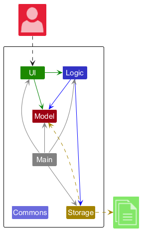

The ***Architecture Diagram*** given above explains the high-level design of the App.

The following provides a quick overview of the main components and their interactions.

**Main components of the architecture**

**`Main`** (consisting of classes [`Main`](https://github.com/AY2627S1-CS2103-F12-1/tp/blob/master/src/main/java/seedu/address/Main.java) and [`MainApp`](https://github.com/AY2627S1-CS2103-F12-1/tp/blob/master/src/main/java/seedu/address/MainApp.java)) is in charge of the app launch and shut down.
* At app launch, it initializes the other components in the correct sequence, and connects them up with each other.
* At shut down, it shuts down the other components and invokes cleanup methods where necessary.

The bulk of the app's work is done by the following four components:

* [**`UI`**](#ui-component): The UI of the App.
* [**`Logic`**](#logic-component): The command executor.
* [**`Model`**](#model-component): Holds the data of the App in memory.
* [**`Storage`**](#storage-component): Reads data from, and writes data to, the hard disk.

[**`Commons`**](#common-classes) represents a collection of classes used by multiple other components.

**How the architecture components interact with each other**

The *Sequence Diagram* below shows how the components interact with each other for the scenario where the user issues the command `hw del 1 2`.

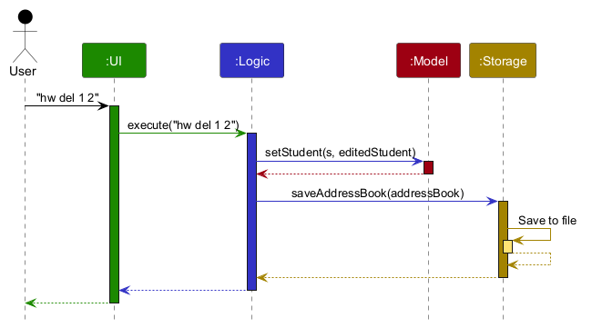

Each of the four main components (also shown in the diagram above),

* defines its *API* in an `interface` with the same name as the Component.
* provides its functionality through a concrete `{Component Name}Manager` class that implements the corresponding API interface.

For example, the `Logic` component defines its API in `Logic.java` and implements it in `LogicManager.java`. Other components interact with a component through its interface rather than its concrete class, preventing them from coupling to that component's implementation, as illustrated in the following partial class diagram.

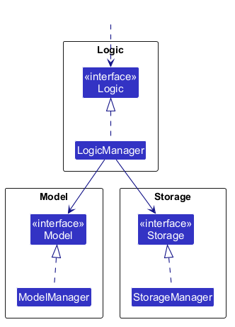

The sections below give more details of each component.

### UI component

The **API** of this component is specified in [`Ui.java`](https://github.com/AY2627S1-CS2103-F12-1/tp/blob/master/src/main/java/seedu/address/ui/Ui.java)

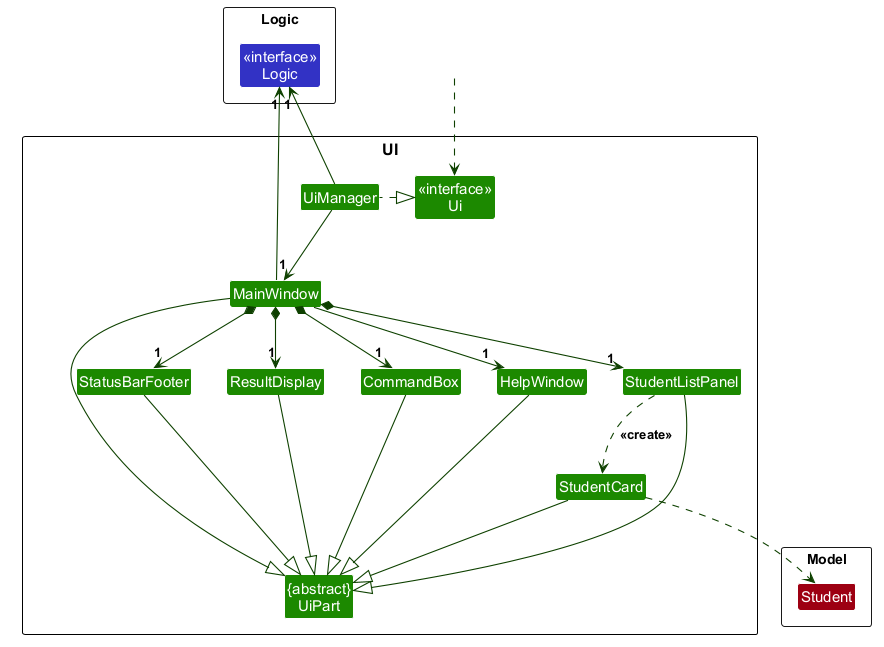

The UI diagram shows the references after successful startup. The UI consists of a `MainWindow` and its parts,
such as `CommandBox`, `ResultDisplay`, `StudentListPanel`, `UpcomingPanel`, and `StatusBarFooter`. All of these,
including `MainWindow`, inherit from the abstract `UiPart` class, which captures common behavior among classes that
represent visible GUI parts.

The `HelpWindow` displays commands from `HelpContent`, grouped into sections. Search filters command words, formats
and descriptions without changing their order. Each command row shows a shortened description; expanding it reveals
the full description, format and example. The `list` row adds its `ls` alias to `ListCommand.MESSAGE_USAGE`.
`HelpContentTest` checks the group order and that every example parses into the listed command; `HelpWindowTest`
covers filtering, empty results and expanded details. The window also explains that Up and Down recall commands from
the current session.

The `UI` component uses the JavaFX UI framework. The layouts of these UI parts are defined in matching `.fxml` files in `src/main/resources/view`. For example, [`MainWindow.fxml`](https://github.com/AY2627S1-CS2103-F12-1/tp/blob/master/src/main/resources/view/MainWindow.fxml) specifies the layout of [`MainWindow`](https://github.com/AY2627S1-CS2103-F12-1/tp/blob/master/src/main/java/seedu/address/ui/MainWindow.java).

The `UI` component,

* executes user commands using the `Logic` component.
* listens for changes to `Model` data so that the UI can be updated with the modified data.
* keeps a reference to the `Logic` component, because the `UI` relies on the `Logic` to execute commands.
* depends on some classes in the `Model` component because it displays `Student` objects from the model.

`MainWindow` shows one `StudentListPanel`, which lists the displayed students (after any `search`, `filter` or
`sort`) as `StudentCard` objects, and a `StatusBarFooter` that shows the path of the data file. Each card
displays `Student#getUpcomingHomeworkCount(today)` and `Student#getOverdueHomeworkCount(today)`.

`UpcomingPanel` displays the **At a glance** sidebar. It observes the full, unmodifiable roster from
`Logic#getAllStudentList()`, rather than the displayed list from `Logic#getStudentList()`, so `search`, `filter` and `sort`
do not hide lessons or homework. Its list-change listener rebuilds the weekly schedule through
`LessonSchedule#buildSchedule` and sorts `ASSIGNED` homework by due date, then student name, title and phone. Both
reports include student phone numbers to distinguish students sharing a name. The same observable roster is
retained when data is reset, so updates continue after `clear` or a failed save is rolled back.

The sidebar evaluates `Homework#isOverdue(today)` to mark overdue entries in bold red;
`Student#getOverdueHomeworkCount(today)` uses the same model rule for student cards. A homework record is
overdue only when its status is `ASSIGNED` and its due date is before today, regardless of its score.
`UpcomingPanel` keeps each sidebar entry's display text and overdue state together, so styling does not depend
on matching rendered strings. Date-only refreshes update homework while preserving weekly lesson entries
and their selection. `UpcomingPanel` and `MainWindow` accept a `Clock` for deterministic UI tests.
`MainWindow` schedules a refresh at the next local date boundary, rechecks on window activation and before commands, and rebuilds cached
student cards and sidebar entries using the same date. The timer stops when the window is hidden and restarts
when shown. The content split pane binds its minimum height to its children's minimum heights at their
narrowest permitted widths, accounting for wrapped headings so the sidebar remains within its bounds. Both
lists show entry counts and empty-state placeholders. `MainWindow.fxml` uses split panes to resize sections,
and `ScrollSupport` lets users scroll over headings and padding while retaining command-box focus.

`StudentListPanel` creates `StudentCard` objects and caches their rendered roots. It observes the displayed
student list; the [sort recovery activity](#sorting-students) explains how the previous view is retained during sorting.

### Logic component

**API** : [`Logic.java`](https://github.com/AY2627S1-CS2103-F12-1/tp/blob/master/src/main/java/seedu/address/logic/Logic.java)

Here's a (partial) class diagram of the `Logic` component:

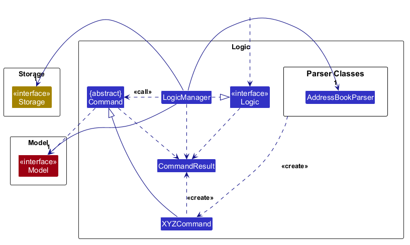

`XYZCommand` represents concrete commands such as `AddCommand`, `FilterCommand`, `SortCommand` and
`HomeworkAddCommand`. `LogicManager` retains the `Model` and `Storage` interfaces; each command uses the
model temporarily during execution and returns a `CommandResult` (or a subclass such as `SortCommandResult`).

The sequence diagram below illustrates the interactions within the `Logic` component, taking `execute("hw del 1 2")` API call as an example.


Parser destruction, validation details and the immutable student-copy interactions are omitted. `updatedStudent`
and `updatedData` name the prepared student replacement and the updated address-book data passed to storage.

How the `Logic` component works:

1. When `Logic` is called upon to execute a command, the command is passed to an `AddressBookParser` object, which in turn creates a parser that matches the command (e.g., `HomeworkCommandParser`, which passes the rest of the command to `HomeworkDeleteCommandParser`) and uses it to parse the command.
1. This results in a `Command` object (more precisely, an object of one of its subclasses e.g., `HomeworkDeleteCommand`) which is executed by the `LogicManager`.
1. The command can communicate with the `Model` when it is executed (e.g. to add homework to a student).<br>
   Note that although this is shown as a single step in the diagram above for simplicity, the code can require several interactions between the command object and the `Model` to complete the operation.
1. If the command changed the data, `LogicManager` saves the data through the `Storage` component. Commands that leave the data unchanged, such as `homework list` and `help`, do not write the data file. If saving fails, `LogicManager` undoes the change (see [Saving after a command](#saving-after-a-command)).
1. The result of the command execution is encapsulated as a `CommandResult` object which is returned from `Logic`.

Here are the other classes in `Logic` (omitted from the class diagram above) that are used for parsing a user command:

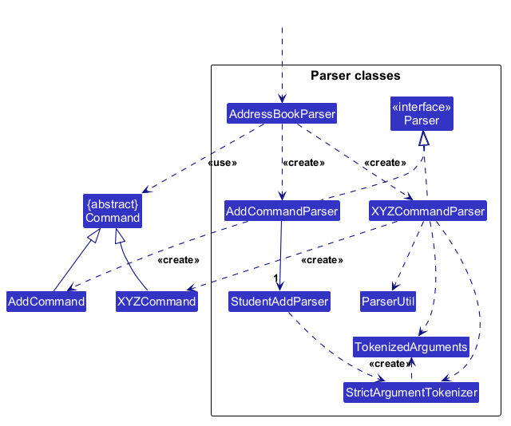

How the parsing works:
* When called upon to parse a user command, the `AddressBookParser` class creates an `XYZCommandParser` (`XYZ` is a placeholder for the specific command name, e.g., `FilterCommandParser`, `SortCommandParser` or `HomeworkAddCommandParser`). The parser uses the other classes shown above to parse the user command and create an `XYZCommand` object. The `AddressBookParser` returns that object as a `Command` object.
* All `XYZCommandParser` classes, such as `AddCommandParser` and `HomeworkAddCommandParser`, implement the `Parser` interface so they can be treated similarly where appropriate, for example during testing.
* `AddCommandParser` retains a `StudentAddParser` to validate the six student fields and construct a `Student`. It then wraps that student in an `AddCommand`. The other parsers use only the helpers relevant to their command; the diagram groups representative dependencies rather than requiring every parser to use every helper.

### Model component
**API** : [`Model.java`](https://github.com/AY2627S1-CS2103-F12-1/tp/blob/master/src/main/java/seedu/address/model/Model.java)

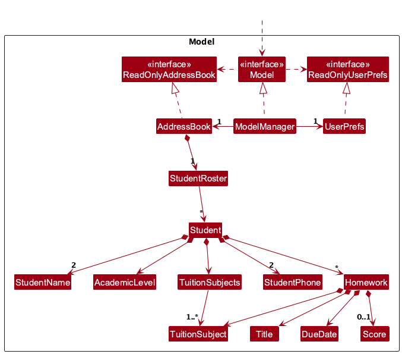

This partial diagram shows the student and homework classes. Students also hold regular lessons, as described below.
Profile and homework references use ordinary associations because immutable values and unchanged homework
records can be shared when a student or homework is copied. `AddressBook` owns its internal `StudentRoster`.

The `Model` component,

* stores all app data in an `AddressBook` object: the student roster (a `StudentRoster` of `Student` objects in insertion order), in which each immutable `Student` holds its own `Homework` records and `RegularLesson` entries.
* uses `LessonSchedule#buildSchedule` to provide a view of all regular lessons ordered by weekday, start time, and student name without changing roster order.
* exposes the displayed students as an unmodifiable `ObservableList<Student>` backed by a `StudentDisplayList` over a `FilteredList`, so the UI updates when roster, predicate or display order changes. `ModelManager` passes roster mutations (`hasStudent`, `addStudent`, `setStudent`, `deleteStudent`) to its `AddressBook`; `getStudentList` returns the display view. The stored roster stays in insertion order.
* stores a `UserPrefs` object that represents the user’s preferences (currently, just the GUI settings). This is exposed to the outside as a `ReadOnlyUserPrefs` object.
* does not depend on any of the other three components (as the `Model` represents data entities of the domain, they should make sense on their own without depending on other components)

The classes keep AB3's names (`AddressBook`, `ReadOnlyAddressBook`, `JsonAddressBookStorage`) to keep the change from AB3 small, but they now hold TutorFlow's students, homework, and regular lessons.

The following class diagram separates the stored roster from its filtered and displayed views. Library list
implementation details and the unmodifiable wrapper returned by `getStudentList()` are omitted.

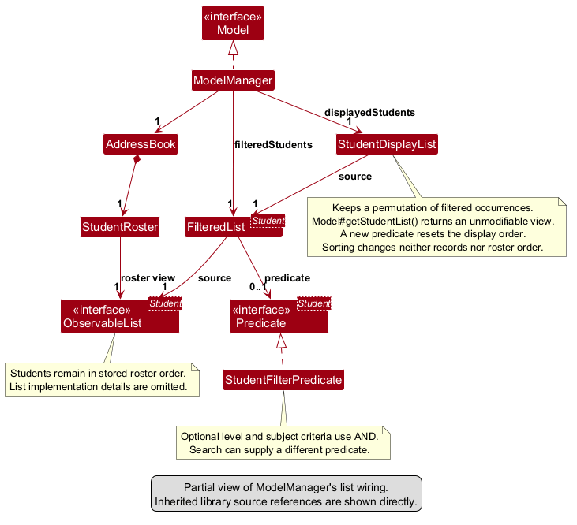

`StudentDisplayList` refers to the filtered occurrences rather than copying student records. A new search or filter
replaces the predicate and resets the permutation; a sort changes only the permutation. Both operations leave
the stored roster and data file unchanged. The UI and student-index commands use the displayed view.

### Storage component

**API** : [`Storage.java`](https://github.com/AY2627S1-CS2103-F12-1/tp/blob/master/src/main/java/seedu/address/storage/Storage.java)

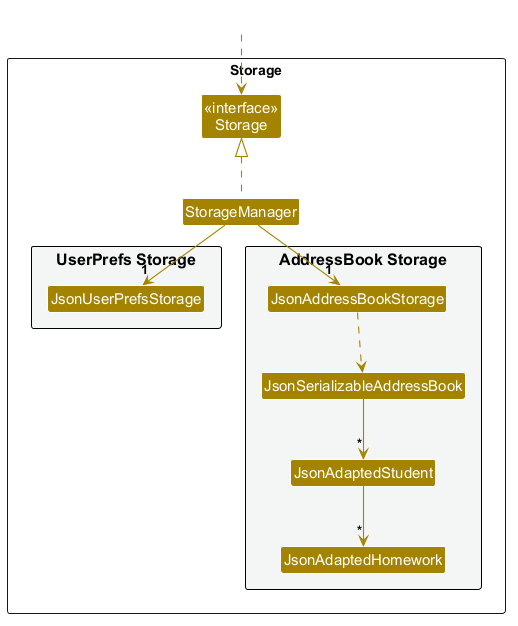

This partial diagram shows the student and homework adapters. Regular lessons use `JsonAdaptedLesson`.

The `Storage` component,
* can save both the app data (students, their homework, and regular lessons) and user preference data in JSON format, and read them back into corresponding objects.
* is implemented by `StorageManager`, which delegates the actual JSON file access to `JsonAddressBookStorage` and `JsonUserPrefsStorage` (one class per data file).
* depends on some classes in the `Model` component (because the `Storage` component's job is to save/retrieve objects that belong to the `Model`)

The app data is saved in `data/tutorflow.json`. `JsonSerializableAddressBook` holds a `students` list of `JsonAdaptedStudent`. Each student adapter holds a `homeworks` list of `JsonAdaptedHomework` and a `lessons` list of `JsonAdaptedLesson`. Jackson reads and writes the fields of these classes directly:

* Student fields: `name`, `academicLevel`, `subjects`, `phone`, `guardianName`, `guardianPhone`, `homeworks`, and `lessons`.
* Homework fields: `title`, `subject`, `dueDate`, `score`, and `status`.
* Lesson fields: `subject`, `dayOfWeek`, `startTime`, and `endTime`.

`JsonUtil#readJsonFile` reads both `data/tutorflow.json` and `preferences.json`. It rejects a file that is not valid UTF-8, has anything but whitespace after its JSON value, or repeats a key within one JSON object. Loading only part of such a file would be unsafe: the next save would overwrite the part that was not loaded. An invalid `preferences.json`, including one whose `guiSettings` is `null`, is replaced with the default preferences (see `MainApp#initPrefs`); the data file is not affected.

Contact and academic fields, homework titles, dates and completion statuses, and lesson fields are strings. `subjects` is a list of strings, `homeworks` and `lessons` are lists of objects, and `score` is a `MARKS` or `MARKS_OBTAINED/TOTAL_MARKS` string such as `"17"` or `"5/10"`, or `null`. Homework status is `ASSIGNED` or `COMPLETED`; missing or null status defaults to `ASSIGNED`, independently of scores. Lessons store weekdays by name and times in `HH:mm` format.

Each adapted class checks its values in `toModelType()` with the same value classes that commands use. Student and homework adapters report missing fields with `MISSING_FIELD_MESSAGE_FORMAT` and invalid values with the value class's `MESSAGE_CONSTRAINTS`. `JsonAdaptedLesson` reports missing lesson fields together and delegates value validation to `TuitionSubject` and `RegularLesson`. Invalid data produces an `IllegalValueException`. Loading also rejects:

* a missing `students` list, or an empty (`null`) student, homework, or lesson entry.
* two students that are the same by `Student#isSameStudent`.
* homework for a subject the student does not take, and two homework records of one student that are the same by `Homework#isSameHomework`.
* a lesson for a subject the student does not take, duplicate lessons within a student, or overlapping lessons within or across students.
* a lesson with a missing or invalid subject, weekday, start time, or end time.
* a due date that is not a full `YYYY-MM-DD` date, does not exist, or has a year outside 2000 to 2099. `JsonAdaptedHomework` uses `DueDate#parseFullDate`, so the year of a saved date is never inferred from today's date, and keeps its message (e.g. `The due date's year must be from 2000 to 2099.`), which says which of the three is wrong. Dates are saved padded (`2026-02-05`).
* a text score that `Score#parse` rejects (e.g. `"5.5/10"`, `"11/10"`, `"5/0"`), with `Score#MESSAGE_CONSTRAINTS`, `Score#MESSAGE_LEADING_ZEROES` for a number with leading zeroes (e.g. `"017"`), or `Score#MESSAGE_TOO_LARGE` for a number beyond the `int` range, and a score that is neither text nor a number (e.g. `true`), with `Score#MESSAGE_CONSTRAINTS`.

A missing `homeworks` list, `lessons` list, or `score` means no homework, no lessons, or no score. This allows older student data without a `lessons` field to load. `JsonAdaptedHomework` keeps `score` as a Jackson `JsonNode`, so it can tell a JSON number from text. A JSON number such as `85` is the format saved before scores were text; `JsonAdaptedHomework` passes its digits (`JsonNode#asText`) to `Score#parse`, so `85` and `"85"` both load as the bare score `85`, which is saved back as `"85"`. A JSON number that `Score#parse` rejects (e.g. `85.5`, `-3`, `3000000000`) makes the homework load with no score, and a warning is logged (`Ignored invalid homework score 85.5 for 'Quadratic equations worksheet'`). This preserves compatibility with legacy numeric scores without discarding the other records. Subjects, levels, and weekdays are accepted in any case and saved in upper case.

`MainApp#readInitialData` returns saved data if the data file is valid, or sample students from `SampleDataUtil#getSampleAddressBook()` if it does not exist. The missing file is first created by a command that changes the data. Loading failures propagate as `DataLoadingException`: `MainApp#init` records the failure and skips model, logic and main-window initialization. `start` shows an error with the absolute data path, the reason and recovery instructions, then exits after the dialog closes. The reason is the message of the exception's cause, e.g. `10-15 is not in YYYY-MM-DD format, e.g. 2026-10-30.` from `DueDate`. For a file that is not valid JSON, `JsonUtil#readJsonFile` replaces Jackson's technical message with a plain one that gives the position, e.g. `The file is not valid JSON near line L, column C.` No replacement roster is created and the original data file is not changed.

The activity diagram below shows how the data file is loaded at startup:

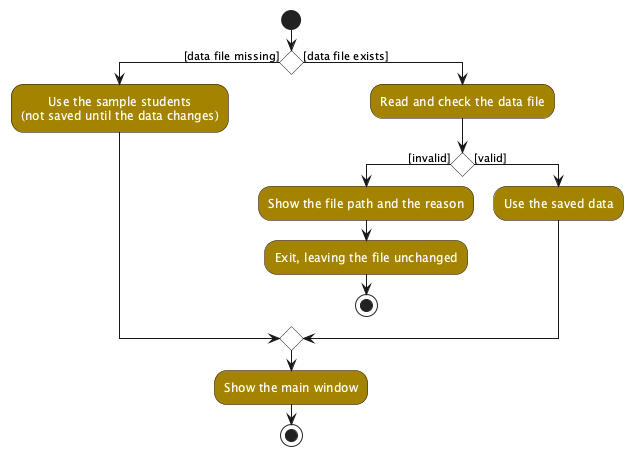

`AppHomeUtil` resolves the packaged JAR's containing folder from its code-source URI. Data, preferences and logs use absolute paths within that folder, regardless of the terminal's working directory. Unpacked Gradle/IDE launches use the project working directory. URI conversion preserves spaces and percent signs; the logging pattern escapes literal percent signs for `FileHandler`. This meets the course data-sandbox constraint without changing process or OS settings. An unwritable log location falls back to console logging. Existing v1.4 files stored in a different working directory must be copied beside the JAR explicitly; the app does not search outside its home folder.

The team planning document specified an empty roster when no data file exists. v1.5 retains the released application's sample roster to preserve the documented quick start and provide examples for first-time tutors. Samples are not written until a modifying command succeeds; `clear` creates an empty saved roster. Invalid files never trigger this fallback. The plan's literal startup-banner wording is also not used: the roster, student count and data-path status bar show the startup state.

`MainAppLifecycleTest` uses isolated data/preferences paths and an injected shutdown action to exercise the rendered recovery dialog without stopping the test JVM's JavaFX toolkit. It checks recovery text, dialog dismissal, shutdown requests, unchanged invalid data, normal saved-roster startup and preference saving. The public no-argument constructor uses the resolved home folder and JavaFX shutdown. `AppHomeUtilTest` checks packaged and unpacked paths; packaged-JAR smoke tests must also launch from a separate directory and verify that all application files remain beside the JAR.

`FileUtil#writeToFile` saves a file atomically: it writes the content to a new temporary file next to the data file, gives it the data file's permissions, and then moves it over the data file. If writing fails, the temporary file is deleted and the data file keeps its previous content, so it is never left partially written. A read-only data file is reported before anything is written, because the move would otherwise replace it.

### Common classes

Classes used by multiple components are in the `seedu.address.commons` package.

--------------------------------------------------------------------------------------------------------------------

## **Implementation**

### Recalling earlier commands

`CommandHistory` stores submitted non-blank command text in memory for the current session. It keeps the newest entry once when identical commands are submitted consecutively. `CommandBox` records the input on Enter, including commands that the Logic component rejects, and uses plain Up and Down to navigate the history. Navigation stays at the oldest command; moving Down past the newest clears the box. Modified arrow keys keep their normal text-field behavior. The caret moves to the end of recalled text, and recalling a command clears the error style. Pressing Enter resets the navigation position. A rejected command stays in the box, so the first Up skips that same command and shows the preceding entry.

This section describes some noteworthy details on how certain features are implemented.

### Splitting arguments at prefixes

`StrictArgumentTokenizer` splits the arguments of `add`, `edit`, `filter`, `sort`, `lesson add`, `lesson edit`,
`lesson delete` and every homework subcommand (`add`, `list`, `upcoming`, `edit`, `marks`, `delete`, `filter` and
`status`) into a preamble (the text before the first prefix, such as the indices in `hw e 1 2 t/Algebra`) and the
value of each prefix. Any lowercase word followed by `/` at the start of the arguments or after whitespace is
a prefix, so a `/` inside a word such as `3/4` does not start one.

Each prefix is checked in the order it appears: an unknown prefix gives the error described below, and a repeated
prefix gives `Prefix X must be specified exactly once.` by default. The student `filter` command supplies its
own repeated-prefix message: `Each filter may only be specified once`.

A caller may also pass a `ValueTokenFilter`, which keeps some prefix-shaped words in the previous value;
`StudentAddParser` and `EditCommandParser` use `StudentAddParser#isPartOfName` so that names can contain words
such as `s/o` and `d/o`.

**Quoted values.** A value wrapped in double quotes may contain prefix-shaped words. After reading a prefix, `StrictArgumentTokenizer#findQuotedValueEnd` decides whether its value is quoted:

1. It skips the whitespace after the prefix. If the next character is not `"`, the value is not quoted.
1. It looks at each later `"` in turn. The first one that is followed by only whitespace up to the end of the arguments, or by whitespace and one of the command's allowed prefixes, closes the value.
1. If no `"` closes the value, the value is not quoted and is read exactly as before quoting was added.

For a quoted value, the tokenizer continues searching for prefixes after the closing quote, so the prefix-shaped words inside the quotes are never treated as prefixes. It also skips the `ValueTokenFilter` for the prefix right after the closing quote, since the quotes have already ended the value. The value is then stripped, its outer quotes are removed, and the text inside them is stripped again, so `t/" Speed in km/h "` gives `Speed in km/h`; quotes and whitespace between words inside it are kept. Empty quotes, or quotes with only whitespace inside, give an empty value, as a prefix with nothing after it does. The caller validates the result like any other value, so quoting works the same way in every command that uses the tokenizer.

For example, with the allowed prefixes `title/`, `t/`, `s/` and `due/` of `hw add`, the value of `t/` in `hw add 1 t/"Read "Hamlet" km/h" s/MATH due/2026-11-02` starts with `"`. The quote before `Hamlet` is followed by `Hamlet`, and the quote after `Hamlet` is followed by ` km/`, which is not an allowed prefix, so neither closes the value. The quote after `km/h` is followed by ` s/`, so it closes the value. The search for prefixes resumes there and finds `s/` and `due/`, and the title is `Read "Hamlet" km/h`. In `hw add 1 t/"Speed in km/h s/MATH due/2026-11-02`, no quote closes the value, so `km/` is read as an unknown prefix and the command is rejected, as it is without quotes.

**Unknown prefixes.** For an unknown prefix, `StrictArgumentTokenizer#buildUnknownPrefixMessage` names the word and keeps the text of the caller's format message from `Usage:` on, on a new line, so the user sees which word is wrong and the command's format:

1. If the word is inside the value of an earlier prefix, it adds a hint to quote that value. The example is that prefix and its text up to the next allowed prefix (after whitespace or directly after a quote) or the end, with the straight or curly quotes at both ends removed so they are not doubled: `hw add 1 t/"Speed in km/h"s/PHYSICS due/2026-11-20` gives `e.g. t/"Speed in km/h".`
1. The example is left out when the value's text before the word is only digits, date or time punctuation (`- / : . +`) and spaces, such as `due/2026-11-01 x/y`, as quoting a date with a word after it is never what the user meant.
1. If the word comes before any prefix (e.g. `score/` in `hw e 1 2 score/5/10`), there is no quote hint.
1. If the arguments contain a curly quote (`“` or `”`), a line `Use straight quotes ("), not curly quotes (“ ”).` comes before the usage, as curly quotes never wrap a value.

Text before the first prefix, when the caller does not allow it, still gives the caller's own format message. `homework add` and `homework edit` check, after tokenizing, that `title/` and its alias `t/` are not both given (`HomeworkAddCommandParser#validateTitlePrefixes`, `Use either title/ or t/, not both.`), so an unknown prefix anywhere in the input is reported first.

#### Design considerations:

**Aspect: Where a quoted value ends:**

* **Alternative 1 (current choice):** At the first `"` that is followed by the end of the arguments, or by whitespace and one of the command's allowed prefixes.
  * Pros: A value can contain both quotes and a word such as `km/`, e.g. `Read "Hamlet" km/h`. Input without quotes, and values whose quote is never closed, are read as before.
  * Cons: A value cannot contain a `"` followed by whitespace and one of the command's own prefixes. For example, in `add n/"Ravi" s/o Kumar …` the quote after `Ravi` closes the name, so `s/` is read as a second subjects prefix.

* **Alternative 2:** At the next `"`.
  * Pros: Simpler to explain and to implement.
  * Cons: A value cannot hold a quote and a word such as `km/` together, because the first quote inside the value would end it.

* **Alternative 3:** Allow escaping a quote inside a quoted value, e.g. `\"`.
  * Pros: Any text can be entered.
  * Cons: Users must learn escape rules, and a `\` in a value would need escaping too. Rejected to keep typing commands simple.

**Aspect: Whitespace at the ends inside the quotes:**

* **Alternative 1 (current choice):** Strip it, as for a value without quotes.
  * Pros: Quotes change only which words are read as prefixes, so `due/" 3 "` means the same as `due/ 3 `, and a stray space typed after `"` does not make a name or a number invalid.
  * Cons: A value cannot start or end with a space. No field needs that: names and titles have their extra spaces removed anyway.

* **Alternative 2:** Keep the text inside the quotes exactly as typed.
  * Pros: Quotes would mean "exactly this text", as in a shell.
  * Cons: `due/" 3 "` would be rejected while `due/ 3 ` is accepted, and every value class would see spaces it never sees from unquoted input.

### Adding students

`AddressBookParser` dispatches `add` to `AddCommandParser`, which delegates the six profile fields to
`StudentAddParser`. Parsing validates the fields and constructs an immutable `Student` without modifying the
roster. `AddCommand` rejects a duplicate identity (the same normalized name and student phone), adds a unique
student, and restores the full displayed roster in stored order. This also discards an earlier filter or sort,
unless saving fails: the rollback then restores them.

The sequence below shows the current integrated design for a successful addition. Parsing and list-observer
callbacks are summarized so the diagram focuses on roster changes and saving. Persistence and save-failure
rollback use the shared [saving mechanism](#saving-after-a-command).

The Add Student, Filter and Sort sequence diagrams start after successful parsing and command construction, inside
`LogicManager#execute`. The earlier parsing calls and the manager's activation bar are omitted. Command
lifelines therefore represent existing objects; their execution, model interactions and subsequent saving are shown.

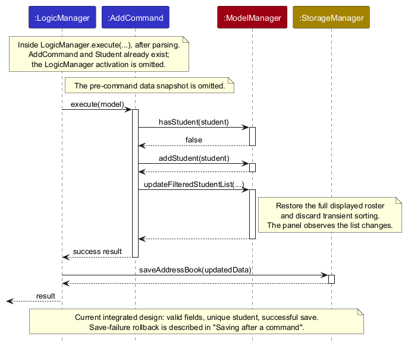

### Listing students

**Parsing.** `AddressBookParser` routes both `list` and its alias `ls` to `ListCommandParser`. The parser accepts no arguments, so `list 1` fails before a command is executed.

**Displayed view.** `ListCommand` calls `Model#updateFilteredStudentList` with `PREDICATE_SHOW_ALL_STUDENTS`, replacing any predicate left by `search` or `filter`. `ModelManager` applies this to its `FilteredList<Student>`, which is backed by the full roster, then resets its `StudentDisplayList` to roster order, discarding any earlier `sort`. The `StudentListPanel` observes an unmodifiable view of the `StudentDisplayList`, so its cards and count update without rebuilding the stored roster. The command returns a `CommandResult` that makes `MainWindow` clear the selection and scroll to the first card.

**Feedback and storage.** `ListCommand` counts the students in the restored view and reports `No students found.`, `Listed 1 student.`, or `Listed N students.` as appropriate. Resetting a filter does not alter the `AddressBook`; `LogicManager` therefore skips the save (see [Saving after a command](#saving-after-a-command)). This also means `list` can be used to return from an empty search result.

The sequence diagram below shows how `list` restores the full student view without changing the stored roster:

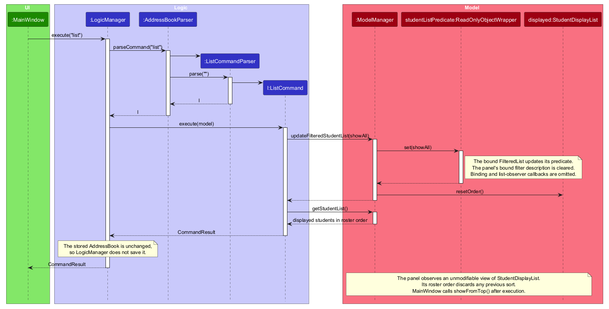

### Searching students

**Parsing and matching.** `AddressBookParser` routes `search KEYWORD` to `SearchCommandParser`, which rejects a blank keyword. `SearchCommand` strips surrounding whitespace and performs a case-insensitive substring match against the student's name, the guardian's name, and both phone numbers. A numeric keyword can therefore find a student by either phone number; the command does not treat numbers as a separate search mode.

**Displayed view.** `SearchCommand` passes the matching predicate to `Model#updateFilteredStudentList`. `ModelManager` applies it to a `FilteredList<Student>` backed by the full roster, resets its `StudentDisplayList` to roster order, discarding any earlier `sort`, and exposes an unmodifiable view of the `StudentDisplayList` to the UI. Changing the predicate updates the visible cards and count; it does not remove students from the roster. A new search replaces any previous search or filter predicate and examines the full roster, even if the previous command showed no matches. The command returns a `CommandResult` that scrolls the list to the top.

**Feedback, indexes, and storage.** The result reports the number of matches, repeats the stripped keyword, and tells the user to type `list` to show all students. Index-based student and homework commands use `Model#getStudentList()`, so their indexes refer to the students currently displayed after a search. `list`, a successful `add`, and `homework upcoming` restore the full view. Searching leaves the stored `AddressBook` unchanged, so `LogicManager` does not save it.

The sequence diagram below shows how `search Jane` reaches the filtered view without changing the stored roster:

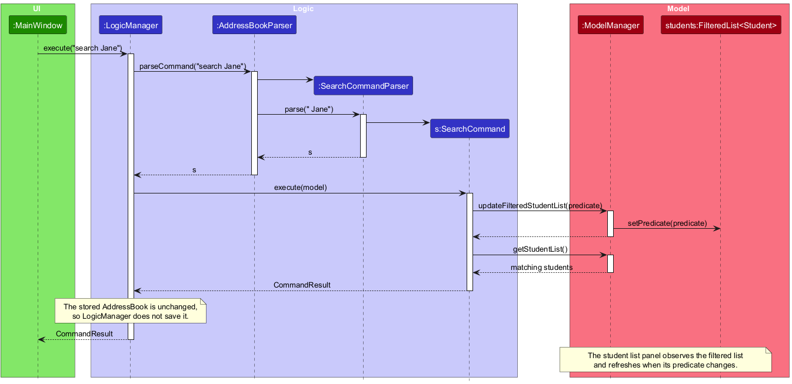

#### Design considerations:

**Aspect: How search results are displayed:**

* **Alternative 1 (current choice):** Apply a predicate to a `FilteredList` backed by the roster.
  * Pros: Repeated searches always examine the full roster, and the observable UI list updates when the predicate or roster changes.
  * Cons: Index-based commands must deliberately use the displayed list, and commands such as `list` must explicitly reset the predicate and any transient sort order.

* **Alternative 2:** Copy matching students into a separate results list.
  * Pros: The search result could be handled as an independent snapshot.
  * Cons: The copy could become stale after a student is edited or deleted, so it would need to be rebuilt or kept in sync with the roster.

### Deleting students

**Parsing and selection.** `AddressBookParser` routes `delete INDEX` to `DeleteCommandParser`. `ParserUtil#parseStrictIndex` rejects zero, signs, leading zeroes, extra arguments, and values beyond the supported integer range. `DeleteCommand` then checks the one-based index against `Model#getStudentList()`, which is the currently displayed list. If a search, filter or sort is active, `delete 1` selects the first displayed student, not necessarily the first student in the full roster. An out-of-range index fails without changing data.

**Model update.** The command passes the selected `Student` to `Model#deleteStudent`. `ModelManager` delegates to `AddressBook`, which removes that student from `StudentRoster`. The remaining students keep their relative order; the observable list updates the displayed cards and their one-based indexes. Homework and regular lessons are held by the deleted `Student`, so they are removed with that student rather than deleted separately.

**Persistence and failure.** Unlike list and search, deletion changes the `AddressBook`, so `LogicManager` saves the updated roster. It keeps a copy of the previous roster before execution; if saving throws an `IOException`, it restores that copy, including the deleted student's homework and lessons, and then the displayed students in their previous order. The screen and data file therefore remain consistent, and after a `sort` or `search` the same index still refers to the same student, so the user can retry the command (see [Saving after a command](#saving-after-a-command)).

The sequence diagram below shows a successful `delete 1`, including the storage update:

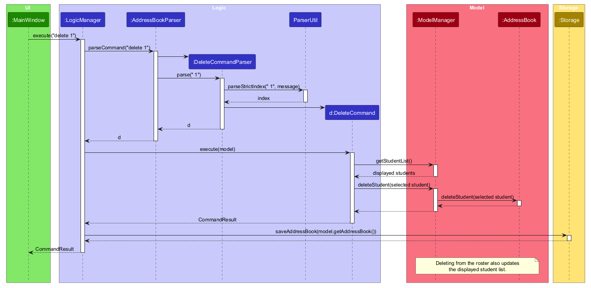

#### Design considerations:

**Aspect: Which student an index identifies:**

* **Alternative 1 (current choice):** Resolve the index against the displayed list.
  * Pros: The number beside a student card always identifies the student that `delete` will remove, even after `search`, `filter` or `sort`.
  * Cons: The same index may identify a different student after the visible list changes; `list` restores full-roster numbering.

* **Alternative 2:** Resolve the index against the full roster regardless of the current filter.
  * Pros: An index would not change meaning when a search filter is applied.
  * Cons: The visible card number could point to a different student from the one actually deleted.

### Editing students

`AddressBookParser` routes `edit INDEX` to `EditCommandParser`. The parser uses strict index parsing and the same
prefix tokenizer and field value types as `add`; its name-token rule preserves `s/o` in student and guardian names.
At least one replacement field is required. `EditCommand` applies only supplied fields to a new immutable `Student`,
retaining its homework and lessons. Before calling `Model#setStudent`, it rejects an unchanged profile, a name-and-phone
identity already used by another student, or subjects that would leave existing homework or lessons unsupported.
`Model#setStudent` replaces the student in the stored roster without changing its stored position. The displayed
card keeps its position if the edited student still matches the active search or filter; otherwise it disappears.
An earlier sort is not reapplied until the user explicitly sorts again. `LogicManager` saves the change and restores
the original roster if saving fails. The command builds its feedback before the replacement, logs unexpected runtime
failures, and supplies an edit-specific save-failure message.

### Sorting students

`AddressBookParser` routes `sort by/KEY [o/ORDER]` to `SortCommandParser`. It uses the shared
`StrictArgumentTokenizer` with sort-specific repeated-prefix feedback; existing callers retain their messages.
The parser validates syntax and maps stripped, case-insensitive values to `SortKey` and `SortOrder` before execution.
`SortCommand` returns normal feedback for empty and single-student views.

The following sequence focuses on Logic/Model interactions for a successful, nonempty `sort by/day o/desc`.
Parsing and observable-list callbacks are omitted. The UI boundary is shown separately in the recovery activity:
the previous view is captured before execution and rendering is verified before showing success.

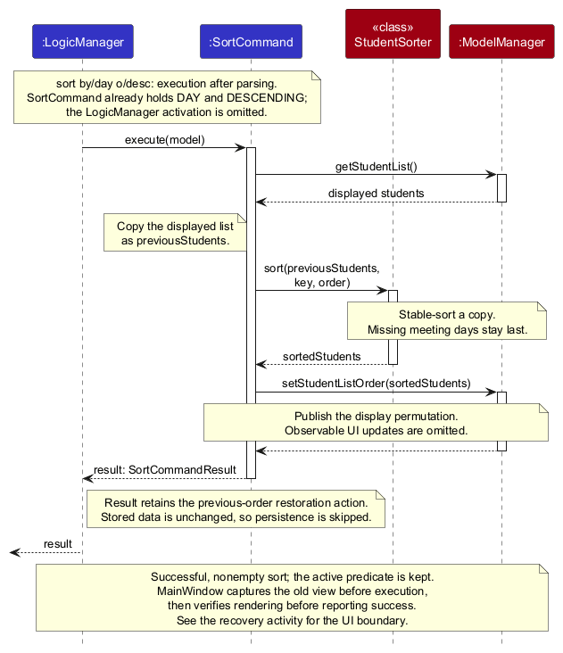

`StudentSorter` stable-sorts a copy of the immediately preceding displayed list. Level uses the academic enum's
school order, subject uses the alphabetically smallest subject name, and day uses the smallest weekday.
For descending days, only the weekday comparator is reversed before applying `nullsLast`; reversing the complete
result would incorrectly move missing meetings first and reverse ties.

`StudentDisplayList` keeps a permutation of filtered-source occurrence indices and publishes a complete candidate
only after validating its references and multiplicities. Equal students and repeated references remain separate.
Source changes preserve surviving display positions and update replaced immutable students. Each
`updateFilteredStudentList` call resets the permutation, including when the predicate still matches all students.
Consequently `list`, a new search, successful `add` and `homework upcoming` do not retain an earlier sort.
Student-index commands continue to use `Model#getStudentList`; lesson-schedule numbering remains independent.
The stored `AddressBook` does not change, so `LogicManager` skips persistence.

Sorting is a one-time permutation; the model does not retain an active comparator. `Model#setStudent` preserves
the displayed position of a replacement that still matches the active predicate, even when its academic level,
subjects or earliest meeting day changes. A replacement that no longer matches disappears from the view.
An explicit `sort` uses the updated values. The student-edit command uses `Model#setStudent` without resetting
the predicate or display order, following the same behavior as lesson and homework updates.

`SortCommandResult` retains an order-restoration action for the UI boundary. `MainWindow` captures the panel state
before a sort request and verifies rendering before reporting success. `StudentListPanel` retains previous cards,
selection, focus and scrollbar positions, checks every candidate card, and forces visible cell layout. Cell callbacks
record runtime failures while this boundary is active; recovery restores old cards before restoring model order.
Cached candidate cards also cover later virtualized cells. During a sort, the panel retains failures for
`MainWindow` to recover and log; ordinary filter rendering failures use the panel callback instead. This avoids
reporting one sort failure through both error paths. No rendering or recovery work is performed in assertions.

The activity below focuses on a rendering failure after a completed sort. Recovery first makes the previous
cards available, then restores the model's display order, and finally restores selection, focus and scrolling.
If a restoration step fails, the remaining steps are skipped and the recovery failure is retained in the logs.
The sort boundary ends before success or error feedback is displayed. Parsing rejection, ordering failures
and empty views are outside this diagram's scope.

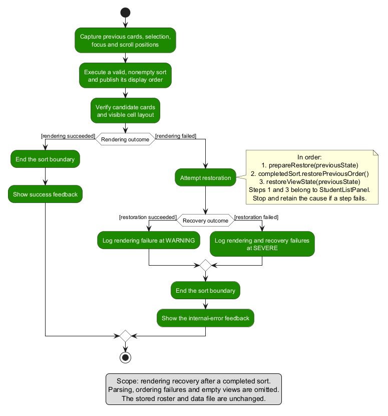

The sorting helper and parser have isolated tests. `SortIntegrationTest` exercises real logic/model/storage
interactions, including zero save calls during sorting, subsequent displayed-index operations and failed saves.
It also checks changes to each sort key through `Model#setStudent`, retention of the displayed position until
another explicit sort, and removal of replacements that no longer match the active filter.
`StudentSortRenderingTest` and `MainWindowSortTest` use controllable renderers on the JavaFX thread to verify
selection/scroll recovery, exact feedback and diagnostic ownership. See the [logging guide](Logging.md).

### Filtering students

**Parsing.** `AddressBookParser` routes `filter [l/LEVEL] [s/SUBJECT] [d/DAY]` to `FilterCommandParser`. At least one
criterion is required, and each prefix may appear only once. The tokenizer checks argument structure before
the parser validates values in prefix order. `AcademicLevel` and `TuitionSubject` validate supported values
and normalize their case and surrounding whitespace. Meeting days use the same full-weekday validation as
regular lessons, including case and whitespace normalization. Empty values receive field-specific non-empty errors;
unsupported values retain the domain constraint message and its exception cause. Comma-separated subjects
receive a single-subject restriction error. Format errors use the shared invalid-format header and command usage.
Invalid input is rejected before the displayed list changes or a UI refresh is requested.

**Matching and display.** `StudentFilterPredicate` combines the supplied criteria with AND: the student's level
must match and their subjects must include the selected subject. An omitted criterion imposes no restriction.
A supplied day must match at least one regular lesson, so students without lessons cannot match it. The subject
criterion checks the student's registration independently of which lesson matches the day. Lesson changes replace
the immutable student, automatically re-evaluating membership under the active predicate.
`FilterCommand` applies the predicate to the full stored roster, replacing any previous search or filter.
Results retain roster order and receive displayed indices starting at 1; commands taking a student index use
these displayed indices. Lesson scheduling and clash detection continue to consider the full roster.

Feedback is `Found 1 student.`, `Found N students.` for multiple matches, or `No students match the selected filters`.
Successful filtering returns the panel to the top. `list`, `ls`, a successful student addition and
`homework upcoming` restore the full roster. Search and filter commands replace each other's criteria.

**Active filter indication.** The model exposes its active predicate as a read-only observable property through
`Logic`. This property also drives the filtered list, so the panel can observe criteria changes even when the
matching students are unchanged. `StudentListPanel` describes the level, subject and day from `StudentFilterPredicate`
below its heading; presentation wording stays in the UI. Other predicates hide this description. Empty results,
sorting, edits and deletions retain the active criteria. The description wraps and reserves its preferred height
at narrow widths. Save-failure recovery restores the exact predicate, preserving its typed criteria along with
the previous roster and displayed order. Filter state remains in memory and is not written to the data file.

The sequence below shows `filter l/S4 s/MATH` with successful rendering. Model updates notify the panel through
the observable displayed list; those callbacks and parsing details are summarized. The result requests
`showFromTop()` after execution. An invalid command is rejected before the predicate or display order changes.

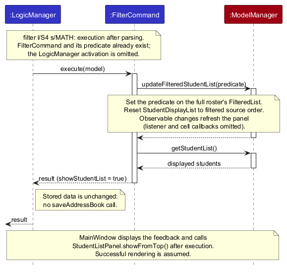

**Persistence.** Only the displayed predicate changes. The stored `AddressBook` remains equal to the snapshot taken
by `LogicManager`, so `Storage#saveAddressBook` is never called and no storage format change is needed.

**Rendering errors and logging.** Unexpected filtering or card-rendering failures are logged with their cause and
reported to the user as an internal error. Rendering errors take precedence over success feedback, including when
a card is first displayed after the command has completed. Student records remain unchanged; the user can retry
or run `list` to restore the full view. Assertion failures remain programming errors and are not caught by this
recovery path. See the [logging guide](Logging.md) for diagnostic conventions.

### Homework records

Homework is managed with eight subcommands of `homework` (short form `hw`): `add`, `list`, `upcoming`, `edit`, `marks`, `delete`, `filter` and `status`. This section covers what they share. `filter` and `status` are described in [Filtering homework](#filtering-homework) and [Updating homework completion](#updating-homework-completion).

**Parsing.** `AddressBookParser` passes everything after `homework` or `hw` to `HomeworkCommandParser`. It reads the next word as the subcommand and passes the rest to that subcommand's parser: for `hw del 1 2`, `HomeworkDeleteCommandParser` gets `1 2`. So `AddressBookParser` needs only one case for all homework commands, and a new subcommand only needs a new case in `HomeworkCommandParser`. The subcommand parsers split their arguments with `StrictArgumentTokenizer` (see [Splitting arguments at prefixes](#splitting-arguments-at-prefixes)), which rejects unknown and repeated prefixes. Parsers that need today's date get it from a `java.time.Clock` passed down from `AddressBookParser`, so tests can fix the date.

**How homework is stored.** Each `Student` keeps its own homework records in a list, in the order they were added. The class diagram below shows the fields of a `Homework` and the methods that commands use to change homework. `Title`, `DueDate` and `Score` are small classes that each check their own value, and `TuitionSubject` and `HomeworkStatus` are enums. A record has at most one score.

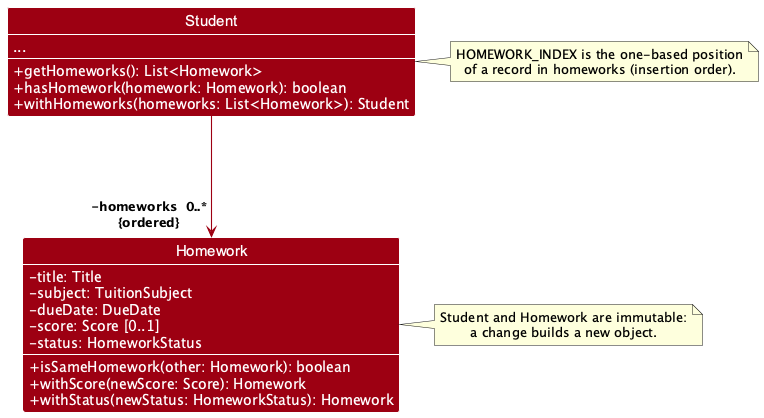

`Student` and `Homework` are immutable, so a command never changes a record in place. To add, edit, score or delete homework, it copies the student's homework list, changes the copy, and calls `Model#setStudent(student, student.withHomeworks(updatedList))`. This puts the new `Student` where the old one was in the roster, and the student card shows the change.

**Homework index.** The `HOMEWORK_INDEX` a tutor types is the record's position in the student's list, counting from 1. It is not stored, and it changes only when an earlier record of the student is deleted (see [Deleting homework](#deleting-homework)). `add`, `list`, `edit`, `marks` and `delete` look up the student (and, for `edit`, `marks` and `delete`, the record) through `HomeworkCommandUtil`, so they check the indices in the same order and give the same errors.

**Saving.** Homework is saved inside each student in the data file (see [Storage component](#storage-component)). `homework list`, `homework upcoming` and `homework filter` only read data, so the data file is not written after them (see [Saving after a command](#saving-after-a-command)).

#### Design considerations:

**Aspect: Where homework is stored:**

* **Alternative 1 (current choice):** Each `Student` holds its own homework list.
  * Pros: A student and their homework stay together, and a student index plus a homework index identify one record without separate homework IDs.
  * Cons: Every change to homework builds a new `Student`, and listing homework across students, as `homework upcoming` does, has to go through every student's list.

* **Alternative 2:** One homework list in the model, with each record referring to its student.
  * Pros: Easy to show all homework across students.
  * Cons: Homework must be kept consistent when a student is edited or deleted, and each student's homework indices must be worked out.

### Adding homework

`homework add STUDENT_INDEX t/TITLE s/SUBJECT due/DATE` adds a record to the end of the student's list, so it gets the next homework index. The activity diagram below shows its checks in order. `HomeworkAddCommandParser` checks the input, `HomeworkAddCommand` checks the student, the subject and duplicates, and `LogicManager` saves. If a check fails, the error is shown and nothing is changed.

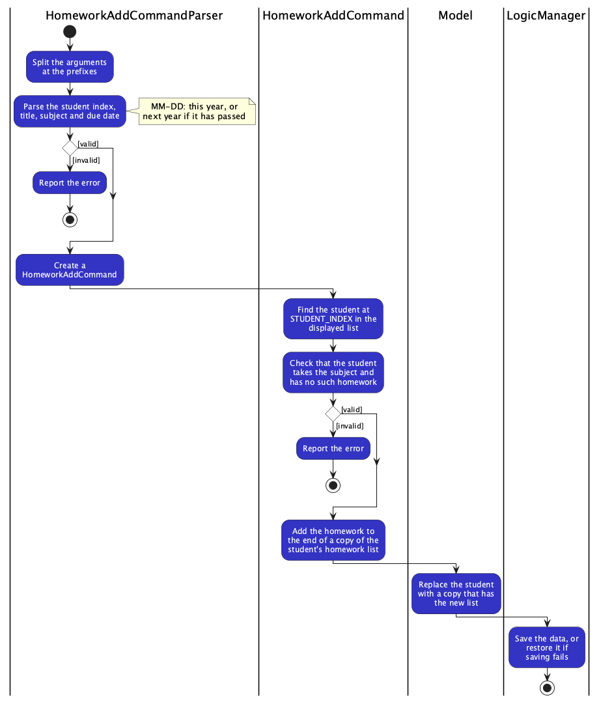

Two records are the same (`Homework#isSameHomework`) if they have the same title ignoring case, the same subject and the same due date. Score and status do not count. For example, on 2026-10-28 with the sample students:

```
hw add 2 t/Rates of reaction s/CHEMISTRY due/11-20         → added, due 2026-11-20
hw add 2 t/rates of REACTION s/CHEMISTRY due/2026-11-20    → This homework already exists for the selected student.
```

**Title.** `Title` tidies the text before checking it. It converts the text to Unicode NFC, turns each run of whitespace into one space and trims both ends. NFC stores characters that look the same in one way: `é` can be typed as one character or as `e` plus an accent, and NFC makes both the same. So the duplicate check treats them as one title, and the title is saved in NFC. The title must then have 1 to 100 characters, each a letter, number, punctuation mark, symbol or space.

This allowlist works like the one in `StudentName`. It rejects invisible characters such as the zero-width space wherever they are. So a title made only of them is rejected (Issue #139), and `Alge<zero-width space>bra drill` is rejected instead of being saved next to `Algebra drill` as a different title. As a result, emoji built with invisible joining characters (e.g. ❤️ and 👨‍👩‍👧) and letters that need a separate combining mark (e.g. many Tamil and Hindi letters) are rejected, as in student names. Single emoji such as 😀 are accepted. A data file with a title that breaks the rule does not load.

Alternatives considered:

* NFKC instead of NFC: rejected, as it changes visible characters, e.g. `²` to `2`.
* A denylist of invisible characters (the previous design): rejected, as it needed several lists of special characters and still accepted invisible characters inside a title.
* Printable ASCII only: rejected, as accented titles such as `Café` would be rejected, titles would be stricter than student names, and data files with such titles would no longer load.

**Due date.** `DueDate#parse` accepts `YYYY-MM-DD` or the short form `MM-DD`. For `MM-DD`, it picks this year, or next year if the date has already passed this year. For example, on 2026-10-28, `11-20` means 2026-11-20 and `10-01` means 2027-10-01. `02-29` is rejected, with a hint to type the full date, when no 29 February falls in the next 12 months. The error says what is wrong: an empty date, input in neither format, a year outside 2000 to 2099, or a date that does not exist (e.g. `2026-02-30 is not a real calendar date.`). `homework add`, `homework edit` and `homework filter` show these messages unchanged. The data file is read with `DueDate#parseFullDate`, which accepts only `YYYY-MM-DD`, so the year of a saved date is never guessed.

The year range is fixed (2000 to 2099) to catch typos such as `2206` or `0001`. A range based on today (e.g. 10 years either way) was rejected: a data file that loads today would stop loading a few years later.

### Listing a student's homework

`homework list STUDENT_INDEX [all]` shows one student's homework. Without `all`, it shows only the records due today or later; with `all`, it also shows overdue records. It sorts the records by due date, keeping records due on the same date in the order they were added, and shows each with its homework index. It only reads data, so nothing is saved.

Because the numbers are homework indices, not row numbers, they can start above 1 or have gaps. For example, on 2026-10-28 Priya Nair's first record is overdue, so `hw ls 2` shows these records:

```
Listed 2 upcoming homework records for Priya Nair (1 record due before today not shown; use homework list 2 all to see it).
Homework for Priya Nair:
2. Organic reaction pathways map (CHEMISTRY) - due 2026-11-02 - score Not recorded - status ASSIGNED
3. Chemical equilibrium past paper (CHEMISTRY) - due 2026-11-09 - score Not recorded - status ASSIGNED
```

So that a gap does not look like a bug, the first line says how many records due before today are left out and names the command that lists them, with the `STUDENT_INDEX` the user typed. `homework edit` and `homework delete` show the same list, so they pass their own `STUDENT_INDEX` to `HomeworkListCommand#formatHomeworkList`.

The activity diagram below shows these steps.

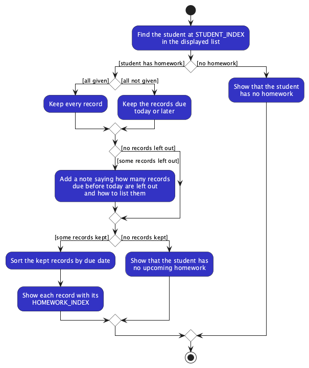

### Listing upcoming homework

`homework upcoming [due/DAYS]` lists the homework of every student that is due from today to `DAYS` days after today (7 days if `due/` is not given), sorted by due date. It goes through the whole roster, not only the students shown, and starts each line with `Student N:`, where `N` is the student's `STUDENT_INDEX`. The index tells apart two students with the same name, and the tutor can type it into `homework list`. For that, `N` must match the student list on screen, so after building the result the command shows the full roster again, as `list` does (e.g. after a `search`). If an internal error stops the command, the displayed list stays as it was.

For example, on 2026-10-28 with the sample students, `hw up due/3` shows:

```
Found 2 homework records due from 2026-10-28 to 2026-10-31.
Student 1: Ethan Lim; Kinematics practice set; PHYSICS; Due: 2026-10-28; Score: Not recorded; Status: ASSIGNED
Student 3: Marcus Tan; Algebraic expansion worksheet; MATH; Due: 2026-10-30; Score: Not recorded; Status: ASSIGNED
```

The sequence diagram below shows how `hw up due/3` builds this result.

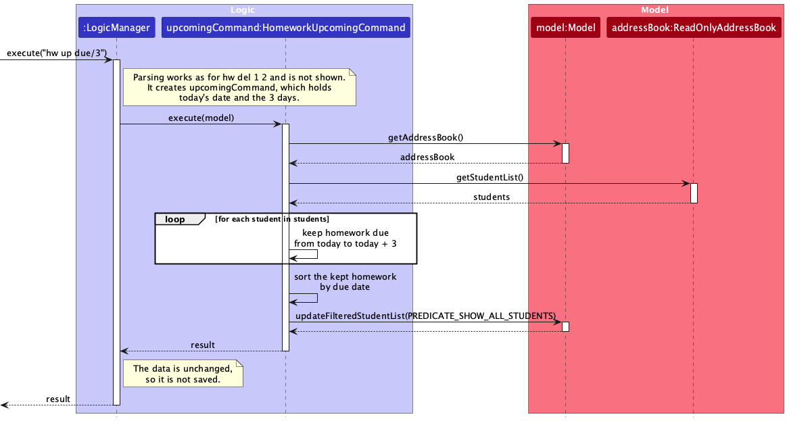

### Deleting homework

`homework delete STUDENT_INDEX HOMEWORK_INDEX` removes one record, and every later record of the student moves up by one. So a second delete that uses the original index may remove the wrong record. For example, `hw ls 2 all` shows Priya Nair's three records:

```
1. Integration by parts exercise (MATH) - due 2026-10-26 - ...
2. Organic reaction pathways map (CHEMISTRY) - due 2026-11-02 - ...
3. Chemical equilibrium past paper (CHEMISTRY) - due 2026-11-09 - ...
```

After `hw del 2 1`, the map is homework 1 and the past paper is homework 2. If the tutor then types `hw del 2 2` to delete the map, reading from the old list, the past paper is deleted instead.

To make this easy to notice, the result shows the deleted record with the number it had, its score and its status, in the `homework list` layout (`HomeworkListCommand#formatHomeworkLine`). It then shows the student's upcoming homework with the new numbers (`HomeworkListCommand#formatHomeworkList`), as `homework edit` does. `HomeworkDeleteCommand` gets today's date for that list from its parser's `Clock`. `homework add`, `homework edit` and `homework marks` show the changed record in their own layouts.

The object diagram below shows the same `hw del 2 1`. As `Student` is immutable, a new `Student` object replaces the old one, while the two remaining `Homework` objects are the same objects, now at positions 1 and 2.

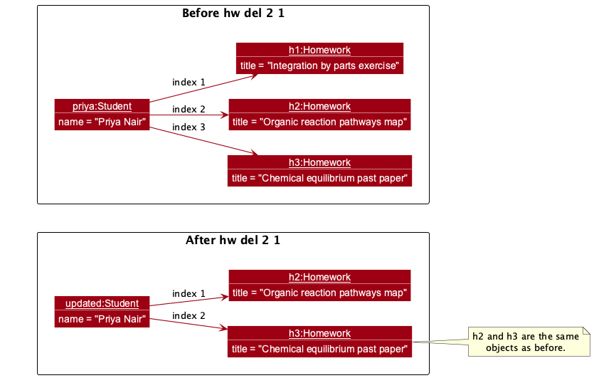

For how a homework command runs through the `Logic`, `Model` and `Storage` components, see the `hw del 1 2` sequence diagram in [Logic component](#logic-component).

### Editing homework and recording marks

`homework edit STUDENT_INDEX HOMEWORK_INDEX [t/TITLE] [s/SUBJECT] [due/DATE]` changes any of a record's title, subject and due date (`HomeworkEditCommand.EditHomeworkDescriptor#applyTo`). Fields that are not given keep their values, and the record keeps its homework index, score and status. Like `homework add`, it rejects a subject the student does not take and a record that would be the same as another of the student's records. It also rejects an edit that changes nothing: running `hw e 2 2 due/11-05` a second time gives `No changes made; the supplied values are identical to the existing homework details.`

`homework marks STUDENT_INDEX HOMEWORK_INDEX score/[SCORE]` records a score, or clears it when `SCORE` is left empty. It does not change the status, so a record with a score can still be `ASSIGNED`.

**Score.** A `Score` is either just the marks (e.g. `17`) or the marks out of a total (e.g. `5/10`). It is kept as typed (`5/10` is not simplified) and saved as text, e.g. `"17"` or `"5/10"`. `Score#parse` checks the format before the size of the numbers. So a number with leading zeroes, such as `05/10`, gets `Score#MESSAGE_LEADING_ZEROES`, even when it is also too large (`02147483648`) or more than the total (`011/10`). Input that is also wrong in another way, such as `-05`, gets `Score#MESSAGE_CONSTRAINTS`.

The sequence diagram below shows `hw m 2 1 score/8/10`, which records 8 out of 10 for Priya Nair's first homework.

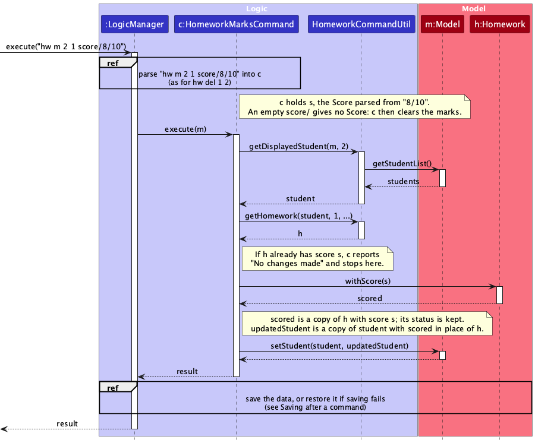

### Filtering homework

`HomeworkCommandParser` routes `homework|hw filter [STUDENT_INDEX] [s/SUBJECT] [due/DATE] [status/STATUS]` to `HomeworkFilterCommandParser`. At least one criterion is required. Subjects use `TuitionSubject.parse`; exact dates use `DueDate.parse` and the injected `Clock`, matching add/edit short-date inference; completion uses `HomeworkStatus.parse`. Unlike `homework upcoming`, `due/` takes an exact date. A full year is needed to search for an overdue date when the equivalent short form would infer next year.

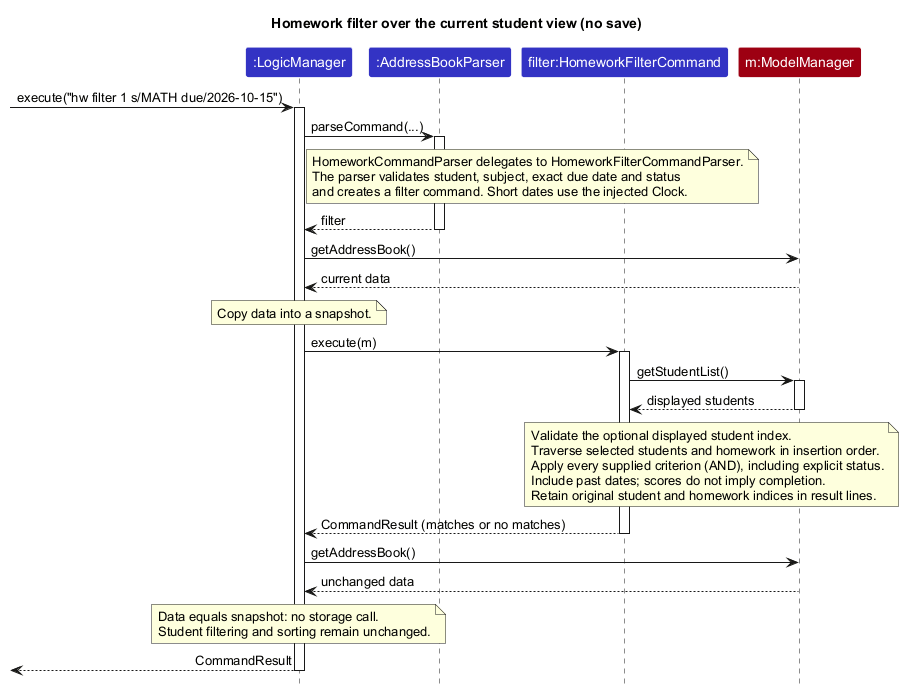

`HomeworkFilterCommand` reads `Model.getStudentList`, so its optional student index and result indices refer to the current displayed view. It intersects supplied criteria (AND), traverses displayed students and each student's homework in insertion order, and retains each homework's original one-based insertion index even when earlier records do not match. Each line prints both student and homework indices. Neither filtering nor sorting of the student view is reset; use `list` before filtering homework to search every student. The command includes past dates and scored records and returns a clear no-match message. It performs no model mutation, so `LogicManager` detects unchanged data and skips saving, including when the data file cannot be written.

**Completion state:** The explicit `HomeworkStatus` field restores completion tracking independently of scores, resolving the mismatch between US26 and the removal of status in PR #68. The filter compares `status/ASSIGNED` or `status/COMPLETED` directly with this field. Scored homework may remain assigned, and completed homework may have no score. Omitting the criterion includes both states.

**Design choice:** A separate `homework filter` command preserves existing `homework list` and `homework upcoming` behavior. It returns a report over the current student view, using the same displayed-index contract as other student-index commands. It does not introduce a persistent filtered homework list or change the meaning of indices for edit/delete.

The PlantUML sources for these diagrams are in `docs/diagrams`. Generate their PNGs with PlantUML 1.2026.9, for example `java -jar PATH_TO_PLANTUML.jar -tpng -o ../images docs/diagrams/LessonEditSequenceDiagram.puml docs/diagrams/HomeworkFilterSequenceDiagram.puml docs/diagrams/HomeworkCompletionClassDiagram.puml` from the repository root. The output path is relative to the source directory.

### Updating homework completion

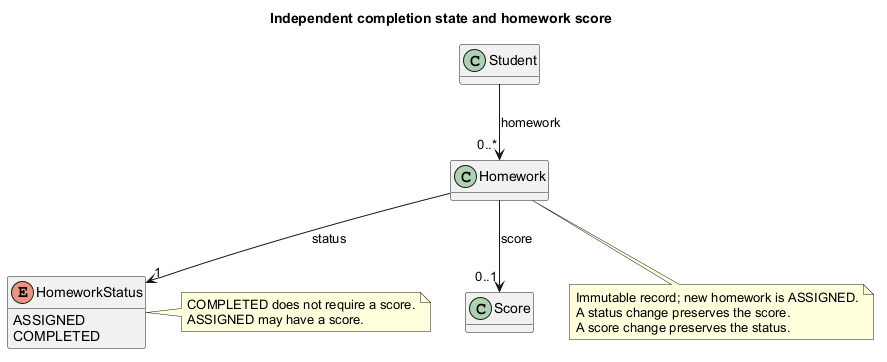

The Model class diagram also shows the required `HomeworkStatus` association alongside the optional `Score`.
The sequence below follows a status change through the displayed-index lookup, immutable replacement, automatic
save, and recovery if saving fails. Parser delegation and value construction are abbreviated; validation failures
are described in the notes and do not reach `setStudent`.

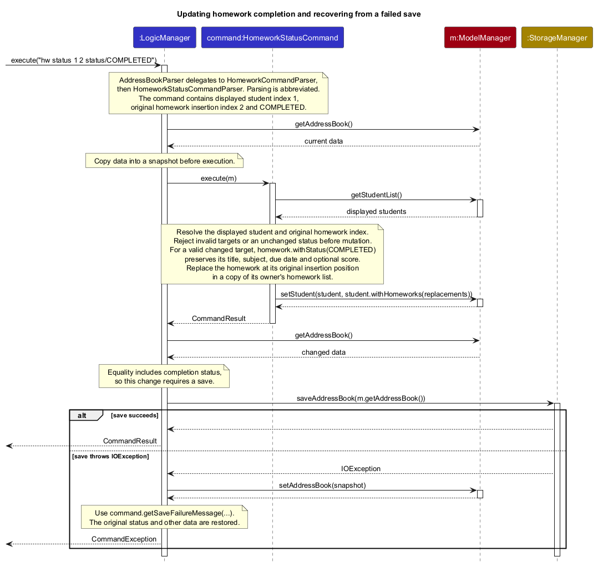

`Homework` holds exactly one `HomeworkStatus` enum value (`ASSIGNED` or `COMPLETED`), independently of its optional `Score`. New homework defaults to `ASSIGNED`. Equality and hashing include status so that `LogicManager` detects status changes; duplicate identity continues to use normalized title, subject and due date only. `Homework.withStatus` copies all other values. `HomeworkEditCommand` and `HomeworkMarksCommand` preserve the original status when constructing replacement homework.

`HomeworkStatusCommandParser` parses `homework|hw status STUDENT_INDEX HOMEWORK_INDEX status/STATUS` using strict displayed student and insertion-order homework indices. The command rejects invalid targets and unchanged status before mutating the model. It replaces one homework in a copied list and updates its immutable owner using `withHomeworks`, preserving other homework, lessons and student data. The standard save/rollback mechanism applies, with `HomeworkStatusCommand.MESSAGE_SAVE_FAILURE` on failure.

`JsonAdaptedHomework` saves status as a string. Existing explicit values from pre-removal files are retained. Missing or null values in files from versions without status default to `ASSIGNED`; no score-based inference is performed. Unsupported explicit values are rejected with `HomeworkStatus.MESSAGE_CONSTRAINTS`. Recording or clearing marks does not complete or reopen homework. The listing commands display status; upcoming selection and card counts remain based solely on due dates, including completed records.

Tests cover completion with and without scores, reopening, status preservation through details/marks edits, combined filtering, displayed indices after search/sort, invalid and unchanged requests, legacy loading, round-trip persistence, and rollback after a failed save. The class diagram deliberately omits unrelated student and homework value classes.

### Adding regular lessons

`lesson add STUDENT_INDEX s/SUBJECT d/DAY st/START_TIME et/END_TIME` is routed by `LessonCommandParser` to `LessonAddCommandParser`. The parser reuses `StrictArgumentTokenizer` and strict student-index parsing. It names missing prefixes and reports the supported integer range for an overflowing positive index. `RegularLesson` stores a subject, `DayOfWeek`, and two minute-precision `LocalTime` values, with end strictly after start. Full weekday names and non-overnight times follow the team specification; supporting abbreviated days or midnight endpoints would be a separate enhancement.

`LessonAddCommand` checks the selected student's subjects and duplicate lessons before checking overlaps across the entire roster. Overlap uses `start < other.end && end > other.start` on the same weekday, allowing adjacent lessons. The command replaces the selected immutable `Student` using `withLessons`, preserving homework and roster order. Homework updates using `withHomeworks` likewise preserve lessons.

Lesson listing, add/edit/delete feedback and clash messages include the owner's name and student phone through `Messages#formatLessonOwner`, distinguishing students with identical names. The global weekly lesson index remains independent of the current student view. `LessonOwnerIntegrationTest` covers same-name owners, hidden-owner clash reports, mutation feedback, correct deletion and persistence.

`JsonAdaptedLesson` stores the four lesson fields inside each student's `lessons` array. A missing array is read as empty so existing data files remain compatible. Loading rejects invalid lesson fields, subject mismatches, duplicates and overlapping schedules. The existing `LogicManager` change detection and save rollback apply to lessons because `Student.equals` includes its lessons. The command supplies the lesson-specific save-failure message.

`LessonListCommand` and `LessonDeleteCommand` use `LessonSchedule` to flatten lessons into the same weekday, start-time and student-name order. Therefore, the one-based index accepted by `lesson delete` always identifies the corresponding row from `lesson list`. Deletion replaces only that lesson's owner through `Student.withLessons()`, without changing the storage format.

`lesson list STUDENT_INDEX` resolves an owner from the displayed student view, then selects that owner's entries from the complete weekly schedule. It retains global lesson numbers, including gaps, so subsequent edits/deletions address the same records. `Locale.ROOT` keeps those numbers parseable in every locale. The command preserves the view and performs no save. `StudentLessonListIntegrationTest` checks hidden and same-name owners, global numbering, Arabic-locale output, empty schedules, invalid displayed indices, unchanged file bytes and zero save calls.

See [Adding a regular lesson](#adding-a-regular-lesson) for a complete reproducible setup and persistence/error checks. The sample-data example uses Tuesday so it does not clash with Ethan's existing Monday lesson.

### Editing regular lessons

`LessonCommandParser` routes `lesson edit LESSON_INDEX [s/SUBJECT] [d/DAY] [st/START_TIME] [et/END_TIME]` to `LessonEditCommandParser`. The shared tokenizer rejects unknown or repeated prefixes and handles quoted values. At least one field is required. An immutable `EditLessonDescriptor` holds only supplied fields; applying it to the original lesson constructs a complete `RegularLesson`, validating the proposed time interval even when only one endpoint changes.

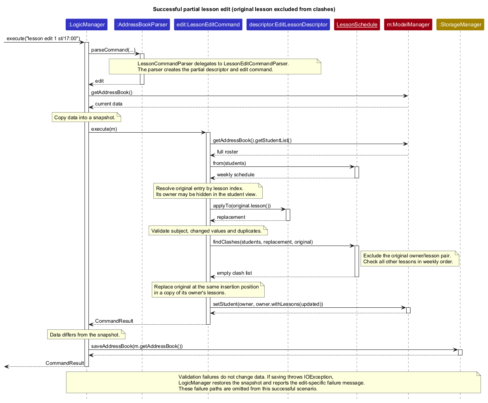

The diagram shows a successful edit, with parsing details and the snapshot copy abbreviated. `LogicManager` snapshots the data before executing the command. `LessonEditCommand` resolves the lesson through `LessonSchedule.buildSchedule` over the full roster, matching `lesson list` and `lesson delete` numbering independently of student filtering and sorting. The owner and original lesson form an `Entry`. After subject, unchanged-value and duplicate checks, `LessonSchedule.findClashes` compares the candidate against the full weekly schedule while excluding only that owner/lesson pair. The half-open interval rule permits adjacent lessons. All conflicts are reported in weekly order; any validation failure leaves records untouched.

On success, the command replaces the original at its insertion position in a copied lesson list, then calls `Model.setStudent(owner, owner.withLessons(updated))`. The immutable replacement preserves homework and all student details. The weekly schedule may be reordered by the changed day/time, so later lesson operations should use a refreshed `lesson list`. `LogicManager` saves the changed data; on an `IOException` it restores its snapshot and uses `LessonEditCommand.MESSAGE_SAVE_FAILURE`. No JSON schema change is needed.

**Design choice:** Use the existing global lesson index, matching deletion, rather than adding a second student-local lesson numbering scheme. Partial edits reuse existing values, so a tutor can move a lesson by specifying only its weekday. Both `LessonAddCommand` and `LessonEditCommand` use `LessonSchedule.findClashes` over the full roster. The two-argument overload checks a new lesson; the three-argument overload excludes the original owner/lesson pair for an edit. It still checks the owner's other lessons and other students' lessons, regardless of subject or visibility in the student view.

**Validation:** `LessonEditIntegrationTest` exercises commands through `LogicManager` and real JSON storage. It checks one-minute overlaps, containment, changes to the weekday or subject, same-owner conflicts, hidden students, all-conflict reporting, adjacency, schedule renumbering and reloads. Rejected clashes leave model data, displayed student order and saved bytes unchanged and make no save calls. `LessonEditUiTest` smoke-tests the rendered main window's command box: a clash identifies the hidden student's lesson, retains the rejected input and current selection, and a corrected edit clears the error and persists successfully.

### Saving after a command

`LogicManager#execute` saves the data after every command that changes it. If saving fails, it puts back the data and the displayed student list as they were before the command, so the app never shows a change that is not in the data file.

`JsonAddressBookStorage` records the bytes of each successfully loaded or saved file, including whether it was missing. Before saving, it acquires a short-lived OS lock on a companion `.lock` file and compares the data file with that recorded version. The lock serializes the version check and atomic replacement across cooperating processes. A stale writer is rejected without replacing newer data; `LogicManager` restores the pre-command model and reports that the user must restart to load the latest file. A busy writer reports that the command can be retried. Reading data does not create or acquire a write lock, so read-only commands and loading from a read-only folder remain possible. The empty lock file stays beside the data file so every writer continues to lock the same file.

The activity diagram below shows these steps for a command that succeeds. If the command throws an exception, `LogicManager` passes it on and saves nothing.

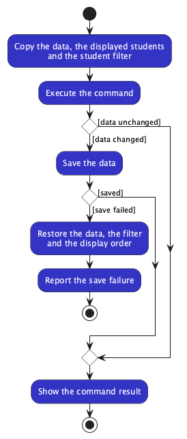

1. Before the command runs, `LogicManager` copies the current data (`new AddressBook(model.getAddressBook())`). The copy is cheap: `Student` and `Homework` are immutable, so only the list is copied, not the students. It also records which students are shown, in their current order (`Model#getStudentList()`), and the search or filter that selects them (`Model#getFilteredStudentListPredicate()`).
1. After the command succeeds, `LogicManager` compares the data with the copy. If they are equal, the command changed nothing (e.g. `homework list`, `homework upcoming`, `help`, `exit`, or `clear` with no students), so nothing is saved.
1. Otherwise, `LogicManager` calls `Storage#saveAddressBook`. If this throws an `IOException`, `LogicManager#restoreModel` puts back the copy (`Model#setAddressBook`), the search or filter (`Model#updateFilteredStudentList`) and the display order (`Model#setStudentListOrder`). `LogicManager` then throws a `CommandException` with the save-failure message described in the next two steps, or, for a `DataFileConflictException`, with the conflict's own message. Restoring the data alone is not enough, because `StudentDisplayList` remembers display positions, not students, when the whole roster is replaced. Without the other two, a failed `delete` after a `sort` would shift the students below the deleted one, a failed `clear` would lose the sort, and a failed `add` would show every student instead of the earlier search result.
1. The message names the data file and the likely cause, e.g. `Could not save data/tutorflow.json: it is a folder, not a file. Nothing was changed.` The file name (`shownName`) is the one the user knows: relative to the app's home folder (see `AppHomeUtil` in [Storage component](#storage-component)), or the absolute path if the file is outside it. The cause comes from `LogicManager#describeSaveFailure`, which checks the file system for common causes, such as `the file is read-only` or `the data folder is read-only`, and otherwise uses the exception's own text. It checks the file system and not the exception, as the exception may be about another file, such as the `.lock` file next to the data file.
1. `Command#getSaveFailureMessage(shownName, cause)` fills the name and cause into the format from `Command#getSaveFailureFormat`, which is `Messages#MESSAGE_SAVE_FAILURE` by default. Commands that want their own wording override `getSaveFailureFormat` to return their own `MESSAGE_SAVE_FAILURE`: the homework commands that change data (`HomeworkAddCommand`, `HomeworkEditCommand`, `HomeworkMarksCommand`, `HomeworkDeleteCommand`, `HomeworkStatusCommand`), `DeleteCommand`, `EditCommand`, `LessonAddCommand`, `LessonEditCommand` and `LessonDeleteCommand`. For example, a failed `hw add` shows `The homework could not be added because TutorFlow could not save data/tutorflow.json: the data folder is read-only. No homework data was changed.` So a new command that needs its own message only overrides `getSaveFailureFormat`, and the name and cause are filled in the same way for every command.

#### Design considerations:

**Aspect: When to save:**

* **Alternative 1 (current choice):** Save only when the command changed the data.
  * Pros: Read-only commands such as `homework list` never write the data file, as the specification requires, and cannot fail because of a save error.
  * Cons: Each command copies and compares the data. This is fast for the number of students one tutor has.

* **Alternative 2 (AB3):** Save after every successful command.
  * Pros: Simpler.
  * Cons: A read-only command can fail with a save error, and it rewrites the data file even though nothing changed.

**Aspect: How to handle a failed save:**

* **Alternative 1 (current choice):** Undo the change by restoring the copy taken before the command.
  * Pros: Works for every command without command-specific undo code, and the app never shows data that is not in the data file.
  * Cons: The copy is taken even when saving succeeds.

* **Alternative 2 (AB3):** Report the error but keep the change in memory.
  * Pros: No copy is needed.
  * Cons: The message says the data could not be saved, but the change is still shown and is lost when the app closes, so the user cannot tell what is saved.

--------------------------------------------------------------------------------------------------------------------

## **Documentation, logging, testing, dev-ops**

* [Documentation guide](Documentation.md)
* [Testing guide](Testing.md)
* [Logging guide](Logging.md)
* [DevOps guide](DevOps.md)

--------------------------------------------------------------------------------------------------------------------

## **Appendix: Requirements**

### Product scope

**Target user profile**:

* is an independent part-time tutor in Singapore
* teaches approximately 10 to 20 secondary or junior-college students through individual lessons
* needs to manage student details, guardian contact details, academic information, homework, and regular lesson schedules
* prefers a desktop application that can be operated efficiently using the keyboard
* is reasonably comfortable using command-line interfaces

**Value proposition**: TutorFlow helps independent tutors manage student information, their homework and regular lesson schedules faster and more reliably than scattered notes, while reducing the risk of timetable clashes.

### User stories

Priorities: High (must-have) - `* * *`, Medium (should-have) - `* *`, Low (nice-to-have) - `*`

| ID | Priority | As a/an | I want to | So that I can |
| --- | --- | --- | --- | --- |
| US01 | `* * *` | independent tutor | add a student profile | keep the student's essential information in one place |
| US02 | `* * *` | independent tutor | list all my students | review my current student roster |
| US03 | `* * *` | independent tutor | view a student's profile | retrieve the student's contact and academic information |
| US04 | `* * *` | independent tutor | delete a student record | remove obsolete or incorrectly created records from my roster |
| US05 | `* * *` | independent tutor | add a regular lesson to a student | record when I teach that student each week |
| US06 | `* * *` | independent tutor | view the regular lessons assigned to a student | check that student's regular lesson schedule |
| US07 | `* * *` | independent tutor | view all regular lessons in weekday-and-time order | understand my overall teaching schedule |
| US08 | `* * *` | independent tutor | delete a regular lesson | remove lessons that no longer take place |
| US09 | `* * *` | independent tutor | be prevented from adding an overlapping regular lesson | avoid double-booking myself |
| US10 | `* * *` | independent tutor | reopen TutorFlow and find my students, their homework and their regular lessons as I left them | avoid entering them again |
| US11 | `* *` | independent tutor | search for a student by name | find the student's record quickly |
| US12 | `* *` | independent tutor | filter students by academic level | focus on students at a particular stage of study |
| US13 | `* *` | independent tutor | filter students by subject | find the students whom I teach a particular subject |
| US14 | `* *` | independent tutor | view regular lessons scheduled on a selected weekday | focus on one day's teaching schedule |
| US15 | `* *` | independent tutor | edit a student's profile | correct changed or incorrectly entered information |
| US16 | `* *` | independent tutor | change a regular lesson's timeslot | keep my schedule accurate when a regular arrangement changes |
| US17 | `*` | independent tutor | archive an inactive student | keep former students from cluttering my current roster |
| US18 | `*` | independent tutor | restore an archived student | resume managing a returning student |
| US19 | `*` | independent tutor | identify students without a regular lesson | notice students whose schedules are incomplete |
| US20 | `*` | independent tutor | export my regular lesson schedule | view or print it outside TutorFlow |
| US21 | `*` | independent tutor | sort students alphabetically | scan my roster more easily |
| US22 | `*` | independent tutor | sort students by academic level | group students at similar stages of study |
| US23 | `*` | independent tutor | search for a student by phone number | identify a student from an unfamiliar contact number |
| US24 | `*` | independent tutor | view available periods in my regular lesson schedule | propose lesson times without checking each lesson manually |
| US25 | `* * *` | independent tutor | add homework to a student | record the work assigned to that student |
| US26 | `* * *` | independent tutor | view and filter homework by student, due date, subject, or completion status | find homework that requires my attention |
| US27 | `* *` | independent tutor | edit recorded homework | correct or update an assignment's details |
| US28 | `* * *` | independent tutor | delete recorded homework | remove assignments entered incorrectly or no longer required |
| US29 | `* * *` | independent tutor | record a student's homework score | keep track of the student's performance |
| US30 | `* *` | independent tutor | mark homework completed or reopen it independently of its score | track unfinished work accurately |
| US31 | `* *` | independent tutor | see the homework of all my students that is due in the next few days | prepare for the coming lessons and remind students in time |
| US32 | `* *` | independent tutor | look up a command's format inside the app | use a command correctly without opening the User Guide |

### Use cases

For all use cases below, the **System** is `TutorFlow` and the **Actor** is the `Tutor`, unless specified otherwise.

#### Use case: UC01 - Add a regular lesson

**MSS**

1. Tutor requests to view the student roster.
2. TutorFlow displays the student roster with displayed indices.
3. Tutor requests to add a regular lesson to a displayed student, specifying the subject, weekday, start time, and end time.
4. TutorFlow records the regular lesson and confirms its details.
5. Use case ends.

**Extensions**

* 2a. The student roster is empty.
  * 2a1. TutorFlow informs the tutor that there are no students.
  * 2a2. Use case ends.
* 3a. The supplied student index does not identify a displayed student.
  * 3a1. TutorFlow displays an error.
  * 3a2. Use case resumes at step 3.
* 3b. One or more lesson details are invalid.
  * 3b1. TutorFlow displays the relevant validation error.
  * 3b2. Use case resumes at step 3.
* 3c. The selected student is not registered for the supplied subject.
  * 3c1. TutorFlow rejects the lesson and displays an error.
  * 3c2. Use case resumes at step 3.
* 3d. The regular lesson already exists.
  * 3d1. TutorFlow informs the tutor that the lesson already exists.
  * 3d2. Use case resumes at step 3.
* 3e. The lesson overlaps another regular lesson on the same weekday.
  * 3e1. TutorFlow rejects the new lesson and identifies every conflicting lesson in weekly order.
  * 3e2. Use case resumes at step 3.
* 4a. TutorFlow cannot save the updated data.
  * 4a1. TutorFlow leaves the lesson schedule unchanged.
  * 4a2. TutorFlow informs the tutor that no lesson data was changed, naming the data file and the likely cause.
  * 4a3. Use case ends.

#### Use case: UC02 - Delete a regular lesson

**MSS**

1. Tutor requests to view all regular lessons.
2. TutorFlow displays the regular lessons in weekday-and-time order with displayed indices.
3. Tutor requests to delete a lesson using its displayed index.
4. TutorFlow deletes the selected lesson and confirms its details.
5. Use case ends.

**Extensions**

* 2a. There are no regular lessons.
  * 2a1. TutorFlow informs the tutor that no regular lessons were found.
  * 2a2. Use case ends.
* 3a. The supplied index does not identify a displayed lesson.
  * 3a1. TutorFlow displays an error.
  * 3a2. Use case resumes at step 3.
* 4a. TutorFlow cannot save the updated data.
  * 4a1. TutorFlow leaves the lesson schedule unchanged.
  * 4a2. TutorFlow informs the tutor that no lesson data was changed, naming the data file and the likely cause.
  * 4a3. Use case ends.

#### Use case: UC03 - Edit a homework record

**MSS**

1. Tutor requests to list a student's homework.
2. TutorFlow displays the student's upcoming homework, each with its homework index.
3. Tutor requests to edit one homework record of the student using its homework index, specifying a new title, subject or due date.
4. TutorFlow updates the homework record, keeping its homework index, score and completion status, and displays it together with the student's upcoming homework.
5. Use case ends.

**Extensions**

* 1a. The supplied student index does not identify a displayed student.
  * 1a1. TutorFlow displays an error.
  * 1a2. Use case resumes at step 1.
* 2a. The homework to edit is due before today, so it is not displayed.
  * 2a1. Tutor requests to list all of the student's homework.
  * 2a2. TutorFlow displays all of the student's homework, including homework due before today, each with its homework index.
  * 2a3. Use case resumes at step 3.
* 2b. The student has no homework.
  * 2b1. TutorFlow informs the tutor that the student has no homework.
  * 2b2. Use case ends.
* 3a. The supplied student index or homework index does not identify a homework record.
  * 3a1. TutorFlow displays an error.
  * 3a2. Use case resumes at step 3.
* 3b. No new detail is supplied, or a new detail is invalid.
  * 3b1. TutorFlow displays the relevant error.
  * 3b2. Use case resumes at step 3.
* 3c. The student does not take the new subject.
  * 3c1. TutorFlow rejects the edit and displays an error.
  * 3c2. Use case resumes at step 3.
* 3d. The new details are identical to the existing details.
  * 3d1. TutorFlow informs the tutor that no changes were made.
  * 3d2. Use case ends.
* 3e. The edited homework would duplicate another homework record of the student.
  * 3e1. TutorFlow rejects the edit and informs the tutor.
  * 3e2. Use case resumes at step 3.
* 4a. TutorFlow cannot save the updated data.
  * 4a1. TutorFlow leaves the homework unchanged.
  * 4a2. TutorFlow informs the tutor that no homework data was changed, naming the data file and the likely cause.
  * 4a3. Use case ends.

#### Use case: UC04 - Record homework marks

**MSS**

1. Tutor finds the homework index of the homework record, as in steps 1 and 2 of UC03 (including extension 2a for homework due before today).
2. Tutor requests to record the marks of one homework record of the student using its homework index, specifying the marks obtained, optionally together with the total marks.
3. TutorFlow records the score, replacing any score recorded before, and displays the homework record with its score.
4. Use case ends.

**Extensions**

* 2a. The supplied student index or homework index does not identify a homework record.
  * 2a1. TutorFlow displays an error.
  * 2a2. Use case resumes at step 2.
* 2b. The score is invalid, for example the marks obtained exceed the total marks.
  * 2b1. TutorFlow displays an error that says what is wrong with the score.
  * 2b2. Use case resumes at step 2.
* 2c. The homework already has this score.
  * 2c1. TutorFlow informs the tutor that no changes were made.
  * 2c2. Use case ends.
* 2d. The tutor leaves the score empty to remove the recorded marks.
  * 2d1. TutorFlow clears the score and displays the homework record with its score shown as not recorded.
  * 2d2. Use case ends.
* 2d1a. TutorFlow cannot save the updated data.
  * 2d1a1. TutorFlow leaves the score unchanged and informs the tutor that no homework data was changed, naming the data file and the likely cause.
  * 2d1a2. Use case ends.
* 2e. The tutor leaves the score empty, but the homework has no recorded marks.
  * 2e1. TutorFlow informs the tutor that no changes were made.
  * 2e2. Use case ends.
* 3a. TutorFlow cannot save the updated data.
  * 3a1. TutorFlow leaves the score unchanged.
  * 3a2. TutorFlow informs the tutor that no homework data was changed, naming the data file and the likely cause.
  * 3a3. Use case ends.

#### Use case: UC05 - List upcoming homework of all students

**MSS**

1. Tutor requests to list the homework of all students that is due within a number of days from today.
2. TutorFlow displays that homework, earliest due date first, with each record's student index and name, title, subject, due date, score and status, and resets the student list to all students so that the student indices match.
3. Use case ends.

**Extensions**

* 1a. The tutor does not specify the number of days.
  * 1a1. TutorFlow uses 7 days.
  * 1a2. Use case resumes at step 2.
* 1b. The number of days is invalid.
  * 1b1. TutorFlow displays an error.
  * 1b2. Use case resumes at step 1.
* 2a. No homework is due in that period.
  * 2a1. TutorFlow informs the tutor that no homework is due in that period.
  * 2a2. Use case ends.
* 2b. The tutor wants to edit, score or delete one of the displayed records.
  * 2b1. Tutor requests to list the homework of the student with the displayed student index to find the record's homework index, as the displayed order is not the homework index (see UC03, UC04 and UC07).
  * 2b2. Use case ends.

#### Use case: UC06 - Add homework to a student

**MSS**

1. Tutor requests to list students.
2. TutorFlow displays the students with their displayed indices.
3. Tutor requests to add homework to one displayed student, specifying the title, subject and due date.
4. TutorFlow adds the homework to the end of the student's homework list and confirms its details.
5. Use case ends.

**Extensions**

* 2a. The student roster is empty.
  * 2a1. TutorFlow informs the tutor that no students were found.
  * 2a2. Use case ends.
* 3a. The supplied student index does not identify a displayed student.
  * 3a1. TutorFlow displays an error.
  * 3a2. Use case resumes at step 3.
* 3b. A detail is missing or invalid, for example the due date is not a real calendar date.
  * 3b1. TutorFlow displays the relevant error.
  * 3b2. Use case resumes at step 3.
* 3c. The due date is given without a year.
  * 3c1. TutorFlow uses this year, or next year if the date has already passed this year, and states the year it used.
  * 3c2. Use case resumes at step 4.
* 3d. The student does not take the subject.
  * 3d1. TutorFlow rejects the homework and displays an error.
  * 3d2. Use case resumes at step 3.
* 3e. The student already has homework with the same title (ignoring case), subject and due date.
  * 3e1. TutorFlow informs the tutor that the homework already exists.
  * 3e2. Use case resumes at step 3.
* 4a. TutorFlow cannot save the updated data.
  * 4a1. TutorFlow leaves the student's homework unchanged.
  * 4a2. TutorFlow informs the tutor that no homework data was changed, naming the data file and the likely cause.
  * 4a3. Use case ends.

#### Use case: UC07 - Delete a homework record

**MSS**

1. Tutor requests to list a student's homework.
2. TutorFlow displays the student's upcoming homework, each with its homework index.
3. Tutor requests to delete one homework record of the student using its homework index.
4. TutorFlow deletes the homework record, displays it with the homework index it had, and displays the student's upcoming homework with the updated homework indices.
5. Use case ends.

**Extensions**

* 1a. The supplied student index does not identify a displayed student.
  * 1a1. TutorFlow displays an error.
  * 1a2. Use case resumes at step 1.
* 2a. The student has no homework.
  * 2a1. TutorFlow informs the tutor that the student has no homework.
  * 2a2. Use case ends.
* 2b. The homework to delete is due before today, so it is not displayed.
  * 2b1. Tutor requests to list all of the student's homework.
  * 2b2. TutorFlow displays all of the student's homework, including homework due before today, each with its homework index.
  * 2b3. Use case resumes at step 3.
* 3a. The supplied student index or homework index does not identify a homework record.
  * 3a1. TutorFlow displays an error.
  * 3a2. Use case resumes at step 3.
* 4a. TutorFlow cannot save the updated data.
  * 4a1. TutorFlow keeps the homework record.
  * 4a2. TutorFlow informs the tutor that no homework data was changed, naming the data file and the likely cause.
  * 4a3. Use case ends.

#### Use case: UC08 - Delete a student

**MSS**

1. Tutor requests to list students.
2. TutorFlow displays the students with their displayed indices.
3. Tutor requests to delete a student using the displayed index.
4. TutorFlow deletes the student, including their homework and lessons, and confirms the deletion.
5. Use case ends.

**Extensions**

* 2a. The student roster is empty.
  * 2a1. TutorFlow informs the tutor that no students were found.
  * 2a2. Use case ends.
* 3a. The supplied index is invalid or does not identify a displayed student.
  * 3a1. TutorFlow displays an error without changing the roster.
  * 3a2. Use case resumes at step 3.
* 4a. TutorFlow cannot save the updated data.
  * 4a1. TutorFlow restores the student and their homework and lessons.
  * 4a2. TutorFlow reports that no student data was changed and explains the save error.
  * 4a3. Use case ends.

#### Use case: UC09 - Edit a student

**MSS**

1. Tutor requests to list students.
2. TutorFlow displays the students with their displayed indices.
3. Tutor requests to edit one displayed student, supplying at least one replacement field.
4. TutorFlow updates the profile and confirms the new details.
5. Use case ends.

**Extensions**

* 3a. The index or replacement field is invalid, or no field is supplied.
  * 3a1. TutorFlow displays an error without changing the profile.
  * 3a2. Use case resumes at step 3.
* 3b. The proposed name and phone duplicate another student.
  * 3b1. TutorFlow identifies the existing student and leaves both profiles unchanged.
  * 3b2. Use case ends.
* 3c. A removed subject is still used by the student's homework or lessons.
  * 3c1. TutorFlow rejects the edit and explains why.
  * 3c2. Use case ends.
* 3d. The supplied values are identical to the existing values.
  * 3d1. TutorFlow reports that no changes were made.
  * 3d2. Use case ends.
* 4a. TutorFlow cannot save the updated data.
  * 4a1. TutorFlow restores the original profile and its related records.
  * 4a2. TutorFlow reports that no student data was changed and explains the save error.
  * 4a3. Use case ends.

### Non-Functional Requirements

1. TutorFlow should work on Windows, Linux, and macOS on a computer with Java `25` installed.
2. TutorFlow should be distributed as a single JAR file no larger than 100 MB and should not require an installer or any additional software beyond Java 25.
3. TutorFlow should support one user, with its data file used only by that user during regular operation.
4. TutorFlow should store all application data locally in a human-editable UTF-8 text file and should not require a database management system.
5. TutorFlow's core student, homework and lesson-management features should work without an Internet connection or a team-maintained remote server.
6. TutorFlow's GUI should work without inconvenience at resolutions of 1920x1080 or higher with 100% or 125% display scaling, and remain usable at resolutions of 1280x720 or higher with 150% display scaling.
7. TutorFlow should respond to commands within one second when managing up to 100 student profiles with up to 10 regular lessons and 50 homework records per student on a computer with a 2.0 GHz dual-core processor, 4 GB of RAM, and solid-state storage.
8. After reading the User Guide for no more than 15 minutes, a target user should be able to add, list, and delete students, homework and regular lessons without assistance.
9. Adding, listing, and deleting students, homework and regular lessons should be possible using only the keyboard.
10. If a save operation fails, TutorFlow should preserve the previously stored data without leaving a partially written data file.

### Glossary

* **Academic level**: The student's current secondary or junior-college year, such as `S3` or `J1`.
* **Command-line interface (CLI)**: A text-based interface in which the user performs operations by entering commands.
* **Displayed index**: A temporary one-based number assigned to an item in the currently displayed list. It is not a permanent identifier.
* **Guardian**: The person recorded as the primary guardian or contact for a student.
* **Homework**: Work assigned to a student and recorded in TutorFlow for follow-up.
* **Homework index**: The one-based position of a homework record in its student's homework list, in the order the homework was added. `homework list` shows it next to each record, and `homework edit`, `homework marks` and `homework delete` use it to identify the record.
* **Lesson clash**: Two regular lessons on the same weekday whose time intervals overlap.
* **Regular lesson**: A tuition lesson that repeats weekly for a student at a specified weekday and time.
* **Score**: The marks a student obtained for a homework record, written on their own, such as `17`, or together with the total marks as `MARKS_OBTAINED/TOTAL_MARKS`, such as `5/10`.
* **Student profile**: The record containing a student's identity, contact information, academic information, guardian information, and associated regular lessons.
* **Student roster**: The collection of student profiles managed by TutorFlow.
* **Tuition subject**: A subject that the tutor teaches to a student, such as Mathematics, Physics, or Chemistry.
* **Upcoming homework**: Homework that is due today or later.

--------------------------------------------------------------------------------------------------------------------

## **Appendix: Instructions for manual testing**

Given below are instructions to test the app manually.

<div markdown="span" class="alert alert-info">:information_source: **Note:** These instructions only provide a starting point for testers to work on;
testers are expected to do more *exploratory* testing.

</div>

### Launch and shutdown

1. Initial launch

   1. Download the JAR file and copy it into an empty writable test folder. Keep all tests separate from real tutoring records. Open a terminal and `cd` to this folder.

   1. Run `java -version` and confirm Java 25, then run `java -jar "addressbook.jar"` (adapt the filename to the download).<br>
      Expected: The GUI opens with a set of sample students with sample homework. The window size may not be optimal.

1. Saving window preferences

   1. Resize the window to an optimal size. Move the window to a different location. Close the window.

   1. Relaunch from the same terminal folder with `java -jar "addressbook.jar"`.<br>
       Expected: The most recent window size and location are retained.

1. Dealing with invalid preferences

   1. Close the app and replace the content of `preferences.json` with `{"guiSettings":null}`. Launch the app.<br>
      Expected: The app opens with the default window size and the same students as before. `preferences.json` now holds the default preferences, and the data file is unchanged.

### Adding and editing students

1. Use a disposable test folder and run `clear` to start with an empty roster.

   1. Run `add n/Zoe Quest l/S2 s/MATH,PHYSICS p/91238888 gn/Ivy Quest gp/97665555`, then `add n/Ben Lim l/S4 s/MATH p/91238889 gn/Jane Lim gp/97665556`.<br>
      Expected: Zoe and Ben appear as students 1 and 2, with the supplied contact, guardian and academic details.
   1. Repeat Zoe's add command, then try `add n/Another Student l/S2 s/MATH p/91238887 gn/Ivy Quest` (missing guardian phone).<br>
      Expected: A duplicate-student error and `Missing required prefix(es): gp/` with usage guidance respectively. The roster remains unchanged.
   1. Run `hw add 1 t/Algebra s/MATH due/2099-12-01` and `lesson add 1 s/MATH d/MONDAY st/16:00 et/17:00`. Run `search Zoe Quest`, then `edit 1 n/Zoe Tan`.<br>
      Expected: Zoe is renamed and disappears from the search results because no profile field now matches `Zoe Quest`. Run `list`: Zoe Tan is still student 1 and Ben is student 2. `hw ls 1 all` and `lesson list` retain Zoe's homework and lesson with the updated name.
   1. Try `edit 1 s/PHYSICS`, `edit 1 n/Ben Lim p/91238889`, `edit 1 n/Zoe Tan` and `edit 1 l/S6`.<br>
      Expected: Rejected respectively because MATH is used by existing records, the proposed identity duplicates Ben, no values change, or the academic level is invalid. The original profiles, homework and lessons remain unchanged.
   1. Restart from the same test folder and run `list`, `hw ls 1 all` and `lesson list`.<br>
      Expected: Both students, Zoe's changed name, homework and regular lesson persist.

### Help and the at-a-glance panel

1. Continue with the preceding two-student test roster.

   1. Run `help`. Use `Page Down` and `Page Up`, then `Esc`; press `F1` to reopen it.<br>
      Expected: Help lists grouped command names and short descriptions. Type `homework marks` in the search field and confirm only matching commands remain. Select a result to reveal its full description, format and example. Clear the search to restore all groups. `Up`, `Down`, `Page Up` and `Page Down` scroll the list; `Esc` closes help and returns focus to the command box. Close it before continuing.
   1. Run `hw status 1 1 status/COMPLETED`, then `hw status 1 1 status/ASSIGNED` and `hw m 1 1 score/17`.<br>
      Expected: Algebra disappears from outstanding homework when completed, reappears when assigned and remains visible after receiving a score, without restarting. Zoe's upcoming-homework count remains 1 because the due date is in the future; this count is independent of completion and marks.
   1. Run `search Ben`, then resize the window and drag the split-pane dividers.<br>
      Expected: The student list shows Ben only, while the sidebar still shows Zoe's lesson and assigned Algebra homework with her name and phone. Entries remain readable; each section can be scrolled whenever its contents exceed its available space. Run `list` to restore the full roster.

### Listing, searching, and deleting students

1. Listing students

   1. In a fresh test folder, launch the app and run `list` (or `ls`).<br>
      Expected: The student cards are shown from the top in roster order and the result says `Listed 6 students.` for the six sample students. `list 1` should instead show a format error without changing the roster.

   1. In a test copy of the data, leave exactly one student and run `list`. Then delete that student and run `list` again.<br>
      Expected: The first result says `Listed 1 student.` and the second says `No students found.`

1. Searching students

   1. In a fresh test folder, run `add n/Zoe Quest l/S2 s/MATH p/91238888 gn/Ivy Quest gp/97665555`.<br>
      Expected: Zoe Quest is added to the roster.

   1. Run `search Zoe`, then `search no-such-student`, then `search 9766`.<br>
      Expected: The first search shows Zoe Quest, the second shows `No students found for "no-such-student".`, and the third shows Zoe Quest again by guardian phone. Each result repeats its keyword and offers `list` to show all students; the third search checks that a previous empty result does not restrict the next search.

   1. Run `search` without a keyword, then run `list`.<br>
      Expected: The blank search shows a format error without changing the roster; `list` shows all students again.

1. Deleting a student with related records

   1. In a fresh test folder with the six sample students, run `add n/Aaron Koh l/S2 s/MATH p/91112222 gn/Koh Mei Hua gp/98887777`, `hw add 7 t/Algebra worksheet s/MATH due/2026-12-01`, `lesson add 7 s/MATH d/SUNDAY st/20:00 et/21:00`, then `delete 7`.<br>
      Expected: Only that student disappears; the remaining students retain their order and are renumbered. Restart the app and run `list`: the deleted student is still absent. Their homework and lesson are absent from `data/tutorflow.json`.

   1. Try `delete 0`, `delete 01`, and an index larger than the roster size.<br>
      Expected: Each shows an error and leaves the roster unchanged.

   1. In a fresh test folder, add `Zoe Quest` as above, run `search Zoe`, then run `delete 1` and `list`.<br>
      Expected: Zoe Quest, the first displayed search result, is deleted rather than the first student in the full roster. The other students remain, and Zoe Quest is still absent after restarting the app.

### Sorting students

1. Prerequisite: a roster with different academic levels, multiple subjects, several regular meeting days,
   at least one student without meetings, and enough records to scroll.
1. Run `search Tan`, then `sort by/level o/desc`.<br>
   Expected: only the search matches remain, ordered from J2 down to S1. The student count is unchanged,
   and equal levels retain their order before the sort. Each card has its new consecutive displayed index.
1. Run `sort by/subject`, then `sort by/day o/desc`.<br>
   Expected: subject uses the alphabetically first subject, and day uses the earliest weekday for each student.
   Students without meetings stay last; equal days retain their order from the subject sort.
1. Select a student, scroll down, then enter `sort by/day by/level`.<br>
   Expected: `Each sort parameter may only be specified once`; order, count, selection and scroll stay unchanged.
1. Compare the data file before and after valid sorts and rejected commands.<br>
   Expected: identical data. Persistence-call counts and injected internal/rendering failures are checked by
   automated tests; unchanged file contents alone do not establish that no save was attempted.
1. Run `homework list INDEX` for a newly displayed index, then `list` and a new `search`.<br>
   Expected: homework belongs to the displayed student. `list` restores stored order, and the new search uses
   roster order. A successful `add` and `homework upcoming` also discard the transient sort.
1. Use a test roster of two students, one meeting only on Monday and another meeting on Tuesday.
   Run `list`, then `sort by/day`.
   Run `lesson list`, then delete the Monday student's only meeting with `lesson delete 1`.<br>
   Expected: that student remains first with no meetings. Run `sort by/day` again: the Tuesday student moves first,
   and the student without meetings moves last. The stored roster order stays unchanged.

### Filtering students

1. In a disposable test folder, run the following commands to create Alice (S4, MATH and PHYSICS),
   Ben (S4, CHEMISTRY) and Cara (J1, MATH), in that order. `clear` removes any existing test records.

   ```text
   clear
   add n/Alice l/S4 s/MATH, PHYSICS p/91111111 gn/Alice Mum gp/92222222
   add n/Ben l/S4 s/CHEMISTRY p/93333333 gn/Ben Mum gp/94444444
   add n/Cara l/J1 s/MATH p/95555555 gn/Cara Mum gp/96666666
   ```

   1. Run `filter l/S4`.<br>
      Expected: Alice and Ben are displayed as students 1 and 2; feedback is `Found 2 students.`
   1. Run `filter s/Math`.<br>
      Expected: Alice and Cara are displayed as students 1 and 2, even though Cara was hidden by the previous filter.
   1. Run `filter l/S4 s/Math`, then `filter s/Math l/S4`.<br>
      Expected: Both commands display only Alice, with `Found 1 student.`
   1. Run `filter l/S5`.<br>
      Expected: The displayed student list is empty and feedback is `No students match the selected filters`.
      All three students remain in the stored roster.
   1. Run `list`.<br>
      Expected: All three students reappear in their original order.

1. To check the persistent filter description, start with the default six-student sample roster.
   1. Run `filter l/S4`, then `hw list 1`.<br>
      Expected: Nurul Aisyah is displayed; the panel keeps `Filtered: level S4` and `1 student` after the homework
      feedback replaces the filter feedback.
   1. Run `filter l/S4 s/Physics`.<br>
      Expected: The same student remains displayed, but the description changes to
      `Filtered: level S4; subject PHYSICS`.
   1. Run `filter l/S5`, then `lesson list`.<br>
      Expected: The student panel keeps `Filtered: level S5` and `0 students` while the lesson list includes
      students hidden by the filter.
   1. Run `filter l/S5 s/MATH`.<br>
      Expected: No students match; the description changes to `Filtered: level S5; subject MATH`.
   1. Run `filter l/S4`, then `sort by/level`, then `filter l/`.<br>
      Expected: Sorting and the rejected command leave `Filtered: level S4` visible.
   1. Run `filter l/S4` before each of `list`, `ls`, `homework upcoming due/7`, and `search Nurul`.<br>
      Expected: Each command removes the level/subject description. The first three show all students;
      the search shows Nurul Aisyah.
   1. Run `filter l/S4 s/PHYSICS` and narrow the student panel.<br>
      Expected: Both criteria remain readable, wrapping onto multiple lines when needed.

1. To check meeting-day filtering, start in a fresh disposable folder with the six sample students.
   1. Run `filter d/MONDAY`.<br>
      Expected: Ethan Lim is displayed as student 1 with `Filtered: day MONDAY`; no data file is created.
   1. Run `filter l/S3 s/MATH d/MONDAY`, then `filter s/PHYSICS d/MONDAY`.<br>
      Expected: Both show Ethan Lim. The second matches his registered PHYSICS subject and his Monday MATH lesson.
   1. Run `filter d/TUESDAY`, then `lesson edit 1 d/TUESDAY`.<br>
      Expected: The empty view gains Ethan Lim after his Monday lesson moves to Tuesday. The day criterion stays
      visible. Lesson indices are global even when their owner is hidden by the student filter.
   1. Run `lesson delete 1`.<br>
      Expected: Ethan's Tuesday lesson is removed; the displayed list becomes empty and retains
      `Filtered: day TUESDAY`. The Saturday lesson still exists in the full roster.
   1. Run `filter d/`, `filter d/MON`, and `filter d/MONDAY d/TUESDAY` separately.<br>
      Expected: Empty, unsupported and repeated-criterion errors respectively; the previous view and data remain.
   1. Run `filter l/S3 s/MATH d/WEDNESDAY` and narrow the student panel.<br>
      Expected: All three criteria wrap without truncation. Run `list` to restore all six students and hide them.
   1. To check rollback separately, start with fresh sample data and run `edit 1 l/S3 p/91234568` to create
      the data file. Run `filter d/MONDAY`, make the data file read-only, then run `lesson edit 1 d/TUESDAY`.<br>
      Expected: Saving fails; Ethan's original Monday lesson, the filtered view, the day label and saved bytes
      remain unchanged. Restore the file's write permission afterwards.

1. With enough matching students to scroll, select a student and scroll partway down the results.
   1. Run `filter`, `filter x/value`, `filter l/S4 l/S4`, `filter l/`, `filter s/`, `filter l/S6`,
      `filter l/Sec 4`, `filter s/BIOLOGY`, and `filter s/Math, Physics` separately.<br>
      Expected: Missing filters produce `Invalid command format.` followed by usage and the missing-filter
      explanation. Unknown prefixes are named in the error, followed by usage. Repeated prefixes receive
      `Each filter may only be specified once`. Empty values receive the field's non-empty error; unsupported
      values list the supported levels or subjects. Comma-separated subjects receive
      `Filter accepts only one subject. Use s/SUBJECT.`. The displayed students, selected student and
      visible scroll position remain unchanged. The data file is unchanged.
   1. Run a valid filter with a read-only data file.<br>
      Expected: Filtering still succeeds because it never attempts a save.

### Listing, editing and scoring homework

1. Listing upcoming and overdue homework

   1. Prerequisites: Start with the sample students (delete `data/tutorflow.json` first). Run `hw add 5 t/Old worksheet s/MATH due/2026-10-01`, which gives Daniel Wong (student 5) homework that is already overdue.

   1. Test case: `hw ls 5`<br>
      Expected: `No upcoming homework found for Daniel Wong (1 record due before today not shown; use homework list 5 all to see it).` Daniel Wong's card shows `Upcoming homework: 0`.

   1. Test case: `hw ls 5 all`<br>
      Expected:

      ```
      Listed 1 homework record for Daniel Wong.
      Homework for Daniel Wong:
      1. Old worksheet (MATH) - due 2026-10-01 - score Not recorded - status ASSIGNED
      ```

   1. Test case: `hw ls 5 ALL`<br>
      Expected: An invalid command format error, as `all` must be in lowercase.

1. Listing upcoming homework of all students

   1. Prerequisites: In a disposable test folder, run `clear`, then `add n/Ethan Lim l/S3 s/MATH,PHYSICS p/91234567 gn/Grace Lim gp/98765432` and `add n/Marcus Tan l/S1 s/MATH p/87654329 gn/Tan Mei Ling gp/91827364`. This gives two students without sample homework. Run `hw add 2 t/Today drill s/MATH due/TODAY`, then `hw add 1 t/Today forces s/PHYSICS due/TODAY` and `hw add 1 t/Old worksheet s/MATH due/PAST`, replacing `TODAY` with today's full date and `PAST` with yesterday's full date in `YYYY-MM-DD` form.

   1. Test case: `hw up due/0`<br>
      Expected: `Found 2 homework records due from TODAY to TODAY.`, then `Student 1: Ethan Lim; Today forces; PHYSICS; Due: TODAY; Score: Not recorded; Status: ASSIGNED` before `Student 2: Marcus Tan; Today drill; MATH; Due: TODAY; Score: Not recorded; Status: ASSIGNED` (roster order, not the order they were added). `Old worksheet` is not shown, as it is overdue.

   1. Test case: `hw up`<br>
      Expected: The summary ends with the date 7 days after today, and the lines are sorted by due date. The data file is not modified.

   1. Test case: `hw status 1 1 status/COMPLETED`, `hw add 1 t/Vectors drill s/MATH due/SOON` and `hw add 1 t/Exam revision s/MATH due/LATER`, replacing `SOON` with the date 3 days after today and `LATER` with the date 400 days after today. Then run `hw up due/365` and `hw ls 1 all`.<br>
      Expected: `hw up due/365` shows the homework due from today through 365 days later, including the completed record, but not `Old worksheet` (overdue) or `Exam revision` (after the window), where `END` is the date 365 days after today:

      ```
      Found 3 homework records due from TODAY to END.
      Student 1: Ethan Lim; Today forces; PHYSICS; Due: TODAY; Score: Not recorded; Status: COMPLETED
      Student 2: Marcus Tan; Today drill; MATH; Due: TODAY; Score: Not recorded; Status: ASSIGNED
      Student 1: Ethan Lim; Vectors drill; MATH; Due: SOON; Score: Not recorded; Status: ASSIGNED
      ```

      `hw ls 1 all` lists Ethan Lim's homework as 2 (`Old worksheet`), 1 (`Today forces`), 3 (`Vectors drill`) and 4 (`Exam revision`), so the order in `hw up` is not the numbering in `hw ls 1 all`.

   1. Test case: `add n/Ethan Lim l/S1 s/MATH p/81234567 gn/Lim Mei gp/81234568` (a second Ethan Lim, with another phone number, who becomes student 3), then `hw add 3 t/Today algebra s/MATH due/TODAY` and `hw up due/0`<br>
      Expected: The new line starts with `Student 3: Ethan Lim`, while the first Ethan Lim's line starts with `Student 1: Ethan Lim`.

   1. Test case: `search Marcus`, then `hw up due/0`, then `hw ls 2`<br>
      Expected: After `hw up due/0`, all three students are shown again and Marcus Tan's line starts with `Student 2`. `hw ls 2` lists Marcus Tan's homework.

   1. Incorrect commands to try: `hw up due/366`, `hw up due/007`, `hw up due/-1`, `hw up due/1.5`, `hw up due/2026-10-20`, `hw up due/`<br>
      Expected: `Days must be a whole number from 0 to 365 without leading zeroes.`

   1. Other incorrect commands to try: `hw up 3`, `hw up x/3`, `hw up due/3 due/7`<br>
      Expected: An invalid command format error with the usage `homework|hw upcoming|up [due/DAYS]` for `hw up 3`, `x/ is not a prefix of this command.` followed by that usage for `hw up x/3`, and `Prefix due/ must be specified exactly once.` for the last one.

1. Adding homework

   1. Prerequisites: Start with the sample students.

   1. Test case: `hw add 1 t/Algebra drill s/MATH due/12-01`<br>
      Expected: `New homework added:`, then `Ethan Lim; Title: Algebra drill; Subject: MATH; Due: YEAR-12-01` and `Inferred year: YEAR`, where `YEAR` is this year, or next year from 2 December on. For example, on 2026-10-27 it is `2026`.

   1. Test case: `hw add 1 t/ALGEBRA DRILL s/MATH due/12-01`<br>
      Expected: `This homework already exists for the selected student.`, as titles are compared ignoring case.

   1. Test case: `hw add 1 t/Algebra drill s/CHEMISTRY due/12-01`<br>
      Expected: `The selected student does not take this subject.`

   1. Test case: `hw add 1 t/Algebra drill s/MATH due/2026-02-30`<br>
      Expected: `2026-02-30 is not a real calendar date.`

   1. Test case: `hw add 1 t/A s/MATH`<br>
      Expected: `Missing required prefix(es): due/`, then the usage `Usage: homework|hw add STUDENT_INDEX title/|t/TITLE s/SUBJECT due/YYYY-MM-DD|MM-DD`. No homework is added by these four commands; `hw ls 1 all` shows only `Algebra drill` in addition to the sample homework.

1. Adding homework with special characters in the title

   1. Prerequisites: Start with the sample students. To type a zero-width space (U+200B), copy it from a character viewer, e.g. Character Viewer on macOS or Character Map on Windows, and paste it into the command box.

   1. Test case: `hw add 3 t/ZWSP s/MATH due/2026-12-01`, where `ZWSP` is one zero-width space, followed by an ordinary space before `s/`<br>
      Expected: `Homework title must be 1 to 100 characters and may contain only letters, numbers, punctuation, symbols and spaces.`, and no homework is added.

   1. Test case: `hw add 3 t/AlgeZWSPbra drill s/MATH due/2026-12-02`<br>
      Expected: The same title error, and no homework is added.

   1. Test case: `hw add 3 t/x² + π ≈ 3.14 s/MATH due/2026-12-03`<br>
      Expected: `New homework added:` followed by `Marcus Tan; Title: x² + π ≈ 3.14; Subject: MATH; Due: 2026-12-03`.

1. Editing homework

   1. Prerequisites: Start with the sample students.

   1. Test case: `hw e 2 1 due/2026-11-05`<br>
      Expected: The result shows the edited homework. Run `hw ls 2 all`: Priya Nair's homework is listed in the order 2, 1, 3, as homework 1 is now due after homework 2, even after the sample due dates have passed.

   1. Test case: `hw e 1 1 t/Quadratic equations worksheet`<br>
      Expected: `No changes made; the supplied values are identical to the existing homework details.`

   1. Test case: `hw e 1 2 t/quadratic EQUATIONS worksheet s/MATH due/2026-10-23`<br>
      Expected: `This edit would make the homework a duplicate of an existing homework record.`

   1. Other incorrect edit commands to try: `hw e 1 2` (no field), `hw e 1 1 t/A title/B`, `hw e 6 1 s/PHYSICS` (subject not taken), `hw e 1 1 score/5/10`<br>
      Expected: An error message each time; `hw ls 1 all` and `hw ls 2` are unchanged.

1. Recording homework marks

   1. Prerequisites: Start with the sample students.

   1. Test case: `hw m 1 2 score/5/10`, then `hw ls 1 all`<br>
      Expected: The result shows `Score: 5/10`, and the list shows `2. Kinematics practice set (PHYSICS) - due 2026-10-28 - score 5/10 - status ASSIGNED`. Restart the app: `hw ls 1 all` still shows the score.

   1. Test case: `hw m 1 2 score/5/10` again<br>
      Expected: `No changes made; the homework already has this score.`

   1. Test case: `hw m 1 2 score/17`, then `hw ls 1 all`<br>
      Expected: `Recorded homework marks:` followed by `Ethan Lim; Title: Kinematics practice set; Subject: PHYSICS; Due: 2026-10-28; Score: 17`, and the list shows `2. Kinematics practice set (PHYSICS) - due 2026-10-28 - score 17 - status ASSIGNED`. Running `hw m 1 2 score/17` again gives `No changes made; the homework already has this score.`, while `hw m 1 2 score/17/20` records `Score: 17/20`.

   1. Test case: `hw m 1 2 score/`, then `hw ls 1 all`<br>
      Expected: `Cleared homework marks:` followed by `Ethan Lim; Title: Kinematics practice set; Subject: PHYSICS; Due: 2026-10-28; Score: Not recorded`, and the list shows `2. Kinematics practice set (PHYSICS) - due 2026-10-28 - score Not recorded - status ASSIGNED`. Restart the app: `hw ls 1 all` still shows `score Not recorded`.

   1. Test case: `hw m 1 2 score/` again, and `hw m 1 1 score/   ` (only spaces)<br>
      Expected: `No changes made; the homework has no recorded marks.` each time.

   1. Test case: `hw m 1 2 score/05/10`, and `hw m 1 2 score/017`<br>
      Expected: `Marks must not have leading zeroes. Enter whole numbers such as 5/10, not 05/10.` each time, and the score is unchanged.

   1. Other incorrect commands to try: `hw m 1 2 score/11/10`, `hw m 1 2 score/5/0`, `hw m 1 2 score/5.5/10`, `hw m 1 2 score/17.5`, `hw m 1 2 score/2147483648/10`, `hw m 1 2 score/2147483648`, `hw m 1 2`<br>
      Expected: An error message each time, and the score is unchanged.

1. Saving fails

   1. Prerequisites: Start with the sample students (delete `data/tutorflow.json` first) and run `hw m 1 1 score/5/10`, which creates the data file.

   1. Make `data/tutorflow.json` read-only (e.g. `chmod 444 data/tutorflow.json` on macOS or Linux), then run `hw e 1 1 t/Changed title`, `hw m 1 1 score/9/10` and `hw del 1 1`.<br>
      Expected: Each shows that the homework could not be edited, that its marks could not be recorded, or that it could not be deleted, and that no homework data was changed, e.g. `The homework could not be deleted because TutorFlow could not save data/tutorflow.json: the file is read-only. No homework data was changed.` `hw ls 1 all` is unchanged. Restore the file's write permission afterwards.

### Quoting values

1. Values containing prefix-like words

   1. Prerequisites: Start with the sample students.

   1. Test case: `hw add 1 t/"Speed in km/h" s/PHYSICS due/2026-11-01`<br>
      Expected: `New homework added:` followed by `Ethan Lim; Title: Speed in km/h; Subject: PHYSICS; Due: 2026-11-01`.

   1. Test case: `hw add 1 t/"Read "Hamlet" km/h" s/MATH due/2026-11-02`<br>
      Expected: The title is `Read "Hamlet" km/h`: the outer quotes are removed and the inner ones kept.

   1. Test case: `hw add 1 t/"Speed" extra s/PHYSICS due/2026-11-03`<br>
      Expected: The title is `"Speed" extra`, as typed, because the value does not end with a quote.

   1. Test case: `hw add 1 t/"Speed in km/h s/PHYSICS due/2026-11-04`, then `hw add 1 t/Speed in km/h s/PHYSICS due/2026-11-04`<br>
      Expected: `km/ is not a prefix of this command. To use it inside a value, wrap the whole value in straight double quotes, e.g. t/"Speed in km/h".` followed by the `hw add` usage each time, and no homework is added.

   1. Test case: `hw add 1 t/“Speed in km/h” s/PHYSICS due/2026-11-04` (curly quotes)<br>
      Expected: The same error with `Use straight quotes ("), not curly quotes (“ ”).` on its own line before the usage, and no homework is added.

   1. Test case: `hw add 1 t/"  Speed in km/h  " s/PHYSICS due/2026-11-05`<br>
      Expected: The title is `Speed in km/h`: the spaces at both ends inside the quotes are removed.

   1. Test case: `hw add 1 t/"" s/PHYSICS due/2026-11-06`, then `hw add 1 t/" " s/PHYSICS due/2026-11-06`<br>
      Expected: The same title error as for `hw add 1 t/ s/PHYSICS due/2026-11-06`, and no homework is added.

   1. Test case: `hw up due/" 3 "`<br>
      Expected: The same result as `hw up due/3`.

   1. Test case: `add n/"Ravi s/o Kumar" l/S3 s/MATH p/91230000 gn/"Maya l/ Raj" gp/98760000`<br>
      Expected: `New student added: Ravi s/o Kumar; Level: S3; Subjects: MATH; Phone: 91230000; Guardian: Maya l/ Raj; Guardian phone: 98760000`. Without the quotes around the guardian name, the command is rejected with `Prefix l/ must be specified exactly once.`

   1. Test case: `lesson add 7 s/"MATH" d/"TUESDAY" st/"16:00" et/"18:00"` (7 is the student added above)<br>
      Expected: `New lesson added: Ravi s/o Kumar (91230000); MATH; TUESDAY; 16:00-18:00`.

### Deleting homework

1. Deleting homework of a student who has homework

   1. Prerequisites: The 1st student has at least 2 homework records. Check with `homework list 1 all`, which also lists overdue homework.

   1. Test case: `homework delete 1 2`<br>
      Expected: The 2nd homework of the 1st student is deleted. The result display shows `Deleted homework:` and the deleted homework in the `homework list` layout, e.g. `2. Kinematics practice set (PHYSICS) - due 2026-10-28 - score Not recorded - status ASSIGNED`, followed by the student's upcoming homework with its new numbers (or `No upcoming homework found for Ethan Lim (1 record due before today not shown; use homework list 1 all to see it).`). The student card shows the new number of upcoming homework. For example, with the sample students on 2026-10-27, the result is:

      ```
      Deleted homework:
      2. Kinematics practice set (PHYSICS) - due 2026-10-28 - score Not recorded - status ASSIGNED
      No upcoming homework found for Ethan Lim (1 record due before today not shown; use homework list 1 all to see it).
      ```

   1. Test case: `homework delete 1 0`<br>
      Expected: No homework is deleted. The result display shows an error message.

   1. Other incorrect delete commands to try: `homework delete`, `homework delete 1`, `homework delete 1 x` (where x is larger than the number of homework of the student)<br>
      Expected: Similar to previous.

### Adding a regular lesson

1. Use a fresh writable test folder with the JAR and no saved data. The sample roster has Ethan Lim at student index 1, with a Monday MATH lesson from 17:00 to 18:30.
   1. Run `lesson add 1 s/MATH d/TUESDAY st/16:00 et/18:00`.<br>
      Expected: `New lesson added: Ethan Lim (91234567); MATH; TUESDAY; 16:00-18:00`. Student details and homework are unchanged. `lesson list 1` shows Ethan's Monday and Tuesday lessons with global lesson numbers 1 and 2; Priya's Saturday lesson is omitted.
   1. Repeat the addition, then try `lesson add 1 s/MATH d/MONDAY st/18:29 et/19:00`.<br>
      Expected: Duplicate and clash errors respectively; no new lesson or saved change.
   1. Run `search Ethan`, then `lesson add 1 s/MATH d/SATURDAY st/15:30 et/16:00`.<br>
      Expected: `This lesson clashes with an existing lesson: Priya Nair (82345671); CHEMISTRY; SATURDAY; 15:00-16:30`. Priya is hidden by the search but her lesson still occupies that time. Only Ethan remains displayed and neither the roster nor saved data changes. Run `list` to restore the sample roster before continuing.
   1. Run each invalid command below:<br>
      `lesson add 1 s/MATH d/Mon st/10:00 et/11:00`<br>
      `lesson add 1 s/MATH d/WEDNESDAY st/25:00 et/11:00`<br>
      `lesson add 1 s/MATH d/WEDNESDAY st/10:00 et/10:00`<br>
      `lesson add 1 s/MATH d/WEDNESDAY st/11:00 et/10:00`<br>
      `lesson add 1 s/CHEMISTRY d/WEDNESDAY st/10:00 et/11:00`<br>
      Expected, in order: the full-weekday error beginning `Day must be one of: MONDAY`, `Start time must be a valid time in HH:mm 24-hour format.`, `End time must be later than start time.` for both equal and reversed endpoints, and `The selected student is not registered for this subject.`. No command adds a lesson or changes saved data.
   1. Run `lesson add 1 s/MATH st/16:00` and `lesson add 2147483648 s/MATH d/TUESDAY st/18:00 et/19:00`.<br>
      Expected: The first error names `d/, et/`; the second states that STUDENT_INDEX must be no greater than 2147483647. Neither changes data.
   1. Run `lesson add 1 s/MATH d/TUESDAY st/18:00 et/19:00`.<br>
      Expected: Success; an endpoint adjacent to an existing lesson is allowed. Restart the app and run `lesson list 1`: all three of Ethan's lessons remain.
   1. Make `data/tutorflow.json` read-only and try `lesson add 1 s/MATH d/WEDNESDAY st/10:00 et/11:00`.<br>
      Expected: A save error states that no lesson data was changed. The Wednesday lesson is absent and saved bytes are unchanged. Restore write permission afterwards.

### Deleting regular lessons

1. Deleting a lesson from the weekly schedule

   1. Prerequisites: At least two regular lessons exist. Check with `lesson list`.

   1. Test case: `lesson delete 2`<br>
      Expected: The second lesson shown by `lesson list` is deleted, its owner retains any other lessons, and the
      result display shows the deleted lesson's details.

   1. Test case: `lesson delete 0`<br>
      Expected: No lesson is deleted. The result display shows an error message.

   1. Test case: `lesson delete 2147483648`<br>
      Expected: No lesson is deleted. The result display shows `The lesson index provided is invalid.` rather than a syntax error.

   1. On fresh sample data, run `search Ethan`, then `lesson list` and `lesson delete 2`.<br>
      Expected: The full schedule still includes Priya Nair's lesson. Deletion removes it and reports `Deleted regular lesson:` followed by `Priya Nair (82345671); CHEMISTRY; SAT; 15:00-16:30`. The displayed student list remains filtered to Ethan.

   1. Other incorrect delete commands to try: `lesson delete`, `lesson delete 1 2`, `lesson delete x` (where x is
      larger than the number of displayed lessons)<br>
      Expected: Similar to previous.

### Preventing clashes after lesson edits

1. Use a separate test data file with an empty roster.

   1. Add `add n/John Tan l/S3 s/MATH,PHYSICS p/91234567 gn/Mary Tan gp/98765432` and `add n/Mary Lim l/S4 s/MATH p/91234568 gn/Amy Lim gp/98765433`.
   1. Add `lesson add 1 s/MATH d/MONDAY st/16:00 et/18:00` and `lesson add 2 s/MATH d/MONDAY st/18:00 et/19:00`. Run `search John` and select John's card.
   1. Run `lesson edit 1 et/18:01`.<br>
      Expected: Rejected with Mary's name and `MATH; MONDAY; 18:00-19:00`, even though Mary is hidden. John's lesson, student selection, filtered roster and data file remain unchanged. The rejected command remains in the input box.
   1. Run `lesson edit 1 st/17:00`, then `lesson edit 1 s/PHYSICS`.<br>
      Expected: Both succeed. The original lesson does not clash with itself, changing only its subject is allowed, and ending at Mary's start time is allowed. Homework and student details remain unchanged.
   1. Run `lesson edit 1 st/19:00 et/20:00`, then `lesson list`.<br>
      Expected: Succeeds because starting at Mary's end time is allowed. Mary is now lesson 1 and John is lesson 2 in the weekly schedule.
   1. Restart and run `lesson edit 2 st/18:59`.<br>
      Expected: John's saved 19:00-20:00 lesson is restored and the edit is rejected because it overlaps Mary's lesson by one minute.
   1. Run `lesson edit 2 d/TUESDAY`, then `lesson list`.<br>
      Expected: Succeeds because the weekdays differ. Monday 19:00-20:00 is free again.

1. Checking conflicts with the same student's other lessons and multiple students

   1. Continue from the preceding test. Run `list`, then `lesson add 1 s/MATH d/TUESDAY st/20:00 et/21:00` and `lesson add 2 s/MATH d/TUESDAY st/22:00 et/23:00`.
   1. Run `lesson edit 2 et/22:30`.<br>
      Expected: Rejected with both John Tan's 20:00-21:00 lesson and Mary Lim's 22:00-23:00 lesson, in that order. Only the target lesson is excluded from the checks. The schedule and saved file remain unchanged.

The automated smoke check is `./gradlew test --tests '*LessonEditUiTest' --tests '*LessonEditIntegrationTest'` (use `gradlew.bat` on Windows). Run `./gradlew check coverage` for the complete test and coding-standard checks.

### Saving data

1. Editing a lesson and filtering homework

   1. Run `clear` to start with an empty roster, then `add n/John Tan l/S3 s/MATH p/91234567 gn/Mary Tan gp/98765432` and `lesson add 1 s/MATH d/MONDAY st/16:00 et/18:00`.
   1. Run `lesson edit 1 st/17:00`, then `lesson list`.<br>
      Expected: One lesson at 17:00–18:00. Overlap with its own original interval is allowed. Restart: the new time remains.
   1. Run `lesson edit 1 st/18:00`.<br>
      Expected: Rejected because the end is not after the start; the lesson stays at 17:00–18:00.
   1. Add `hw add 1 t/Algebra s/MATH due/2026-10-15`, then run `hw filter 1 s/MATH due/2026-10-15`.<br>
      Expected: One matching assignment, labelled Student 1 / Homework 1, even when its due date is past. Recording a score with `hw m 1 1 score/17` does not exclude it from this filter.
   1. Run `hw filter 1 s/PHYSICS`.<br>
      Expected: `No homework matches the supplied filters.` The student view remains unchanged.
   1. Run `hw status 1 1 status/COMPLETED`, then `hw filter 1 status/COMPLETED`.<br>
      Expected: Homework 1 appears as COMPLETED with its existing score. Clear the score with `hw m 1 1 score/` and repeat the filter: the completed assignment still appears with Score: Not recorded. Restart: it remains completed.
   1. Run `hw status 1 1 status/ASSIGNED`, then `hw m 1 1 score/17` and `hw filter 1 status/ASSIGNED`.<br>
      Expected: The scored assignment remains ASSIGNED. Making or clearing a score does not change completion.
   1. Make the data file read-only, run `lesson edit 1 d/TUESDAY`, then `hw filter 1`.<br>
      Expected: The edit fails with no changed lesson data; the original Monday lesson remains. Filtering still succeeds because it does not save. Restore the file's write permission afterwards.

1. Saving students, homework and lessons

   1. Prerequisites: Start with the sample students (delete `data/tutorflow.json` first).

   1. Add a student with `add n/Aaron Koh l/S2 s/MATH p/91112222 gn/Koh Mei Hua gp/98887777`. With the sample students, Aaron Koh is student 7, so run `homework add 7 t/Algebra worksheet s/MATH due/2026-12-01` and `lesson add 7 s/MATH d/SUNDAY st/20:00 et/21:00` (use Aaron Koh's index if it is not 7). Close the app and launch it again.<br>
      Expected: The student, the homework and the lesson are still shown: `homework list 7 all` shows `Listed 1 homework record for Aaron Koh.`, `Homework for Aaron Koh:` and `1. Algebra worksheet (MATH) - due 2026-12-01 - score Not recorded - status ASSIGNED`, and `lesson list` shows the lesson as `Aaron Koh (91112222); MATH; SUN; 20:00-21:00`.

1. Dealing with a missing data file

   1. Close the app and delete `data/tutorflow.json`. Launch the app.<br>
      Expected: The app shows the sample students. A new data file is created after the first command that changes the data, e.g. `hw m 1 1 score/5/10`.

1. Dealing with a corrupted data file

   1. Close the app. In `data/tutorflow.json`, change the `dueDate` of a homework to `10-15` (no year), delete the closing `}`, add a second object such as `{"students":[]}` after the closing `}`, or change a homework title to `Révision` and save the file in the Windows-1252 (Western) encoding instead of UTF-8. Launch the app.<br>
      Expected: An error dialog shows the absolute data path, a `Reason:` line and recovery instructions; the roster does not open. For `10-15`, the reason is `10-15 is not in YYYY-MM-DD format, e.g. 2026-10-30.`; for a missing closing `}`, it is `The file is not valid JSON near line L, column C.` where `L` and `C` are the line and column of the last character in the file that is not a space or line break (with the sample data, `line 120, column 5`). Dismiss the dialog and verify that the file bytes are unchanged. Restore the valid backup and relaunch: the original records appear.

   1. Close the app. In `data/tutorflow.json`, change the `dueDate` of a homework to `2206-10-23`, or rename the `guardianPhone` key of a student to `guardianPhon`. Launch the app.<br>
      Expected: The same error dialog as above, with `Reason: The due date's year must be from 2000 to 2099.` or `Reason: Student's guardianPhone field is missing!`.

   1. Close the app. In `data/tutorflow.json`, add `, "students" : [ ]` just before the last `}` of the file, so that the file has two `"students"` keys. Launch the app.<br>
      Expected: The same error dialog as above; the roster does not open and the file bytes are unchanged.

1. Dealing with a score saved by an older version

   1. Start with the sample students and run a command that changes the data, e.g. `hw m 1 1 score/5/10`, so that the data file is created. Close the app. In `data/tutorflow.json`, change the `score` of Ethan Lim's first homework (`Quadratic equations worksheet`) to `85` (a number, without quotes). Launch the app.<br>
      Expected: All students are shown, and `homework list 1 all` shows `1. Quadratic equations worksheet (MATH) - due 2026-10-23 - score 85 - status ASSIGNED`. The `85` stays in the data file until a command changes the data, which saves the homework with `"score" : "85"`.

   1. Change the `score` to `"85"` (text, with quotes) instead. Launch the app.<br>
      Expected: Same as above.

   1. Change the `score` to `85.5` (a number that is not a valid score) instead. Launch the app.<br>
      Expected: All students are shown, and the homework shows `score Not recorded`. A warning such as `Ignored invalid homework score 85.5 for 'Quadratic equations worksheet'` is logged.

   1. Change the `score` to `"85.5"` (text, with quotes) instead. Launch the app.<br>
      Expected: The loading error dialog appears, the roster does not open, and the data file is unchanged, as for corrupted data above.

1. Dealing with a data file that cannot be written

   1. Prerequisites: Start with the sample students (delete `data/tutorflow.json` first) and run `hw m 1 1 score/5/10`, which creates the data file.

   1. Make `data/tutorflow.json` read-only (e.g. `chmod 444 data/tutorflow.json` on macOS or Linux), then run `homework add 1 t/Test s/MATH due/2026-12-01` (the 1st student must take MATH).<br>
      Expected: `The homework could not be added because TutorFlow could not save data/tutorflow.json: the file is read-only. No homework data was changed.` `homework list 1` does not show the homework. Restore the file's write permission afterwards.

   1. Make the `data` folder read-only instead (e.g. `chmod 555 data` on macOS or Linux), then run `delete 1`.<br>
      Expected: `The student could not be deleted because TutorFlow could not save data/tutorflow.json: the data folder is read-only. No student data was changed.` Restore the folder's write permission afterwards.

   1. In a fresh folder with no `data` folder, launch the app, make the folder read-only (e.g. `chmod 555 .`), then run `delete 1`.<br>
      Expected: `The student could not be deleted because TutorFlow could not save data/tutorflow.json: the home folder is read-only. No student data was changed.` Restore the folder's write permission afterwards.

   1. In a fresh folder with no `data` folder, launch the app with the sample students. While it is open, create a folder named `data` next to the JAR and, inside it, a folder named `tutorflow.json`. Run `delete 1`.<br>
      Expected: `The student could not be deleted because TutorFlow could not save data/tutorflow.json: it is a folder, not a file. No student data was changed.` and Ethan Lim is still student 1.

   1. Close the app and launch it again with the `tutorflow.json` folder still there.<br>
      Expected: The loading error dialog appears and the app does not open. The folder is unchanged. Delete the `data` folder afterwards.

   1. In a fresh folder, create an empty file named `data` next to the JAR. Launch the app and run `add n/Aaron Koh l/S2 s/MATH p/91112222 gn/Koh Mei Hua gp/98887777`.<br>
      Expected: `Could not save data/tutorflow.json: a file named data is in the way of the data folder. Nothing was changed.` `list` shows 6 students.

   1. In a fresh folder, launch the app with the sample students and run `add n/Temp Student l/S1 s/MATH p/90000000 gn/Temp Parent gp/90000001`, then `delete 7`, to create the data file. Make `data/tutorflow.json` read-only, then run `sort by/level o/desc` and `delete 1`.<br>
      Expected: `The student could not be deleted because TutorFlow could not save data/tutorflow.json: the file is read-only. No student data was changed.` Daniel Wong is still student 1, and the order (Daniel Wong, Priya Nair, Nurul Aisyah, Ethan Lim, Chloe Chua, Marcus Tan) is the same as after the sort. Run `filter s/MATH`, `sort by/level o/desc` and `add n/John Tan l/S3 s/MATH p/91234567 gn/Mary Tan gp/98765432`: the addition fails and the same 5 MATH students stay displayed in the sorted order. Restore the file's write permission afterwards.
