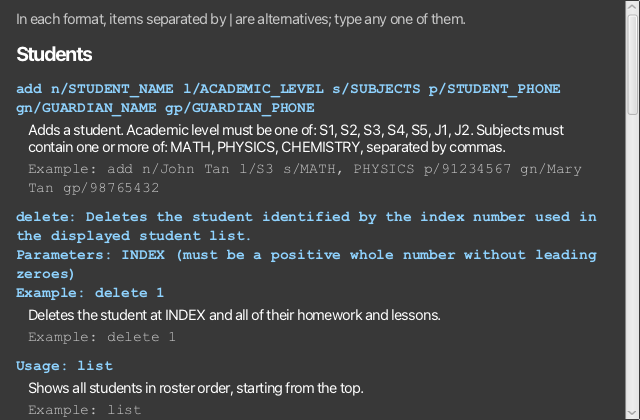

TutorFlow is a **desktop application for private tutors to manage their students, homework and regular lessons, optimized for use through a Command Line Interface (CLI)** while retaining the benefits of a Graphical User Interface (GUI). If you type quickly, TutorFlow can help you manage your students faster than traditional GUI applications.

* Table of Contents
{:toc}

--------------------------------------------------------------------------------------------------------------------

## Quick start

1. Ensure that Java `25` or later is installed on your computer.<br>
   **Mac users:** Ensure you have the precise JDK version prescribed [here](https://se-education.org/guides/tutorials/javaInstallationMac.html).

1. Download the latest `.jar` file from [here](https://github.com/AY2627S1-CS2103-F12-1/tp/releases).

1. Copy the file to the folder you want to use as the _home folder_ for TutorFlow.

1. Open a terminal, `cd` to the folder containing the JAR file, and run `java -jar addressbook.jar`.<br>
   A GUI similar to the one below should appear in a few seconds. Note how the app contains some sample data.<br>
   

1. Type a command in the command box and press Enter to execute it. For example, type **`help`** and press Enter to open the help window.<br>
   Some example commands you can try:

   * `add n/Aaron Koh l/S2 s/MATH p/91112222 gn/Koh Mei Hua gp/98887777` : Adds a student named `Aaron Koh` to the student list.

   * `list` : Lists all students.

   * `homework list 1` : Lists the upcoming homework of the 1st student shown in the student list.

   * `hw add 1 t/Algebra worksheet s/MATH due/2026-10-15` : Adds homework to the 1st student.

   * `delete 3` : Deletes the 3rd student shown in the student list.

   * `lesson list` : Lists all regular lessons in weekly chronological order.

   * `clear` : Deletes all students together with their homework and regular lessons.

   * `exit` : Exits the app.

1. Refer to the [Features](#features) section below for details of each command.

--------------------------------------------------------------------------------------------------------------------

## Features

<div markdown="block" class="alert alert-info">

**:information_source: Notes about the command format:**<br>

* Words in `UPPER_CASE` are the parameters to be supplied by the user.<br>
  For example, in `add n/NAME`, replace `NAME` with a value such as `John Doe`.

* Items in square brackets are optional.<br>
  For example, `n/NAME [t/TAG]` can be used as `n/John Doe t/friend` or as `n/John Doe`.

* Items separated by `|` are alternatives; type any one of them.<br>
  For example, `homework|hw list|ls STUDENT_INDEX` can be used as `homework list 1` or as `hw ls 1`.

* Items followed by `…`​ can appear zero or more times.<br>
  For example, `[t/TAG]…​` may be omitted, or written as `t/friend` or `t/friend t/family`.

* Parameters can be in any order.<br>
  For example, if the command specifies `n/NAME p/PHONE_NUMBER`, `p/PHONE_NUMBER n/NAME` is also acceptable.

* Extraneous parameters for commands that take no parameters, such as `help`, `exit`, and `clear`, are ignored. The `list` command rejects extra parameters.<br>
  For example, `help 123` is interpreted as `help`.

* If you are using a PDF version of this document, be careful when copying and pasting commands that span multiple lines as space characters surrounding line-breaks may be omitted when copied over to the application.
</div>

### Viewing help: `help`

Opens the help window, which lists the commands `add`, `list`, `delete`, `homework add`, `homework list`, `homework edit`, `homework marks`, `homework delete`, `lesson add`, `lesson list`, `lesson delete`, `help`, `clear` and `exit`, grouped into Students, Homework, Lessons and General. Each command is shown with its format, what it does and an example.



Format: `help`

* Pressing `F1` or choosing **Help** in the menu bar also opens the help window.
* Use the arrow keys, `Page Up` and `Page Down` to scroll the help window.
* Press `Esc` to close the help window. The cursor goes back to the command box, so you can type your next command straight away.


### Adding a student: `add`

Adds a student to the end of the student list.

Format: `add n/STUDENT_NAME l/ACADEMIC_LEVEL s/SUBJECTS p/STUDENT_PHONE gn/GUARDIAN_NAME gp/GUARDIAN_PHONE`

* All six fields are required, and each prefix must appear exactly once.
* `STUDENT_NAME` and `GUARDIAN_NAME` must be 1 to 70 characters long and may contain letters, numbers, spaces, apostrophes, hyphens, periods, parentheses and `/`. Extra spaces are removed, and capitalization is kept.
* A name may contain words such as `s/o` and `d/o`, but not this command's other prefixes (such as `p/` or `gn/`) after a space.
* `ACADEMIC_LEVEL` must be one of `S1`, `S2`, `S3`, `S4`, `S5`, `J1` or `J2` (in any case).
* `SUBJECTS` is one or more of `MATH`, `PHYSICS` and `CHEMISTRY` (in any case), separated by commas, with no subject repeated. The student card shows the subjects in the order you type them.
* `STUDENT_PHONE` and `GUARDIAN_PHONE` must each be an 8-digit Singapore number starting with 6, 8 or 9, or an international number written as `+` followed by 8 to 15 digits, without spaces.
* A student cannot be added if a student with the same name (ignoring case) and the same student phone number is already in the list.

Examples:
* `add n/Aaron Koh l/S2 s/MATH p/91112222 gn/Koh Mei Hua gp/98887777`
* `add n/Siti Rahmah binte Ismail l/j1 s/math, chemistry, physics p/87654321 gn/Ismail bin Yusof gp/+60123456789` adds a J1 student who takes all three subjects, with a Malaysian number for the guardian.
* `add gp/96543210 gn/Ramesh s/o Krishnan p/93334444 s/PHYSICS, MATH n/Kavin Ramesh l/S4` gives the fields in a different order. `s/o` in the guardian's name is part of the name, not the `s/` prefix.

### Listing all students: `list`

Shows all students in roster order, starting from the top. The displayed indexes start at 1.
If the roster is empty, the app shows `No students found.` This command does not change the roster.
With one student, the result says `Listed 1 student.`; with more students, it says `Listed N students.` using the actual count.

Format: `list` or `ls` (no parameters)

### Adding homework to a student: `homework add`

Adds a homework record to the end of a student's homework list.

Format: `homework|hw add STUDENT_INDEX title/|t/TITLE s/SUBJECT due/YYYY-MM-DD|MM-DD`

* `homework` can be shortened to `hw`, and `title/` can be shortened to `t/`.
* `STUDENT_INDEX` refers to the index number shown in the displayed student list. It **must be a positive whole number without leading zeroes**, such as 1, 2, 3, …​
* `TITLE` must be 1 to 100 characters long and must not contain line breaks or control characters (such as tabs). Extra spaces are removed, and capitalization is kept.
* A lowercase word directly followed by `/` in `TITLE` (such as `km/h` or `and/or`) is read as a prefix, so the command is rejected. Write such words with a capital letter or with spaces around the `/` instead, e.g. `And/or`, `and / or` or `km / h`.
* `SUBJECT` must be `MATH`, `PHYSICS` or `CHEMISTRY` (in any case), and the student must take that subject.
* The due date must be a real calendar date in `YYYY-MM-DD` format. Past dates are accepted, so you can record homework that was assigned earlier.
* The due date can also be given as `MM-DD`. The year is then this year, or next year if that date has already passed this year, and the result shows the year used.
* For 29 February (`02-29` or `2-29`), the year is this year only if this year is a leap year and 29 February has not passed yet. Otherwise it is next year, and if next year is not a leap year, the date is rejected. For example, `due/2-29` is rejected throughout 2026, and gives `2028-02-29` throughout 2027.
* In both formats, the month and day may have 1 or 2 digits, so `2026-2-5` means 5 February 2026 and `10-5` means 5 October. The year must have 4 digits.
* A student cannot have two homework records with the same title (ignoring case), subject and due date. The same homework can be added to different students.
* Each student card shows `Upcoming homework: N`, the number of the student's homework records due today or later.

Examples:
* `homework add 1 title/Complete algebra worksheet s/MATH due/2026-10-15`
* `hw add 1 t/Attempt mechanics questions 1-5 s/PHYSICS due/2026-10-20`
* `homework add 2 due/10-18 s/chemistry title/Revise atomic structure` adds homework due on 18 October of this year, or of next year if 18 October has passed.
* `hw add 1 t/Read chapter 3 s/physics due/10-5` adds homework due on 5 October of this year, or of next year if 5 October has passed.

### Listing a student's homework: `homework list`

Shows a student's homework that is due today or later, earliest due date first, with the score of each. Add `all` to also show overdue homework.

Format: `homework|hw list|ls STUDENT_INDEX [all]`

* `homework` can be shortened to `hw`, and `list` can be shortened to `ls`.
* `STUDENT_INDEX` follows the same rules as in `homework add`.
* Without `all`, homework due before today is left out. With `all` (in lowercase), all of the student's homework is shown.
* Homework is sorted by due date, earliest first. Homework due on the same date is shown in the order it was added.
* The result starts with `Listed N upcoming homework records for NAME.` (`Listed N homework records for NAME.` with `all`, and `record` when there is only one) and `Homework for NAME:`, followed by one line per homework with its number, title, subject, due date and score, e.g. `2. Kinematics practice set (PHYSICS) - due 2026-10-28 - score 5/10`. Homework without marks shows `score Not recorded`.
* Each homework is numbered by its position in the order the homework was added, so the numbers may appear out of order. These numbers are the `HOMEWORK_INDEX` values used by `homework edit`, `homework marks` and `homework delete`. They change only when homework is deleted.
* If the student has no homework, the result is `No homework found for NAME.` If none of the student's homework is due today or later, the result is `No upcoming homework found for NAME.`; use `all` to see the overdue homework.

Examples:
* `homework list 1`
* `hw ls 2 all` lists all homework of the 2nd student, including overdue homework.

### Editing a student's homework: `homework edit`

Changes the title, subject or due date of one homework record of a student.

Format: `homework|hw edit|e STUDENT_INDEX HOMEWORK_INDEX [title/|t/TITLE] [s/SUBJECT] [due/YYYY-MM-DD|MM-DD]`

* `homework` can be shortened to `hw`, `edit` can be shortened to `e`, and `title/` can be shortened to `t/`.
* `STUDENT_INDEX` follows the same rules as in `homework add`.
* `HOMEWORK_INDEX` refers to the number shown by `homework list STUDENT_INDEX` (or by `homework list STUDENT_INDEX all` for overdue homework). It **must be a positive whole number without leading zeroes**.
* Give at least one of `title/` (or `t/`), `s/` and `due/`, in any order and each at most once. `title/` and `t/` cannot be used together. The details you do not give stay unchanged.
* `TITLE`, `SUBJECT` and the due date follow the same rules as in [`homework add`](#adding-homework-to-a-student-homework-add). A due date in `MM-DD` form gets its year in the same way, and the result shows the year used.
* The homework keeps its number and its score. To change the score, use [`homework marks`](#recording-homework-marks-homework-marks).
* The edit is rejected if it changes nothing (`No changes made; the supplied values are identical to the existing homework details.`), or if the edited homework would have the same title (ignoring case), subject and due date as another homework of the student (`This edit would make the homework a duplicate of an existing homework record.`).
* On success, the result shows the edited homework, followed by the student's upcoming homework in the format of `homework list STUDENT_INDEX`.

Examples:
* `hw e 1 2 t/Complete algebra questions 1-10` changes the title of the 2nd homework of the 1st student.
* `hw e 2 1 due/2026-11-05` changes the due date of the 1st homework of the 2nd student. With the sample students, the result is:

  ```
  Edited homework:
  Priya Nair; Title: Integration by parts exercise; Subject: MATH; Due: 2026-11-05
  Listed 3 upcoming homework records for Priya Nair.
  Homework for Priya Nair:
  2. Organic reaction pathways map (CHEMISTRY) - due 2026-11-02 - score Not recorded
  1. Integration by parts exercise (MATH) - due 2026-11-05 - score Not recorded
  3. Chemical equilibrium past paper (CHEMISTRY) - due 2026-11-09 - score Not recorded
  ```
* `hw edit 1 2 t/Revise mechanics s/PHYSICS due/2026-11-10` changes the title, subject and due date together.
* `hw e 3 1 due/10-5` moves the due date to 5 October of this year, or of next year if 5 October has passed.

### Recording homework marks: `homework marks`

Records the marks a student obtained for one homework record, replacing any marks recorded before, or clears the recorded marks.

Format: `homework|hw marks|m STUDENT_INDEX HOMEWORK_INDEX score/[SCORE]`

* `homework` can be shortened to `hw`, and `marks` can be shortened to `m`.
* `STUDENT_INDEX` and `HOMEWORK_INDEX` follow the same rules as in `homework edit`.
* `SCORE` is written as `MARKS_OBTAINED/TOTAL_MARKS`, e.g. `5/10`. Both are whole numbers without signs, decimals, spaces or leading zeroes, and neither may be greater than 2147483647. `TOTAL_MARKS` must be at least 1, and `MARKS_OBTAINED` must be from 0 to `TOTAL_MARKS`. So `0/10` and `10/10` are accepted, but `11/10`, `5/0`, `5.5/10` and `5 / 10` are not.
* The score is kept as you give it: `5/10` is not simplified to `1/2`.
* Recording the score that the homework already has is rejected with `No changes made; the homework already has this score.`
* Homework without marks shows `Not recorded`, not `0`, in `homework list`.
* On success, the result shows the homework with its new score, e.g. `Recorded homework marks:` followed by `Ethan Lim; Title: Kinematics practice set; Subject: PHYSICS; Due: 2026-10-28; Score: 5/10`.
* Leaving `SCORE` empty (nothing or only spaces after `score/`) clears the recorded marks, so the homework shows `Not recorded` again. The result is `Cleared homework marks:` followed by the homework, e.g. `Ethan Lim; Title: Kinematics practice set; Subject: PHYSICS; Due: 2026-10-28; Score: Not recorded`. Clearing homework that has no marks is rejected with `No changes made; the homework has no recorded marks.`
* The `score/` prefix is required even when clearing: `hw m 1 2` without it is rejected.

Examples:
* `hw m 1 2 score/5/10`
* `hw m 2 1 score/35/50`
* `homework marks 4 2 score/0/10` records that the 4th student scored no marks for their 2nd homework.
* `hw m 1 2 score/` clears the marks of the 2nd homework of the 1st student.

### Deleting a student: `delete`

Deletes the specified student, together with their homework and regular lessons, from the student list. The change is saved automatically.

Format: `delete INDEX`

* `INDEX` is the number shown next to the student, starting at 1. It must be a positive whole number without leading zeroes.
* If the list is empty or the index exceeds its size, no student is deleted.
  The app shows `The student index provided is invalid.`
* Remaining students retain their order and are renumbered. Deletion cannot be undone.

Example: `delete 2` deletes the second student and their homework and regular lessons.

### Deleting a student's homework: `homework delete`

Deletes one homework record from a student.

Format: `homework|hw delete|del STUDENT_INDEX HOMEWORK_INDEX`

* `homework` can be shortened to `hw`, and `delete` can be shortened to `del`.
* `STUDENT_INDEX` follows the same rules as in `homework add`.
* `HOMEWORK_INDEX` refers to the number shown by `homework list STUDENT_INDEX` (or by `homework list STUDENT_INDEX all` for overdue homework). It **must be a positive whole number without leading zeroes**.
* The remaining homework keeps its order and is renumbered.
* Deletion cannot be undone.

Examples:
* `homework list 1` followed by `homework delete 1 2` deletes the 2nd homework of the 1st student.
* `hw del 3 1`

### Clearing all students: `clear`

Deletes all students together with their homework and regular lessons.

Format: `clear`

* Clearing cannot be undone. To keep a copy of your data, back up the data file first (see [Editing the data file](#editing-the-data-file)).

### Exiting the program: `exit`

Exits the program.

Format: `exit`

### Adding a regular lesson: `lesson add`

Adds a weekly lesson to the student at the displayed student index.

Format: `lesson add INDEX s/SUBJECT d/DAY st/START_TIME et/END_TIME`

Example: `lesson add 1 s/MATH d/MONDAY st/16:00 et/18:00`

* Use a positive student index without leading zeroes. Use `list` to see the current indices.
* Supply each prefix exactly once, in any order. Unknown prefixes are rejected.
* `SUBJECT` must be MATH, PHYSICS or CHEMISTRY and must be one of the student's tuition subjects.
* `DAY` must be a full weekday name, such as MONDAY. Subjects and days ignore case and surrounding spaces.
* Times must use the 24-hour `HH:mm` format, such as `09:00`. End time must be later than start time on the same day; overnight lessons are not supported.
* An identical lesson for the same student is rejected. Overlapping lessons across any students are rejected with the conflicting student's name and lesson details. Lessons that meet exactly at an endpoint are allowed.

On success, TutorFlow shows `New lesson added: John Tan; MATH; MONDAY; 16:00-18:00` and saves the lesson automatically. The student's position, profile and homework remain unchanged. If saving fails, the addition is undone and TutorFlow reports that no lesson data was changed.

### Deleting a regular lesson: `lesson delete`

Deletes a regular lesson from the weekly schedule. Use `lesson list` first to see the displayed lesson indices.

Format: `lesson delete LESSON_INDEX`

* `LESSON_INDEX` must be a positive whole number without leading zeroes.
* The lesson index is the number shown by `lesson list`, rather than a student index.
* The remaining lessons keep their weekly order and are renumbered.
* If there are no lessons, TutorFlow reports `There are no regular lessons to delete.`
* Deletion cannot be undone.

Example: `lesson delete 2`

### Listing all regular lessons: `lesson list`

Lists every student's regular lessons in one weekly schedule.

Format: `lesson list`

* Lessons are ordered from Monday to Sunday, then by start time.
* Lessons with the same weekday and start time are ordered by student name.
* Each row shows the student name, subject, abbreviated weekday and time range.
* If no lessons have been added, TutorFlow reports `No regular lessons found.`

Example output:

```text
Listed 2 regular lessons.
1. Ethan Lim; MATH; MON; 17:00-18:30
2. Priya Nair; CHEMISTRY; SAT; 15:00-16:30
```

### Saving the data

TutorFlow saves your students, homework and regular lessons automatically after every command that changes them. You do not need to save manually.

* Commands that do not change the data, such as `homework list`, `lesson list`, `help` and `exit`, do not write to the data file.
* If TutorFlow cannot save the data (for example, because the data file is read-only), the command is cancelled: its changes are undone and an error message is shown. Homework and lesson commands state that their respective data was not changed.

### Editing the data file

TutorFlow data is saved automatically as a JSON file `[JAR file location]/data/tutorflow.json`. Advanced users are welcome to update data directly by editing that data file.

If the data file does not exist when TutorFlow starts, for example the first time you run it, TutorFlow starts with some sample students and saves them to a new data file after the first command that changes the data. To get the sample students back, close TutorFlow, delete the data file and start TutorFlow again.

The data file holds a list of `students`. Each student can hold `homeworks` and `lessons`. For example:

```json
{
  "students" : [ {
    "name" : "Ethan Lim",
    "academicLevel" : "S3",
    "subjects" : [ "MATH", "PHYSICS" ],
    "phone" : "91234567",
    "guardianName" : "Grace Lim",
    "guardianPhone" : "98765432",
    "homeworks" : [ {
      "title" : "Quadratic equations worksheet",
      "subject" : "MATH",
      "dueDate" : "2026-10-23",
      "score" : null
    } ],
    "lessons" : [ {
      "subject" : "MATH",
      "dayOfWeek" : "MONDAY",
      "startTime" : "17:00",
      "endTime" : "18:30"
    } ]
  } ]
}
```

When editing the file, follow these rules:

* Students are shown in the app in the order they appear in the file.
* Each student needs `name`, `academicLevel`, `subjects`, `phone`, `guardianName` and `guardianPhone`, with the same rules as in [`add`](#adding-a-student-add). `subjects` is a list with one subject per entry. No two students may have the same name (ignoring case) and the same `phone`.
* `homeworks` may be left out, or written as `[ ]`, for a student with no homework.
* `lessons` may be left out, or written as `[ ]`, for a student with no regular lessons. Each lesson has `subject`, `dayOfWeek`, `startTime` and `endTime`, for example `{"subject":"MATH","dayOfWeek":"MONDAY","startTime":"16:00","endTime":"18:00"}`. The same subject, weekday, time and overlap rules as `lesson add` apply. Older files without `lessons` continue to work.
* Each homework needs `title`, `subject` and `dueDate`. `title` follows the same rules as in [`homework add`](#adding-homework-to-a-student-homework-add), and `subject` must be one of the student's `subjects`.
* `dueDate` must be a full date in `YYYY-MM-DD` format, such as `2026-10-23`. The short `MM-DD` form is not accepted in the data file, as TutorFlow never guesses the year of a saved date.
* `score` is the marks obtained and the total marks as text in `MARKS_OBTAINED/TOTAL_MARKS` format, such as `"5/10"`: whole numbers without signs, decimals or leading zeroes, a total of at least 1, and marks obtained from 0 to the total. Use `null` (or leave `score` out) if the homework has no score. A single number such as `85` is not accepted.
* A student cannot have two homework records with the same title (ignoring case), subject and due date.
* Values such as `math` or `s3` are accepted in any case, and extra spaces in names and titles are removed. TutorFlow writes them in its own format the next time it saves.
* Spell every key exactly as shown above. A misspelled key that may be left out (`homeworks`, `lessons` or `score`) is ignored without an error: for example, with `homework` instead of `homeworks`, the student loads with no homework, and the next command that changes the data removes that homework from the file. A misspelled required key, such as `phne` instead of `phone`, makes the data file invalid (see the caution below).
* Keys that TutorFlow does not use are ignored and removed the next time TutorFlow saves. For example, a data file saved by an older version of TutorFlow, in which each homework has a `status` key, still loads.

<div markdown="span" class="alert alert-warning">:exclamation: **Caution:**
If your changes make the data file invalid, TutorFlow starts with no students at the next run (not with the sample students). The invalid file remains on disk until you run a command that changes the data, which overwrites it. So if TutorFlow starts with no students after you edit the file, close it without changing anything, fix the file and start TutorFlow again. Still, we recommend backing up the file before editing it.<br>
Furthermore, certain edits can cause TutorFlow to behave in unexpected ways (e.g., if a value entered is outside of the acceptable range). Therefore, edit the data file only if you are confident that you can update it correctly.
</div>

### Archiving data files `[coming in v2.0]`

_Details coming soon ..._

--------------------------------------------------------------------------------------------------------------------

## FAQ

**Q**: How do I transfer my data to another computer?<br>
**A**: Install the app on the other computer and overwrite the data file it creates (`data/tutorflow.json`) with the data file from your previous TutorFlow home folder.

**Q**: How do I start with an empty student list instead of the sample students?<br>
**A**: Run `clear`. It deletes all students, including the sample students, and the empty list is saved.

--------------------------------------------------------------------------------------------------------------------

## Known issues

1. **When using multiple screens**, if you move the application to a secondary screen, and later switch to using only the primary screen, the GUI will open off-screen. The remedy is to delete the `preferences.json` file created by the application before running the application again.
2. **If you minimize the Help Window** and then run the `help` command (or use the `Help` menu, or the keyboard shortcut `F1`) again, the original Help Window will remain minimized, and no new Help Window will appear. The remedy is to manually restore the minimized Help Window.

--------------------------------------------------------------------------------------------------------------------

## Command summary

Action | Format, Examples
--------|------------------
**Add** | `add n/STUDENT_NAME l/ACADEMIC_LEVEL s/SUBJECTS p/STUDENT_PHONE gn/GUARDIAN_NAME gp/GUARDIAN_PHONE` <br> e.g., `add n/Aaron Koh l/S2 s/MATH p/91112222 gn/Koh Mei Hua gp/98887777`
**Clear** | `clear`
**Delete student** | `delete INDEX`<br> e.g., `delete 2`
**List** | `list` or `ls`
**Homework add** | <code>homework&#124;hw add STUDENT_INDEX title/&#124;t/TITLE s/SUBJECT due/YYYY-MM-DD&#124;MM-DD</code><br> e.g., `homework add 1 title/Complete algebra worksheet s/MATH due/2026-10-15`
**Homework delete** | <code>homework&#124;hw delete&#124;del STUDENT_INDEX HOMEWORK_INDEX</code><br> e.g., `homework delete 1 2`
**Homework edit** | <code>homework&#124;hw edit&#124;e STUDENT_INDEX HOMEWORK_INDEX [title/&#124;t/TITLE] [s/SUBJECT] [due/YYYY-MM-DD&#124;MM-DD]</code><br> e.g., `hw edit 1 2 t/Revise mechanics s/PHYSICS due/2026-11-10`
**Homework list** | <code>homework&#124;hw list&#124;ls STUDENT_INDEX [all]</code><br> e.g., `homework list 1`, `hw ls 2 all`
**Homework marks** | <code>homework&#124;hw marks&#124;m STUDENT_INDEX HOMEWORK_INDEX score/[SCORE]</code><br> e.g., `hw m 1 2 score/5/10`, `hw m 1 2 score/`
**Lesson add** | `lesson add INDEX s/SUBJECT d/DAY st/START_TIME et/END_TIME`<br> e.g., `lesson add 1 s/MATH d/MONDAY st/16:00 et/18:00`
**Lesson list** | `lesson list`
**Lesson delete** | `lesson delete LESSON_INDEX`<br> e.g., `lesson delete 2`
**Help** | `help`
**Exit** | `exit`
