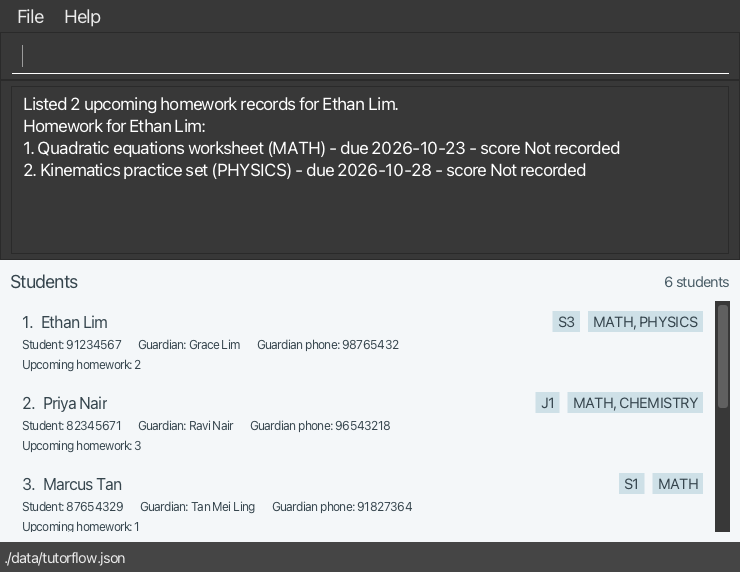

TutorFlow is a **desktop application for private tutors to manage their students, homework and regular lessons, optimized for use through a Command Line Interface (CLI)** while retaining the benefits of a Graphical User Interface (GUI). If you type quickly, TutorFlow can help you manage your students faster than traditional GUI applications.

* Table of Contents
{:toc}

--------------------------------------------------------------------------------------------------------------------

## Quick start

1. Ensure that Java `25` is installed on your computer. Run `java -version` in your terminal and check that it reports version `25`.<br>
   **Mac users:** Ensure you have the precise JDK version prescribed [here](https://se-education.org/guides/tutorials/javaInstallationMac.html).

1. Download the latest `.jar` file from [here](https://github.com/AY2627S1-CS2103-F12-1/tp/releases).

1. Copy the file to an empty, writable folder you want to use as the _home folder_ for TutorFlow. The app must be able to create its data and preferences here.

1. Open a terminal, `cd` to that home folder, and run `java -jar "addressbook.jar"` (replace the filename if your download has a different name). Keep the JAR in this folder to use the same saved records. Double-clicking may not work on some systems.<br>
   A GUI similar to the one below should appear in a few seconds. Note how the app contains some sample data.<br>
   

1. Type a command in the command box and press Enter to execute it. For example, type **`help`** and press Enter to open the help window.<br>
   Some example commands you can try:

   * `add n/Aaron Koh l/S2 s/MATH p/91112222 gn/Koh Mei Hua gp/98887777` : Adds a student named `Aaron Koh` to the student list.

   * `list` : Lists all students.

   * `edit 1 n/Updated Student` : Changes the name of the 1st student shown in the list.

   * `search Tan` : Shows students whose name, phone, guardian name or guardian phone contains `Tan`.

   * `homework list 1` : Lists the upcoming homework of the 1st student shown in the student list.

   * `hw add 1 t/Algebra worksheet s/MATH due/2026-10-15` : Adds homework to the 1st student.

   * `delete 3` : Deletes the 3rd student shown in the student list.

   * `lesson list` : Lists all regular lessons in weekly chronological order.

   * `clear` : Deletes all students together with their homework and regular lessons.

   * `exit` : Exits the app.

1. Refer to the [Features](#features) section below for details of each command.

--------------------------------------------------------------------------------------------------------------------

## Features

<div markdown="block" class="alert alert-info">

**:information_source: Notes about the command format:**<br>

* Words in `UPPER_CASE` are the parameters to be supplied by the user.<br>
  For example, in `add n/NAME`, replace `NAME` with a value such as `John Doe`.

* Items in square brackets are optional.<br>
  For example, `n/NAME [t/TAG]` can be used as `n/John Doe t/friend` or as `n/John Doe`.

* Items separated by `|` are alternatives; type any one of them.<br>
  For example, `homework|hw list|ls STUDENT_INDEX` can be used as `homework list 1` or as `hw ls 1`.

* Items followed by `…`​ can appear zero or more times.<br>
  For example, `[t/TAG]…​` may be omitted, or written as `t/friend` or `t/friend t/family`.

* Parameters can be in any order.<br>
  For example, if the command specifies `n/NAME p/PHONE_NUMBER`, `p/PHONE_NUMBER n/NAME` is also acceptable.

* A lowercase word directly followed by `/` after a space (such as `km/h` or `and/or`) is read as a prefix. To use such a word in a value, wrap the whole value in double quotes (`"`). The outer quotes are removed before the value is checked. This works for every value that follows a prefix.<br>
  For example, `hw add 1 t/"Speed in km/h" s/PHYSICS due/2026-11-01` adds homework titled `Speed in km/h`, while `hw add 1 t/Speed in km/h s/PHYSICS due/2026-11-01` is rejected because `km/` is not a prefix of `hw add`.

* Spaces at both ends of a quoted value are removed, both outside and inside the quotes, as they are for a value without quotes. Spaces between words are kept.<br>
  For example, `n/" Ravi s/o Kumar "` gives the name `Ravi s/o Kumar`, and `hw up due/" 3 "` is the same as `hw up due/3`. Empty quotes (`""`), or quotes with only spaces inside, give an empty value, which is treated like a prefix with nothing after it: `t/""` is rejected like `t/`.

* A quoted value ends at the first `"` that is followed by the end of the command, or by a space and another prefix of the same command. Any other `"` is kept as typed.<br>
  For example, `t/Read "Hamlet" act 1` gives the title `Read "Hamlet" act 1`, and `t/"Read "Hamlet" km/h"` gives `Read "Hamlet" km/h`.

* A value whose opening `"` is never closed in this way is read as typed, as if it had no quotes.<br>
  For example, `t/"Speed" extra` gives the title `"Speed" extra`, and `hw add 1 t/"Speed in km/h s/PHYSICS due/2026-11-01` is rejected because the quote is not closed, so `km/` is read as a prefix.

* Extraneous parameters for commands that take no parameters, such as `help`, `exit`, and `clear`, are ignored. The `list` command rejects extra parameters.<br>
  For example, `help 123` is interpreted as `help`.

* If you are using a PDF version of this document, be careful when copying and pasting commands that span multiple lines as space characters surrounding line-breaks may be omitted when copied over to the application.
</div>

### Viewing lessons and homework at a glance

The **At a glance** panel on the right shows every student's regular lessons in weekly chronological order and every homework record with status `ASSIGNED`, regardless of score, in due-date order, earliest first. Each entry includes the student's name, phone number and subject, so students sharing a name can be distinguished. Homework entries also show the due date; overdue homework (`ASSIGNED` and due before today) is marked `(overdue)` in bold red text.

The headings show the total number of lessons and outstanding homework tasks. Empty sections show `No regular lessons` or `No outstanding homework`. The panel updates when roster data changes and always covers all students, even while `search`, `filter` or `sort` changes the displayed student cards. Marking homework `COMPLETED` removes it from the sidebar and overdue count; recording a score alone does not. Date-sensitive entries and card counts refresh at midnight, when the window becomes active again, and before a command is run.

Drag the dividers to resize the command box, result display, student list and sidebar. You can scroll over a section's heading or padding as well as its entries while keeping the cursor in the command box.

### Viewing help: `help`

Opens the help window, which lists the commands `add`, `edit`, `list`, `search`, `filter`, `sort`, `delete`, `homework add`, `homework list`, `homework upcoming`, `homework edit`, `homework marks`, `homework delete`, `homework filter`, `homework status`, `lesson add`, `lesson list`, `lesson delete`, `lesson edit`, `help`, `clear` and `exit`, grouped into Students, Homework, Lessons and General. Each command is shown with its format, what it does and an example.

Format: `help`

* Pressing `F1` or choosing **Help** in the menu bar also opens the help window.
* Use the arrow keys, `Page Up` and `Page Down` to scroll the help window.
* Press `Esc` to close the help window. The cursor goes back to the command box, so you can type your next command straight away.


### Adding a student: `add`

Adds a student to the end of the student list.

Format: `add n/STUDENT_NAME l/ACADEMIC_LEVEL s/SUBJECTS p/STUDENT_PHONE gn/GUARDIAN_NAME gp/GUARDIAN_PHONE`

* All six fields are required, and each prefix must appear exactly once.
* `STUDENT_NAME` and `GUARDIAN_NAME` must be 1 to 70 characters long and may contain letters, numbers, spaces, apostrophes, hyphens, periods, parentheses and `/`. Extra spaces are removed, and capitalization is kept.
* A name may contain words such as `s/o` and `d/o`, but not this command's other prefixes (such as `p/` or `gn/`) after a space, unless the whole name is wrapped in double quotes (see the [notes about the command format](#features)).
* `ACADEMIC_LEVEL` must be one of `S1`, `S2`, `S3`, `S4`, `S5`, `J1` or `J2` (in any case).
* `SUBJECTS` is one or more of `MATH`, `PHYSICS` and `CHEMISTRY` (in any case), separated by commas, with no subject repeated. The student card shows the subjects in the order you type them.
* `STUDENT_PHONE` and `GUARDIAN_PHONE` must each be an 8-digit Singapore number starting with 6, 8 or 9, or an international number written as `+` followed by 8 to 15 digits, without spaces.
* A student cannot be added if a student with the same name (ignoring case) and the same student phone number is already in the list.

Examples:
* `add n/Aaron Koh l/S2 s/MATH p/91112222 gn/Koh Mei Hua gp/98887777`
* `add n/Siti Rahmah binte Ismail l/j1 s/math, chemistry, physics p/87654321 gn/Ismail bin Yusof gp/+60123456789` adds a J1 student who takes all three subjects, with a Malaysian number for the guardian.
* `add gp/96543210 gn/Ramesh s/o Krishnan p/93334444 s/PHYSICS, MATH n/Kavin Ramesh l/S4` gives the fields in a different order. `s/o` in the guardian's name is part of the name, not the `s/` prefix.

### Listing all students: `list`

Shows all students in stored roster order, starting from the top, including after a search, filter or sort. The displayed indexes start at 1.
If the roster is empty, the app shows `No students found.` This command does not change the roster.
With one student, the result says `Listed 1 student.`; with more students, it says `Listed N students.` using the actual count.

Format: `list` or `ls` (no parameters)

### Editing a student: `edit`

Changes one or more details of the student at the displayed index without removing their homework or lessons. The
change is saved automatically. In the full roster, the updated student card stays in the same position. After a
search or filter, the card remains visible only if the edited details still match. If the displayed students have
been sorted, editing does not reorder them; run `sort` again to use the updated values.

Format: `edit INDEX [n/STUDENT_NAME] [l/ACADEMIC_LEVEL] [s/SUBJECTS] [p/STUDENT_PHONE] [gn/GUARDIAN_NAME] [gp/GUARDIAN_PHONE]`

* `INDEX` is a positive whole number without leading zeroes, as shown beside the student. At least one field prefix
  must be supplied; fields you omit stay unchanged. Prefixes may be in any order, but must not be repeated.
* Edited values follow the same rules as in `add`. The new name and student phone must not duplicate another
  student's name and phone; changes to other fields do not affect identity.
* A subject cannot be removed if any of this student's homework or lessons uses it. You can add subjects while
  retaining all used subjects.
* If all supplied values are identical to the existing details, or the index is invalid, nothing is changed. If
  saving fails, the original profile, homework and lessons are restored.

Examples:
* `edit 1 l/S4 p/91234568` changes the first student's academic level and phone.
* `edit 2 gn/Ramesh s/o Krishnan gp/96543210` changes the guardian's name and phone.

### Searching for students: `search`

Shows students whose student name, student phone, guardian name or guardian phone contains the keyword. Name matching
ignores letter case. Matches stay in roster order and are numbered from 1 in the displayed list.

Format: `search KEYWORD`

* `KEYWORD` must not be blank; it can contain spaces. For example, `search Mary Tan` searches for that full phrase.
* `search 9123` can find a student by part of their phone number. `search Tan` may match a student or a guardian.
* The feedback repeats the keyword used, e.g. `Found 2 students for "Tan".` If nothing matches, TutorFlow shows
  `No students found for "Nobody".` and displays no student cards. In both cases, the feedback reminds you to type
  `list` to show all students again.
* Student indexes in subsequent commands, such as `delete 1` or `homework list 1`, refer to the currently displayed
  search results. Run `list` or `ls` to show the full roster again. Adding a student or running `homework upcoming`
  also restores the full roster.
* Searching only changes which students are displayed; it does not change the saved roster.
* A new search replaces any active filter and searches the full roster.

### Filtering students: `filter`

Shows students at an academic level, taking a tuition subject, or satisfying both conditions.

Format: `filter [l/LEVEL] [s/SUBJECT]`

* Supply at least one filter. Each prefix may appear only once, in either order.
* `LEVEL` must be `S1`, `S2`, `S3`, `S4`, `S5`, `J1` or `J2`.
* `SUBJECT` must be one of `MATH`, `PHYSICS` or `CHEMISTRY`. A student taking several subjects matches if one
  of them is the selected subject. Supply only one subject to the filter command.
* Values ignore letter case and surrounding whitespace, so `s/Math` matches `MATH`.
* With both filters, a student must match **both**. Matches retain roster order and receive displayed indexes
  starting at 1. Subsequent student-index commands use these displayed indexes.
* Each filter examines the full roster and replaces any previous search or filter. To show all students again,
  run `list` or `ls`. Adding a student or running `homework upcoming` also restores the full roster.
* Filtering changes only the displayed students. It does not change records or write to the data file.

Examples:

* `filter l/S4` shows every S4 student.
* `filter s/Math` shows every student taking MATH, including those taking other subjects too.
* `filter l/S4 s/Math` and `filter s/Math l/S4` both show S4 students taking MATH.

For matches, the feedback is `Found N student(s)`, using the actual count. If nothing matches, including when
the roster is empty, no student cards are displayed and the feedback is `No students match the selected filters`.

With no filters, TutorFlow shows:

```text
Invalid Command Format
Usage: filter [l/LEVEL] [s/SUBJECT]
At least one filter must be provided
```

Other invalid commands report:

| Problem | Feedback |
| --- | --- |
| Unknown prefix or text before the first prefix | `Invalid command format`, followed by `Usage: filter [l/LEVEL] [s/SUBJECT]` on the next line |
| Repeated prefix | `Each filter may only be specified once` |
| Empty or unsupported level | `Academic level must be a non-empty value` |
| Empty or unsupported subject | `Subject must be a non-empty value` |

Invalid commands leave the displayed students, selection, scroll position and data file unchanged.
If an internal problem prevents rendering, TutorFlow shows
`TutorFlow could not display the filtered results due to an internal error`. Student records remain unchanged;
you can retry the filter or use `list` to show all students again.

### Sorting displayed students: `sort`

Orders the displayed students while preserving any current search or filter results and the saved roster order.

Format: `sort by/KEY [o/ORDER]`

* Give exactly one `by/` parameter. `KEY` is `level`, `subject` or `day`.
* `ORDER` is `asc` (the default) or `desc`. Values ignore letter case and surrounding spaces.
  The parameters may appear in either order, and each prefix may appear only once.

Key | Ascending order | Value used per student
----|-----------------|----------------------
`level` | `S1`, `S2`, `S3`, `S4`, `S5`, `J1`, `J2` | The student's academic level
`subject` | Alphabetical, ignoring case | Alphabetically first subject, e.g. `MATH` for `PHYSICS, MATH`
`day` | Monday through Sunday | Earliest regular meeting day; meeting times are ignored

Descending uses the same value in reverse order. Students without regular meetings stay last in both directions.
Students with equal values, including those without meetings, retain their order immediately before this command.

Examples:

* `sort by/level` orders students by academic level, ascending.
* `sort by/subject o/desc` orders students by their alphabetically first subject, descending.
* `sort o/ASC by/ DAY` orders students by earliest regular meeting day, ascending.

The feedback is `Sorted N student(s) by academic level (ascending).`, with the actual count, key and direction.
An empty result reports `No students to sort.` Sorting one student also succeeds.

Displayed indexes restart at 1. Subsequent commands such as `delete 1`, `lesson add 1` and `homework list 1`
use these displayed positions. `list` restores the complete roster in stored order. A new search uses its own
roster ordering; successful `add` and `homework upcoming` also restore the full roster in stored order.
A new `filter` command also discards the previous sort and displays matching students in stored roster order.
Sorting does not edit student records, change the data file or trigger a save.

Sorting is applied once. If a student's academic level, subjects or regular meetings change, the student keeps
their displayed position while they still match the active search or filter. Students who no longer match disappear
from the view. Run `sort` again to order the updated values. For example, after `sort by/day`, deleting the first
student's only meeting leaves them first. Running `sort by/day` again moves them behind students with meetings.

Invalid input leaves the current roster, order, selection and scroll position unchanged:

Condition | Message
----------|--------
Missing `by/` | `Invalid command format` followed by `Usage: sort by/KEY [o/ORDER]` and `Exactly one sort key must be provided` on separate lines
Unknown prefix or text before the parameters | `Invalid command format` followed by `Usage: sort by/KEY [o/ORDER]` on a new line
Repeated prefix | `Each sort parameter may only be specified once`
Empty or invalid key | `Sort key must be one of: level, subject, day.`
Empty or invalid order | `Sort order must be either asc or desc.`

If sorting or rendering fails unexpectedly, TutorFlow restores the previous displayed view and shows
`TutorFlow could not sort the students due to an internal error.` Technical details are recorded in the logs.

### Adding homework to a student: `homework add`

Adds a homework record to the end of a student's homework list.

Format: `homework|hw add STUDENT_INDEX title/|t/TITLE s/SUBJECT due/YYYY-MM-DD|MM-DD`

* `homework` can be shortened to `hw`, and `title/` can be shortened to `t/`.
* `STUDENT_INDEX` refers to the index number shown in the displayed student list. It **must be a positive whole number without leading zeroes**, such as 1, 2, 3, …​
* `TITLE` must be 1 to 100 characters long and must not contain line breaks or control characters (such as tabs). Extra spaces are removed, and capitalization is kept.
* A lowercase word directly followed by `/` in `TITLE` (such as `km/h` or `and/or`) is read as a prefix, so the command is rejected. Wrap the title in double quotes to keep such words, e.g. `t/"Speed in km/h"` (see the [notes about the command format](#features)).
* `SUBJECT` must be `MATH`, `PHYSICS` or `CHEMISTRY` (in any case), and the student must take that subject.
* The due date must be a real calendar date in `YYYY-MM-DD` format. Past dates are accepted, so you can record homework that was assigned earlier.
* The due date can also be given as `MM-DD`. The year is then this year, or next year if that date has already passed this year, and the result shows the year used.
* For 29 February (`02-29` or `2-29`), the year is this year only if this year is a leap year and 29 February has not passed yet. Otherwise it is next year, and if next year is not a leap year, the date is rejected. For example, `due/2-29` is rejected throughout 2026, and gives `2028-02-29` throughout 2027.
* In both formats, the month and day may have 1 or 2 digits, so `2026-2-5` means 5 February 2026 and `10-5` means 5 October. The year must have 4 digits.
* A student cannot have two homework records with the same title (ignoring case), subject and due date. The same homework can be added to different students. New homework starts as `ASSIGNED` with no recorded score.
* Each student card shows `Upcoming homework: N`, the number of the student's homework records due today or later (including scored or completed homework), and `Overdue homework: N`, the number of `ASSIGNED` homework records due before today, regardless of score.

Examples:
* `homework add 1 title/Complete algebra worksheet s/MATH due/2026-10-15`
* `hw add 1 t/Attempt mechanics questions 1-5 s/PHYSICS due/2026-10-20`
* `homework add 2 due/10-18 s/chemistry title/Revise atomic structure` adds homework due on 18 October of this year, or of next year if 18 October has passed.
* `hw add 1 t/Read chapter 3 s/physics due/10-5` adds homework due on 5 October of this year, or of next year if 5 October has passed.
* `hw add 1 t/"Speed in km/h" s/PHYSICS due/2026-11-01` adds homework titled `Speed in km/h`; the quotes keep `km/h` in the title.

### Listing a student's homework: `homework list`

Shows a student's homework that is due today or later, earliest due date first, with the score and completion status of each. Add `all` to also show overdue homework. Listing includes both assigned and completed homework; use `homework filter` to narrow by completion status.

Format: `homework|hw list|ls STUDENT_INDEX [all]`

* `homework` can be shortened to `hw`, and `list` can be shortened to `ls`.
* `STUDENT_INDEX` follows the same rules as in `homework add`.
* Without `all`, homework due before today is left out. With `all` (in lowercase), all of the student's homework is shown.
* Homework is sorted by due date, earliest first. Homework due on the same date is shown in the order it was added.
* The result starts with `Listed N upcoming homework records for NAME.` (`Listed N homework records for NAME.` with `all`, and `record` when there is only one) and `Homework for NAME:`, followed by one line per homework with its number, title, subject, due date, score and status, e.g. `2. Kinematics practice set (PHYSICS) - due 2026-10-28 - score 5/10 - status ASSIGNED`. Homework without marks shows `score Not recorded`.
* Each homework is numbered by its position in the order the homework was added, so the numbers may appear out of order. These numbers are the `HOMEWORK_INDEX` values used by `homework edit`, `homework marks` and `homework delete`. They change only when homework is deleted.
* If the student has no homework, the result is `No homework found for NAME.` If none of the student's homework is due today or later, the result is `No upcoming homework found for NAME.`; use `all` to see the overdue homework.

Examples:
* `homework list 1`
* `hw ls 2 all` lists all homework of the 2nd student, including overdue homework.

### Listing upcoming homework of all students: `homework upcoming`

Shows the homework of all students that is due in the next few days, earliest due date first, with the score of each.

Format: `homework|hw upcoming|up [due/DAYS]`

* `homework` can be shortened to `hw`, and `upcoming` can be shortened to `up`.
* `DAYS` is a **number of days, not a date**: the homework shown is due from today to `DAYS` days after today, both days included. For example, on 2026-10-17, `due/3` shows homework due from 2026-10-17 to 2026-10-20, and `due/0` shows homework due today only.
* `DAYS` must be a whole number from 0 to 365 without signs, decimals, spaces or leading zeroes (`0` itself is accepted). If `due/` is left out, `DAYS` is 7.
* Homework due before today is left out. Homework is shown whether or not it has marks, including completed homework. Upcoming lists and student-card counts are based on due dates; use `homework filter status/ASSIGNED` to find unfinished work.
* The homework of every student is searched, not only the students shown in the student list.
* Like [`list`](#listing-all-students-list), this command shows all students in the student list again, even when no homework is due. So after a search or filter, `Student N` still matches the student list.
* Homework is sorted by due date, earliest first. Homework due on the same date is shown in the order of the students in the student list, and then in the order it was added.
* The result starts with `Found N homework records due from START to END.` (`record` when there is only one), followed by one line per homework with the student's `STUDENT_INDEX` and name, title, subject, due date, score and status, e.g. `Student 1: Ethan Lim; Quadratic equations worksheet; MATH; Due: 2026-10-23; Score: 5/10; Status: ASSIGNED`. Homework without marks shows `Score: Not recorded`.
* `Student N` is the index of the student in the displayed student list, the `STUDENT_INDEX` that other commands take. It tells apart students with the same name.
* If no homework is due in that period, the result is `No homework due from START to END.`
* The lines are not numbered, and their order is not the `HOMEWORK_INDEX` used by other homework commands. To edit, score or delete a record shown here, find its number with [`homework list STUDENT_INDEX`](#listing-a-students-homework-homework-list), using the student index shown after `Student`.
* This command does not change your data.

Examples:
* `hw up` shows the homework due in the next 7 days. With the sample students on 2026-10-17, the result is:

  ```
  Found 1 homework record due from 2026-10-17 to 2026-10-24.
  Student 1: Ethan Lim; Quadratic equations worksheet; MATH; Due: 2026-10-23; Score: Not recorded; Status: ASSIGNED
  ```
* `hw up due/3` shows the homework due from today to 3 days later. With the sample students on 2026-10-17, the result is `No homework due from 2026-10-17 to 2026-10-20.`
* `hw up due/7` is the same as `hw up`.
* `hw up due/0` shows the homework due today.
* `hw upcoming due/7` is the same as `hw up due/7`.

### Editing a student's homework: `homework edit`

Changes the title, subject or due date of one homework record of a student.

Format: `homework|hw edit|e STUDENT_INDEX HOMEWORK_INDEX [title/|t/TITLE] [s/SUBJECT] [due/YYYY-MM-DD|MM-DD]`

* `homework` can be shortened to `hw`, `edit` can be shortened to `e`, and `title/` can be shortened to `t/`.
* `STUDENT_INDEX` follows the same rules as in `homework add`.
* `HOMEWORK_INDEX` refers to the number shown by `homework list STUDENT_INDEX` (or by `homework list STUDENT_INDEX all` for overdue homework). It **must be a positive whole number without leading zeroes**.
* Give at least one of `title/` (or `t/`), `s/` and `due/`, in any order and each at most once. `title/` and `t/` cannot be used together. The details you do not give stay unchanged.
* `TITLE`, `SUBJECT` and the due date follow the same rules as in [`homework add`](#adding-homework-to-a-student-homework-add). A due date in `MM-DD` form gets its year in the same way, and the result shows the year used.
* The homework keeps its number, score and completion status. To change the score, use [`homework marks`](#recording-homework-marks-homework-marks).
* The edit is rejected if it changes nothing (`No changes made; the supplied values are identical to the existing homework details.`), or if the edited homework would have the same title (ignoring case), subject and due date as another homework of the student (`This edit would make the homework a duplicate of an existing homework record.`).
* On success, the result shows the edited homework, followed by the student's upcoming homework in the format of `homework list STUDENT_INDEX`.

Examples:
* `hw e 1 2 t/Complete algebra questions 1-10` changes the title of the 2nd homework of the 1st student.
* `hw e 2 1 due/2026-11-05` changes the due date of the 1st homework of the 2nd student. With the sample students, the result is:

  ```
  Edited homework:
  Priya Nair; Title: Integration by parts exercise; Subject: MATH; Due: 2026-11-05
  Listed 3 upcoming homework records for Priya Nair.
  Homework for Priya Nair:
  2. Organic reaction pathways map (CHEMISTRY) - due 2026-11-02 - score Not recorded - status ASSIGNED
  1. Integration by parts exercise (MATH) - due 2026-11-05 - score Not recorded - status ASSIGNED
  3. Chemical equilibrium past paper (CHEMISTRY) - due 2026-11-09 - score Not recorded - status ASSIGNED
  ```
* `hw edit 1 2 t/Revise mechanics s/PHYSICS due/2026-11-10` changes the title, subject and due date together.
* `hw e 1 2 t/"Speed in km/h"` changes the title to `Speed in km/h`.
* `hw e 3 1 due/10-5` moves the due date to 5 October of this year, or of next year if 5 October has passed.

### Recording homework marks: `homework marks`

Records the marks a student obtained for one homework record, replacing any marks recorded before, or clears the recorded marks.

Format: `homework|hw marks|m STUDENT_INDEX HOMEWORK_INDEX score/[SCORE]`

* `homework` can be shortened to `hw`, and `marks` can be shortened to `m`.
* `STUDENT_INDEX` and `HOMEWORK_INDEX` follow the same rules as in `homework edit`.
* `SCORE` is either the marks on their own, e.g. `17`, or `MARKS_OBTAINED/TOTAL_MARKS`, e.g. `5/10`, when the homework has a total.
* Every number in `SCORE` is a whole number without a sign, decimals, spaces or leading zeroes, and no greater than 2147483647. So `0`, `17` and `150` are accepted, but `-1`, `+17`, `017` and `17.5` are not.
* With a total, `TOTAL_MARKS` must be at least 1, and `MARKS_OBTAINED` must be from 0 to `TOTAL_MARKS`. So `0/10` and `10/10` are accepted, but `11/10`, `5/0`, `5.5/10` and `5 / 10` are not.
* The score is kept and shown as you give it: `5/10` is not simplified to `1/2`, and `17` and `17/20` are different scores.
* Recording the score that the homework already has is rejected with `No changes made; the homework already has this score.`
* Homework without marks shows `Not recorded`, not `0`, in `homework list`.
* On success, the result shows the homework with its new score, e.g. `Recorded homework marks:` followed by `Ethan Lim; Title: Kinematics practice set; Subject: PHYSICS; Due: 2026-10-28; Score: 5/10`.
* Leaving `SCORE` empty (nothing or only spaces after `score/`) clears the recorded marks, so the homework shows `Not recorded` again. The result is `Cleared homework marks:` followed by the homework, e.g. `Ethan Lim; Title: Kinematics practice set; Subject: PHYSICS; Due: 2026-10-28; Score: Not recorded`. Clearing homework that has no marks is rejected with `No changes made; the homework has no recorded marks.`
* The `score/` prefix is required even when clearing: `hw m 1 2` without it is rejected.

Examples:
* `hw m 1 2 score/5/10`
* `hw m 1 2 score/17` records 17 marks, without a total, for the 2nd homework of the 1st student.
* `hw m 2 1 score/35/50`
* `homework marks 4 2 score/0/10` records that the 4th student scored no marks for their 2nd homework.
* `hw m 1 2 score/` clears the marks of the 2nd homework of the 1st student.

### Deleting a student: `delete`

Deletes the specified student, together with their homework and regular lessons, from the student list. The change is saved automatically.

Format: `delete INDEX`

* `INDEX` is the number shown next to the student, starting at 1. It must be a positive whole number without leading zeroes.
* If the list is empty or the index exceeds its size, no student is deleted.
  The app shows `The student index provided is invalid.`
* Remaining students retain their order and are renumbered. Deletion cannot be undone.

Example: `delete 2` deletes the second student and their homework and regular lessons.

### Deleting a student's homework: `homework delete`

Deletes one homework record from a student.

Format: `homework|hw delete|del STUDENT_INDEX HOMEWORK_INDEX`

* `homework` can be shortened to `hw`, and `delete` can be shortened to `del`.
* `STUDENT_INDEX` follows the same rules as in `homework add`.
* `HOMEWORK_INDEX` refers to the number shown by `homework list STUDENT_INDEX` (or by `homework list STUDENT_INDEX all` for overdue homework). It **must be a positive whole number without leading zeroes**.
* The remaining homework keeps its order and is renumbered.
* Deletion cannot be undone.

Examples:
* `homework list 1` followed by `homework delete 1 2` deletes the 2nd homework of the 1st student.
* `hw del 3 1`

### Updating homework completion: `homework status`

Marks homework completed or reopens it as assigned, independently of its score.

Format: `homework|hw status STUDENT_INDEX HOMEWORK_INDEX status/STATUS`

* `STUDENT_INDEX` selects a student in the current displayed order. `HOMEWORK_INDEX` is the original homework number shown by `homework list STUDENT_INDEX all` or `homework filter`. Both indices must be positive whole numbers without leading zeroes.
* `STATUS` is `ASSIGNED` or `COMPLETED`, ignoring case and surrounding spaces. Supply `status/` exactly once. Empty or unsupported values and extra arguments are rejected.
* `COMPLETED` marks homework complete, even if it has no score. `ASSIGNED` reopens it, retaining any score. Recording, replacing or clearing a score does not change completion status. Editing the homework's title, subject or due date also preserves status.
* The homework retains its insertion position and all other fields. If it already has the requested status, TutorFlow reports that no changes were made.
* Changes are saved automatically. If saving fails, TutorFlow restores the original homework and reports that no homework data was changed.

Examples:

* `hw status 1 2 status/COMPLETED` marks homework 2 of displayed student 1 completed.
* `hw status 1 2 status/ASSIGNED` reopens that homework without changing its score.
* `hw filter 1 status/COMPLETED` shows that student's completed homework, including overdue records.

### Filtering homework: `homework filter`

Lists homework matching a student, subject, exact due date and/or completion status.

Format: `homework|hw filter [STUDENT_INDEX] [s/SUBJECT] [due/DATE] [status/STATUS]`

* Supply at least one criterion. All supplied criteria must match (AND).
* Without `STUDENT_INDEX`, searches homework of every currently displayed student. Run `list` first to include the full roster. An index selects one student in the current displayed order, including after searching, filtering or sorting students.
* `STUDENT_INDEX` must be a positive whole number without leading zeroes. Put it before the prefixes.
* `SUBJECT` is MATH, PHYSICS or CHEMISTRY, ignoring case. Each prefix may appear once, in any order; unknown prefixes and empty values are rejected.
* `DATE` is an exact due date in `YYYY-MM-DD` or `MM-DD` format, with one or two digits for the month and day. Short dates infer this year or the next year if the date has passed, as in `homework add`. Use a full date to find overdue homework. Here `due/` takes a date; in `homework upcoming` it takes a number of days.
* Includes overdue homework and homework with or without scores. `STATUS` is `ASSIGNED` or `COMPLETED`, ignoring case; it must match the explicit status, independently of the score. Omit `status/` to include both states.
* Results follow displayed student order, then homework insertion order. Each line identifies both `Student N` and `Homework M`, which can be used directly in homework edit, marks and delete commands while the lists remain unchanged. The command preserves the displayed students, sorting and stored data.
* If nothing matches, TutorFlow reports `No homework matches the supplied filters.`

Examples:

* `hw filter 1` lists all homework of displayed student 1, including overdue homework.
* `hw filter s/PHYSICS` lists Physics homework among displayed students.
* `hw filter due/2026-10-20` lists homework due on 20 October 2026.
* `hw filter 1 s/MATH due/2026-10-15` lists student 1's Math homework due on 15 October 2026.
* `hw filter 1 s/MATH due/2026-10-15 status/ASSIGNED` adds the condition that the homework is still assigned.
* `hw filter status/COMPLETED` lists completed homework among displayed students, whether or not a score is recorded.

For a matching assignment, a result line looks like `Student 1: John Tan; Homework 2: Algebra; MATH; Due: 2026-10-15; Score: Not recorded; Status: ASSIGNED`. Use `hw edit 1 2 t/Algebra practice` to edit that assignment.

### Clearing all students: `clear`

Deletes all students together with their homework and regular lessons.

Format: `clear`

* Clearing cannot be undone. To keep a copy of your data, back up the data file first (see [Editing the data file](#editing-the-data-file)).

### Exiting the program: `exit`

Exits the program.

Format: `exit`

### Adding a regular lesson: `lesson add`

Each lesson belongs to one student. All overlapping lessons are rejected as tutor clashes, including lessons belonging to different students. Simultaneous group lessons are not supported.

Adds a weekly lesson to the student at the displayed student index.

Format: `lesson add INDEX s/SUBJECT d/DAY st/START_TIME et/END_TIME`

Example: `lesson add 1 s/MATH d/MONDAY st/16:00 et/18:00`

* Use a positive student index without leading zeroes. Use `list` to see the current indices.
* Supply each prefix exactly once, in any order. Unknown prefixes are rejected.
* `SUBJECT` must be MATH, PHYSICS or CHEMISTRY and must be one of the student's tuition subjects.
* `DAY` must be a full weekday name, such as MONDAY. Subjects and days ignore case and surrounding spaces.
* Times must use the 24-hour `HH:mm` format, such as `09:00`. End time must be later than start time on the same day; overnight lessons are not supported.
* An identical lesson for the same student is rejected. A lesson that overlaps any existing lesson, for any student, is rejected. TutorFlow lists every conflicting lesson, with its student's name and lesson details, in weekly order. Lessons that meet exactly at an endpoint are allowed.

On success, TutorFlow shows `New lesson added: John Tan (91234567); MATH; MONDAY; 16:00-18:00` (using John's student phone) and saves the lesson automatically. The student's position, profile and homework remain unchanged. If saving fails, the addition is undone and TutorFlow reports that no lesson data was changed.

### Editing a regular lesson: `lesson edit`

Updates a regular lesson identified by its number in `lesson list`.

Format: `lesson edit LESSON_INDEX [s/SUBJECT] [d/DAY] [st/START_TIME] [et/END_TIME]`

* Run `lesson list` first. `LESSON_INDEX` is a positive whole number without leading zeroes, referring to the full weekly schedule, including lessons whose students are hidden by a student search or filter.
* Supply at least one field. Omitted fields retain their original values. Prefixes may appear once, in any order; unknown prefixes and empty values are rejected. Subjects, weekdays and times follow the rules for `lesson add`.
* The proposed end must be after the proposed start, using the existing value for any omitted time. The student must take the proposed subject.
* TutorFlow checks the proposed day and times against every other lesson in the full roster, including the same student's other lessons and lessons hidden by a student search or filter. Only the original lesson is excluded. Changing just the subject is allowed when it is one of the student's tuition subjects.
* Lessons clash when they share a weekday and their times overlap, even by one minute. Lessons on different weekdays and lessons that meet exactly at an endpoint are allowed. If there are multiple clashes, all are listed in weekly order. Duplicates and edits that change no values are rejected.
* A rejected edit leaves the original lesson, displayed student list and saved data unchanged. The error identifies each conflicting student's name and phone, subject, weekday and times so you can choose another slot.
* The lesson remains with the same student, preserving their profile, homework and lesson insertion order. Its weekly schedule number may change after an edit; run `lesson list` again before another edit or deletion.
* The edit is saved automatically. If saving fails, TutorFlow restores the original data and reports that no lesson data was changed.

Examples:

* `lesson edit 1 d/TUESDAY` moves the first lesson to Tuesday, retaining its subject and times.
* `lesson edit 1 st/17:00 et/19:00` changes both times of the first lesson.

For example, suppose John Tan has a Monday lesson at 16:00-18:00 and Mary Lim (student phone 91234568) has one at 18:00-19:00. Editing John's lesson with `lesson edit 1 et/18:30` is rejected with `This lesson clashes with an existing lesson: Mary Lim (91234568); MATH; MONDAY; 18:00-19:00` (assuming Mary's subject is MATH). Editing John's lesson with `lesson edit 1 st/17:00` succeeds: 17:00-18:00 overlaps only its own original slot and ends exactly when Mary's lesson starts. The same checks apply after restarting TutorFlow.

### Deleting a regular lesson: `lesson delete`

Deletes a regular lesson from the weekly schedule. Use `lesson list` first to see the displayed lesson indices.

Format: `lesson delete LESSON_INDEX`

* `LESSON_INDEX` must be a positive whole number without leading zeroes.
* The lesson index is the number shown by `lesson list`, rather than a student index.
* The remaining lessons keep their weekly order and are renumbered.
* If there are no lessons, TutorFlow reports `There are no regular lessons to delete.`
* Deletion cannot be undone.

Example: `lesson delete 2`

### Listing all regular lessons: `lesson list`

Lists every student's regular lessons in one weekly schedule.

Format: `lesson list`

* Lessons are ordered from Monday to Sunday, then by start time.
* Lessons with the same weekday and start time are ordered by student name.
* Each row shows the student name and phone, subject, abbreviated weekday and time range. The phone distinguishes students who share a name; lesson add, edit, delete and clash feedback use the same owner details.
* If no lessons have been added, TutorFlow reports `No regular lessons found.`

Example output:

```text
Listed 2 regular lessons.
1. Ethan Lim (91234567); MATH; MON; 17:00-18:30
2. Priya Nair (82345671); CHEMISTRY; SAT; 15:00-16:30
```

### Saving the data

TutorFlow saves your students, homework and regular lessons automatically after every command that changes them. You do not need to save manually.

* Commands that do not change the data, such as `filter`, `search`, `list`, `homework list`, `homework upcoming`, `lesson list`, `help` and `exit`, do not write to the data file.
* If TutorFlow cannot save the data (for example, because the data file is read-only), the command is cancelled: its changes are undone and an error message is shown. Homework and lesson commands state that their respective data was not changed.
* If another copy of TutorFlow or an editor changes the data file, a stale session refuses to overwrite it. Restart TutorFlow to load the latest data before making more changes. If another copy is saving at the same moment, wait for it to finish and try again.

### Editing the data file

TutorFlow data is saved automatically as `data/tutorflow.json` inside the folder containing the JAR. Preferences (`preferences.json`) and log files (`addressbook.log.*`) stay in that same home folder. Launching the JAR by its full path from a different terminal folder still uses the files beside the JAR. The status bar shows the full data path.

To move TutorFlow, close it and copy the JAR together with its `data` folder and `preferences.json` to the new folder. If you previously launched v1.4 from a different terminal folder, copy your saved files from that folder into the folder containing the JAR before starting v1.5; back up both locations first. The JSON format remains compatible.

Advanced users may edit this JSON file while TutorFlow is closed. Back it up first.

If the data file does not exist when TutorFlow starts, for example the first time you run it, TutorFlow starts with some sample students and saves them to a new data file after the first command that changes the data. To get the sample students back, close TutorFlow, delete the data file and start TutorFlow again.

The data file holds a list of `students`. Each student can hold `homeworks` and `lessons`. For example:

```json
{
  "students" : [ {
    "name" : "Ethan Lim",
    "academicLevel" : "S3",
    "subjects" : [ "MATH", "PHYSICS" ],
    "phone" : "91234567",
    "guardianName" : "Grace Lim",
    "guardianPhone" : "98765432",
    "homeworks" : [ {
      "title" : "Quadratic equations worksheet",
      "subject" : "MATH",
      "dueDate" : "2026-10-23",
      "score" : null,
      "status" : "ASSIGNED"
    } ],
    "lessons" : [ {
      "subject" : "MATH",
      "dayOfWeek" : "MONDAY",
      "startTime" : "17:00",
      "endTime" : "18:30"
    } ]
  } ]
}
```

When editing the file, follow these rules:

* Students are shown in the app in the order they appear in the file.
* Each student needs `name`, `academicLevel`, `subjects`, `phone`, `guardianName` and `guardianPhone`, with the same rules as in [`add`](#adding-a-student-add). `subjects` is a list with one subject per entry. No two students may have the same name (ignoring case) and the same `phone`.
* `homeworks` may be left out, or written as `[ ]`, for a student with no homework.
* `lessons` may be left out, or written as `[ ]`, for a student with no regular lessons. Each lesson has `subject`, `dayOfWeek`, `startTime` and `endTime`, for example `{"subject":"MATH","dayOfWeek":"MONDAY","startTime":"16:00","endTime":"18:00"}`. The same subject, weekday, time and overlap rules as `lesson add` apply. Older files without `lessons` continue to work.
* Each homework needs `title`, `subject` and `dueDate`. `title` follows the same rules as in [`homework add`](#adding-homework-to-a-student-homework-add), and `subject` must be one of the student's `subjects`.
* `dueDate` must be a full date in `YYYY-MM-DD` format, such as `2026-10-23`. The short `MM-DD` form is not accepted in the data file, as TutorFlow never guesses the year of a saved date.
* `score` is text in the same format as `SCORE` in [`homework marks`](#recording-homework-marks-homework-marks): the marks on their own, such as `"17"`, or `MARKS_OBTAINED/TOTAL_MARKS`, such as `"5/10"`. Use `null` (or leave `score` out) if the homework has no score. A score saved by an older version of TutorFlow as a number without quotes, such as `85`, loads as the score `85` and is saved as `"85"` the next time TutorFlow saves. A number that is not a valid score, such as `85.5` or `-3`, is ignored: the homework loads with no score (`Not recorded`) and the rest of the file loads as usual. Invalid text, such as `"85.5"` or `"abc"`, makes the data file invalid.
* A student cannot have two homework records with the same title (ignoring case), subject and due date.
* Values such as `math` or `s3` are accepted in any case, and extra spaces in names and titles are removed. TutorFlow writes them in its own format the next time it saves.
* Spell every key exactly as shown above. A misspelled key that may be left out (`homeworks`, `lessons` or `score`) is ignored without an error: for example, with `homework` instead of `homeworks`, the student loads with no homework, and the next command that changes the data removes that homework from the file. A misspelled required key, such as `phne` instead of `phone`, makes the data file invalid (see the caution below).
* `status` is `"ASSIGNED"` or `"COMPLETED"`, independent of `score`. Older files that include this key retain their explicit status. Missing or `null` status loads as `ASSIGNED`, including for scored homework; update historical records with `homework status` when needed. An invalid explicit status makes the data file invalid.
* Keys that TutorFlow does not use are ignored and removed the next time TutorFlow saves.

<div markdown="span" class="alert alert-warning">:exclamation: **Caution:**
If the data file cannot be read or contains invalid data, TutorFlow shows an error with the full file path and stops before opening the roster. The original data file remains unchanged. Close the error dialog, restore a valid backup or correct the file, and restart from the same home folder. To start with sample data instead, move the original file to a safe location before restarting; keep it if you need to recover records.<br>
Furthermore, certain edits can cause TutorFlow to behave in unexpected ways (e.g., if a value entered is outside of the acceptable range). Therefore, edit the data file only if you are confident that you can update it correctly.
</div>

--------------------------------------------------------------------------------------------------------------------

## FAQ

**Q**: How do I transfer my data to another computer?<br>
**A**: Install the app on the other computer and overwrite the data file it creates (`data/tutorflow.json`) with the data file from your previous TutorFlow home folder.

**Q**: How do I start with an empty student list instead of the sample students?<br>
**A**: Run `clear`. It deletes all students, including the sample students, and the empty list is saved.

--------------------------------------------------------------------------------------------------------------------

## Known issues

1. **When using multiple screens**, if you move the application to a secondary screen, and later switch to using only the primary screen, the GUI will open off-screen. The remedy is to delete the `preferences.json` file created by the application before running the application again.
2. **If you minimize the Help Window** and then run the `help` command (or use the `Help` menu, or the keyboard shortcut `F1`) again, the original Help Window will remain minimized, and no new Help Window will appear. The remedy is to manually restore the minimized Help Window.

--------------------------------------------------------------------------------------------------------------------

## Command summary

Action | Format, Examples
--------|------------------
**Add** | `add n/STUDENT_NAME l/ACADEMIC_LEVEL s/SUBJECTS p/STUDENT_PHONE gn/GUARDIAN_NAME gp/GUARDIAN_PHONE` <br> e.g., `add n/Aaron Koh l/S2 s/MATH p/91112222 gn/Koh Mei Hua gp/98887777`
**Clear** | `clear`
**Delete student** | `delete INDEX`<br> e.g., `delete 2`
**Edit student** | `edit INDEX [n/STUDENT_NAME] [l/ACADEMIC_LEVEL] [s/SUBJECTS] [p/STUDENT_PHONE] [gn/GUARDIAN_NAME] [gp/GUARDIAN_PHONE]`<br> e.g., `edit 1 l/S4 p/91234568`
**List** | `list` or `ls`
**Search** | `search KEYWORD`<br> e.g., `search Tan`
**Filter** | `filter [l/LEVEL] [s/SUBJECT]`<br> e.g., `filter l/S4 s/Math`
**Sort** | `sort by/KEY [o/ORDER]`<br> e.g., `sort by/level`, `sort by/day o/desc`
**Homework add** | <code>homework&#124;hw add STUDENT_INDEX title/&#124;t/TITLE s/SUBJECT due/YYYY-MM-DD&#124;MM-DD</code><br> e.g., `homework add 1 title/Complete algebra worksheet s/MATH due/2026-10-15`, `hw add 1 t/"Speed in km/h" s/PHYSICS due/2026-11-01`
**Homework delete** | <code>homework&#124;hw delete&#124;del STUDENT_INDEX HOMEWORK_INDEX</code><br> e.g., `homework delete 1 2`
**Homework edit** | <code>homework&#124;hw edit&#124;e STUDENT_INDEX HOMEWORK_INDEX [title/&#124;t/TITLE] [s/SUBJECT] [due/YYYY-MM-DD&#124;MM-DD]</code><br> e.g., `hw edit 1 2 t/Revise mechanics s/PHYSICS due/2026-11-10`
**Homework list** | <code>homework&#124;hw list&#124;ls STUDENT_INDEX [all]</code><br> e.g., `homework list 1`, `hw ls 2 all`
**Homework marks** | <code>homework&#124;hw marks&#124;m STUDENT_INDEX HOMEWORK_INDEX score/[SCORE]</code><br> e.g., `hw m 1 2 score/5/10`, `hw m 1 2 score/17`, `hw m 1 2 score/`
**Homework upcoming** | <code>homework&#124;hw upcoming&#124;up [due/DAYS]</code><br> e.g., `hw up`, `hw up due/3`
**Homework filter** | <code>homework&#124;hw filter [STUDENT_INDEX] [s/SUBJECT] [due/DATE] [status/STATUS]</code><br> e.g., `hw filter 1 s/MATH due/2026-10-15 status/ASSIGNED`
**Homework status** | <code>homework&#124;hw status STUDENT_INDEX HOMEWORK_INDEX status/STATUS</code><br> e.g., `hw status 1 2 status/COMPLETED`, `hw status 1 2 status/ASSIGNED`
**Lesson add** | `lesson add INDEX s/SUBJECT d/DAY st/START_TIME et/END_TIME`<br> e.g., `lesson add 1 s/MATH d/MONDAY st/16:00 et/18:00`
**Lesson list** | `lesson list`
**Lesson delete** | `lesson delete LESSON_INDEX`<br> e.g., `lesson delete 2`
**Lesson edit** | `lesson edit LESSON_INDEX [s/SUBJECT] [d/DAY] [st/START_TIME] [et/END_TIME]`<br> e.g., `lesson edit 1 d/TUESDAY`
**Help** | `help`
**Exit** | `exit`
